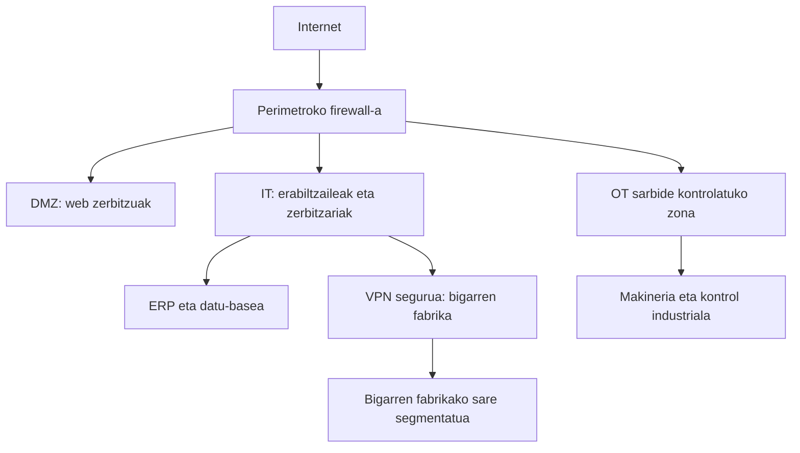

# Ugarteburu Torlojuak — Compliance Plana

**2. Erronka: Egiturak indartzen**  
**Dokumentu mota:** Araudia betetzeko eta arriskuak kudeatzeko plana (`README.md`)  
**Enpresa:** Ugarteburu Torlojuak  
**Bertsioa:** 1.0 — 2026-10-28  
**Egoera:** Proposamen akademikoa; ez da benetako ziurtagiri edo auditoretza baten egiaztagiria.

> **Irakurtzeko oharra:** Erronkaren enuntziatuan jasotako datuak enpresaren abiapuntuko informaziotzat hartu dira. Dokumentu honetan azaltzen diren politika, kontrol, epe eta arduradun gehienak **proposamenak** dira, eta ez dugu baieztatzen dagoeneko ezarrita daudenik. Legezko betebehar zehatzen aplikagarritasuna enpresaren benetako egoerarekin egiaztatu beharko da.

---

## Aurkibidea

1. [Sarrera eta helburua](#1-sarrera-eta-helburua)
2. [Enpresaren ezaugarriak](#2-enpresaren-ezaugarriak)
3. [Planaren esparrua](#3-planaren-esparrua)
4. [Araudi eta estandarren mapa](#4-araudi-eta-estandarren-mapa)
5. [ISO 37301: Compliance orokorra](#5-iso-37301-compliance-orokorra)
6. [RGPD eta LOPDGDD: datuen babesa](#6-rgpd-eta-lopdgdd-datuen-babesa)
7. [UNE 19601: Compliance penala](#7-une-19601-compliance-penala)
8. [UNE 19602: Compliance tributarioa](#8-une-19602-compliance-tributarioa)
9. [ISO/IEC 27001: Informazioaren segurtasunaren kudeaketa](#9-isoiec-27001-informazioaren-segurtasunaren-kudeaketa)
10. [IEC 62443: Industria-inguruneen segurtasuna](#10-iec-62443-industria-inguruneen-segurtasuna)
11. [Beste lege eta estandar garrantzitsu batzuk](#11-beste-lege-eta-estandar-garrantzitsu-batzuk)
12. [Arriskuen analisia](#12-arriskuen-analisia)
13. [Kontrolak eta barne-prozedurak](#13-kontrolak-eta-barne-prozedurak)
14. [Zibersegurtasun-gorabeheren aurrean jarduteko plana](#14-zibersegurtasun-gorabeheren-aurrean-jarduteko-plana)
15. [Negozioaren jarraitutasuna eta berreskuratzea](#15-negozioaren-jarraitutasuna-eta-berreskuratzea)
16. [Prestakuntza eta kontzientziazioa](#16-prestakuntza-eta-kontzientziazioa)
17. [Auditoretza, neurketa eta etengabeko hobekuntza](#17-auditoretza-neurketa-eta-etengabeko-hobekuntza)
18. [Ezarpen-egutegia](#18-ezarpen-egutegia)
19. [Dokumentazioa eta ebidentziak](#19-dokumentazioa-eta-ebidentziak)
20. [Ondorioak](#20-ondorioak)
21. [Osatzeko falta diren datuak](#21-osatzeko-falta-diren-datuak)
22. [Erreferentzia ofizialak](#22-erreferentzia-ofizialak)

---

## 1. Sarrera eta helburua

Compliance-a enpresa batek aplikatu behar dituen **legeak, arauak, kontratu-betebeharrak eta barne-politikak betetzeko antolatzen duen sistema** da. Ez da soilik legeen zerrenda egitea: arriskuak identifikatu, erantzukizunak banatu, kontrolak ezarri, langileak prestatu eta arauak benetan betetzen direla frogatzeko ebidentziak gorde behar dira.

Ugarteburu Torlojuak industria-enpresa da, eta automobilgintzarako nahiz beste industria-sektore batzuetarako pieza bereziak fabrikatzen ditu. Bere jardueran langileen datu pertsonalak, bezeroen informazioa, fabrikazio-prozesuak, hornitzaileak, ERP propio bat eta bi fabrikatako makineria erabiltzen dira. Horregatik, araudia betetzeak garrantzi handia du, bai ikuspegi juridikotik, bai ekoizpenaren eta informazioaren segurtasunaren ikuspegitik.

Plan honen helburu nagusiak hauek dira:

- Enpresari aplikatzen zaizkion arau nagusiak identifikatzea eta haien aplikazioa antolatzea.
- Datu pertsonalak, industria-informazioa eta sistemak babesteko neurriak proposatzea.
- Zigor-, zerga-, lan- eta ingurumen-arriskuak prebenitzea.
- Bi fabriken jarduera eta ERP sistemaren erabilgarritasuna bermatzen laguntzea.
- Gorabeheren aurrean nola jokatu zehaztea, erabakiak dokumentatuz.
- Langile guztien artean segurtasunaren eta legezko jardunaren kultura sustatzea.
- Hobekuntzak neurtzeko adierazleak eta auditoretza-mekanismoak ezartzea.

Dokumentua lau oinarri nagusiren inguruan antolatzen da: **compliance orokorra (ISO 37301)**, **datuen babesa (RGPD eta LOPDGDD)**, **compliance penala eta tributarioa (UNE 19601/19602)** eta **IT/OT zibersegurtasuna (ISO/IEC 27001 eta IEC 62443)**. Horiez gain, industriari lotutako bestelako arauak aztertzen dira.

## 2. Enpresaren ezaugarriak

### 2.1. Jarduera eta antolaketa

Erronkaren dokumentuaren arabera, Ugarteburu Torlojuak enpresak automobilgintzaren eta industria orokorraren sektoreetarako pieza bereziak garatzen eta fabrikatzen ditu. 2010etik aurrera, pieza teknikoagoak egiteko gaitasuna indartu du. **40 langile** ditu, eta honela banatzen dira:

| Saila | Langile kopurua | Eginkizun nagusiak |
|---|---:|---|
| Gerentzia | 2 | Estrategia, baliabideak eta erabaki nagusiak |
| Administrazioa | 3 | Fakturazioa, nominak, salmentak, erosketak eta kontabilitatea |
| IKT | 3 | Sareak, zerbitzariak, erabiltzaileak, ERP eta zibersegurtasuna |
| Ikerketa eta garapena | 4 | Piezen garapena, prozesu berriak eta dokumentazio teknikoa |
| Produkzioa | 28 | Makineria, materialak, fabrikazioa eta kalitate-kontrola |
| **Guztira** | **40** | |

Enpresak **bi fabrika** ditu. Makineria fisikoaren bidez titanioa, altzairua, aluminioa eta kromo-molibdenoa lantzen ditu. Horrek esan nahi du informazio-sistemek ez ezik, makinen kontrol-sistemek ere segurtasun-neurriak behar dituztela.

### 2.2. ERP sistema eta materialaren kontrola

Enpresak **ERP propioa** du, eta enuntziatuaren arabera inplementatuta dago. Sistema horrek fabrikaziorako erabiltzen diren materialen izakinak automatikoki kontrolatzen ditu. Material baten stocka **% 20ra** iristen denean, erosketen arduradunari oharra bidaltzen dio, eskaera berri bat egin ahal izateko.

ERPak enpresaren jardueran duen garrantziagatik, haren aurkako eraso edo akats batek ondorio larriak izan ditzake: eskaerak gaizki kudeatzea, biltegiko datuak galtzea, materialik gabe geratzea edo ekoizpena gelditzea. Gainera, enuntziatuan azaltzen denez, aurreko aldi batean garraioarekin lotutako stock faltagatik **sei ekoizpen-geldialdi** izan ziren; luzeena **lau egunekoa** izan zen. Horregatik, hornidura-katearen jarraitutasuna planaren lehentasunetako bat izango da.

### 2.3. IT eta OT inguruneak

Enpresan bi ingurune teknologiko bereizi behar dira:

- **IT (Information Technology):** administrazioko ordenagailuak, posta elektronikoa, ERP, datu-baseak, web-orria, erabiltzaile-kontuak eta zerbitzariak.
- **OT (Operational Technology):** fabriketako makinak, automatizazio-gailuak, kontrol industrialeko sistemak eta ekoizpenarekin lotutako ekipamendu elektronikoa.

OT ingurunea ez da IT sarea bezalakoa: makina bat gelditzeak edo haren konfigurazioa aldatzeak langileen segurtasunean, piezen kalitatean eta produkzioan eragin zuzena izan dezake. Horregatik, bi inguruneak koordinatu behar dira, baina sarbideak behar bezala bereizita.

## 3. Planaren esparrua

Compliance plana honako eremu hauetan aplikatzea proposatzen da:

1. **Pertsonak:** zuzendaritza, administrazioa, IKT, I+G, produkzioko langileak eta kanpoko mantentze-teknikariak.
2. **Instalazioak:** bi fabrikak, bulegoak, biltegiak, zerbitzariak eta sareko armairuak.
3. **Sistemak:** ERP, datu-baseak, posta elektronikoa, web-zerbitzua, Android aplikazioa —proiektuan garatzen bada—, sareak eta segurtasun-kopiak.
4. **Industria-prozesuak:** makineria, kontrol industriala, materialaren trazabilitatea eta fabrikazio-erregistroak.
5. **Kanpoko harremanak:** bezeroak, hornitzaileak, garraiolariak, informatika-zerbitzuen hornitzaileak eta mantentze-enpresak.
6. **Lege-betebeharrak:** datuen babesa, zerga-ordainketak, erantzukizun penala, lan-arriskuen prebentzioa, ingurumen-betebeharrak eta dagokion araudi industriala.

**Muga garrantzitsua:** ez dira ezagutzen enpresaren benetako kokapena, erabiltzen diren makina zehatzak, IT sarearen IP/VLAN guztiak edo bere ziurtagiriak. Horregatik, dokumentu honetan ez da halakorik asmatu; atal teknikoak proposamen mailan geratzen dira.

## 4. Araudi eta estandarren mapa

Arau guztiak ez dira izaera berekoak. **Legeek eta erregelamenduek** betebehar juridikoak sor ditzakete; **ISO, IEC eta UNE estandarrek**, aldiz, kudeaketa egokia ezartzeko erreferentzia ematen dute eta, oro har, borondatezkoak dira, kontratuak edo bestelako eskakizunak derrigorrezko bihurtzen ez badituzte.

| Araua edo legea | Zertarako erabiltzen da? | Ugarteburun proposatutako aplikazioa | Izaera |
|---|---|---|---|
| ISO 37301:2021 | Compliance kudeaketa orokorra | Politika, erantzukizunak, arriskuak eta auditoretzak | Borondatezko estandarra |
| RGPD (EB 2016/679) | Datu pertsonalak babestea | Langile, bezero eta hornitzaileen datuak | Aplikagarria, tratamenduaren arabera |
| LOPDGDD (3/2018 LO) | Espainiako datuen babesaren esparrua | Pribatutasuna eta langileen eskubide digitalak | Legea |
| UNE 19601:2025 | Compliance penala | Delitu-arriskuen prebentzioa | Borondatezko estandarra |
| UNE 19602:2019 | Compliance tributarioa | Fakturak, zergak eta erregistro fiskalak | Borondatezko estandarra |
| ISO/IEC 27001:2022 | SGSI/ISMS | Informazioaren segurtasuna eta arriskuak | Borondatezko estandarra |
| ISO/IEC 27002:2022 | Segurtasun-kontrolen jarraibideak | Sarbideak, erregistroak, kopiak eta hornitzaileak | Borondatezko jarraibidea |
| IEC 62443 seriea | Industria-kontrol sistemak babestea | Fabriketako IT/OT segmentazioa | Borondatezko estandar-familia |
| ISO 22301 | Negozioaren jarraitutasuna | Stock eta produkzio-geldialdien kudeaketa | Borondatezko estandarra |
| ISO 9001 / IATF 16949 | Kalitatearen kudeaketa | Piezen kalitatea eta automobilgintzako eskakizunak | Kontratuaren eta jardueraren araberakoa |
| ISO 45001 / 31/1995 Legea | Laneko segurtasuna eta osasuna | Makinen erabilera segurua eta prebentzioa | Estandarra / legea |
| ISO 14001 / 7/2022 Legea | Ingurumena eta hondakinak | Metal-hondakinak eta industria-jarduera | Estandarra / legea |

## 5. ISO 37301: Compliance orokorra

### 5.1. Zer da ISO 37301?

**ISO 37301:2021** compliance-a kudeatzeko sistema bat ezartzeko nazioarteko erreferentzia da. Enpresak legeak betetzeaz gain, arriskuak aurrez identifikatu, prozesuak dokumentatu eta hobekuntza jarraitua izatea sustatzen du. Helburua ez da auditoretza baten egunean dokumentuak aurkeztea bakarrik; eguneroko erabakietan jokabide arduratsua txertatzea da.

Ugartebururen kasuan, ISO 37301 oinarri orokorra izango da. Gainerako arloak —datuen babesa, zergak, segurtasun informatikoa eta makinen segurtasuna— sistema beraren barruan antola daitezke.

### 5.2. Compliance politika

Zuzendaritzak politika idatzia onartzea proposatzen da, honako konpromiso hauekin:

- Indarreko legeak eta kontratu-betebeharrak betetzea.
- Ez onartzea eroskeria, dokumentu faltsutzea, iruzur fiskala edo legez kanpoko jarduerarik.
- Langileen, bezeroen eta hornitzaileen datuak babestea.
- Fabrikazio-prozesu segurua eta produktuaren kalitatea lehenestea.
- Gorabeherak eta arau-hausteak jakinarazteko bide segurua eskaintzea.
- Gorabeherak objektiboki ikertzea eta zuzenketak dokumentatzea.
- Langileei beren eginkizunen araberako prestakuntza eskaintzea.

Politika hori zuzendaritzak sinatu beharko luke, eta langileek erraz kontsultatzeko leku batean argitaratu.

### 5.3. Ardurak banatzea

40 langileko enpresa batean ez da beharrezkoa compliance sail handi bat sortzea. Sistema arina eta praktikoa proposatzen da:

| Rola | Proposatutako ardura |
|---|---|
| Gerentzia | Politika onartzea, baliabideak ematea eta arrisku garrantzitsuei buruz erabakitzea |
| Compliance arduraduna | Lege-betebeharren erregistroa, kexak, jarraipena eta txostenak koordinatzea |
| IKTko arduraduna | SGSI, erabiltzaileen baimenak, segurtasun-kopiak eta gorabehera informatikoak |
| Administrazioko arduraduna | Zerga-kontrola, nominak, kontratuak eta fakturazioa |
| Produkzioko arduraduna | Makinen erabilera, OT segurtasuna, kalitatea eta trazabilitatea |
| Langile guztiak | Prozedurak betetzea eta gorabeherak jakinaraztea |

**Proposamena:** gerentziak compliance funtzioa pertsona bati esleitzea, ahal den neurrian independentzia eta zuzendaritzarekiko zuzeneko komunikazioa bermatuz. Gainera, hiru hilean behin gerentzia, administrazio, IKT eta produkzioko ordezkariek bilera egitea.

### 5.4. Compliance zikloa

Sistema **PDCA** logikarekin kudeatuko da:

1. **Plan (Planifikatu):** legeak aztertu, betebeharrak identifikatu eta arriskuak baloratu.
2. **Do (Egin):** politikak, baimenak, prestakuntza eta kontrolak ezarri.
3. **Check (Egiaztatu):** auditoretzak, berrikuspenak eta adierazleak aztertu.
4. **Act (Hobetu):** akatsak zuzendu, prozedurak eguneratu eta arrisku berriak landu.

### 5.5. Jardunbide egokiak

Adibidez, hornitzaile berri batekin lan egin aurretik, erosketen arduradunak gutxienez hornitzailearen identitatea, fakturazio-datuak, kontratuko baldintzak eta segurtasun-eskakizunak berrikusiko ditu. Hornitzaileak ERP edo OT sistemetara konektatu behar badu, IKT sailak baimen espezifikoa eman eta sarbide hori erregistratuko du. Horrela, erosketa-kontrolak, datuen babesa eta zibersegurtasuna sistema bakar batean lotuko dira.

## 6. RGPD eta LOPDGDD: datuen babesa

### 6.1. Zergatik aplikatzen zaizkio enpresari?

Enpresak 40 langile ditu eta administrazioak nominak, salmentak eta erosketak kudeatzen ditu. Jarduera horietan datu pertsonalak tratatzen dira: izen-abizenak, harremanetarako datuak, langileen identifikazio-datuak, nominen informazioa eta bezero edo hornitzaileen kontaktuak. Horregatik, datuen babesa compliance planaren zati garrantzitsua da.

Araudi nagusiak hauek dira:

- **RGPD:** Europar Batasuneko 2016/679 Erregelamendu Orokorra.
- **LOPDGDD:** 3/2018 Lege Organikoa, Espainiako datuen babesa eta eskubide digitalak arautzen dituena.

### 6.2. Tratamenduen erregistroa

Lehen urratsa **datu pertsonalen tratamenduen erregistroa (RAT)** egitea izango da. Enpresak 250 langile baino gutxiago izan arren, salbuespenak mugatuak dira eta ohiko langile/nomina tratamenduak ez dira noizbehinkakoak; beraz, enpresaren tratamendu guztiak aztertu eta erregistroa osatzea proposatzen da.

| Tratamendua | Datuen adibideak | Helburua | Erantzule operatiboa |
|---|---|---|---|
| Langileen kudeaketa | Izena, kontratua, identifikazioa, harremanetarako datuak | Lan-harremana kudeatzea | Administrazioa |
| Nominak | Ordainsariak, banku-datuak, atxikipenak | Soldata eta betebehar fiskalak | Administrazioa |
| Bezeroen kontaktuak | Izena, laneko helbide elektronikoa, telefonoa | Eskaerak eta komunikazioa | Administrazioa |
| Hornitzaileen kontaktuak | Ordezkariaren datuak, laneko posta | Erosketak eta hornidura | Erosketak |
| ERP erabiltzaileak | Identifikatzaileak, rolak, sarbide-erregistroak | Sarbidea eta jarduera kontrolatzea | IKT |
| Web/Android erabiltzaileak | Proiektuan biltzen diren datuak, hala badagokio | Zerbitzuak eskaintzea | IKT |

Erregistro bakoitzean tratamenduaren **oinarri juridikoa**, datuen hartzaileak, kontserbazio-epeak, segurtasun-neurriak eta, behar izanez gero, nazioarteko transferentziak dokumentatu behar dira. Tratamendu bat ez da legezkoa automatikoki baimena eskatzeagatik: kontratua, legezko betebeharra edo beste oinarri egoki bat aplikatu daiteke.

### 6.3. Datuak babesteko neurriak

1. **Gutxieneko datuak:** lanerako beharrezkoak diren datuak soilik bildu.
2. **Sarbide mugatua:** produkzioko erabiltzaile batek ezingo du nominen informaziora sartu, bere eginkizunengatik behar ez badu.
3. **Rolak eta baimenak:** ERPko administratzaile, kontabilitate, erosketak eta produkzio profilak bereiztu.
4. **MFA:** ahal den tokian, bereziki VPN, administrazio-kontu eta hodeiko zerbitzuetarako faktore anitzeko autentifikazioa.
5. **Zifratzea:** HTTPS/TLS komunikazioetan eta zifratzea behar duten gailuetan.
6. **Segurtasun-kopiak:** datuak berreskuratzeko probak egitea, kopia bat sare nagusitik bereizita mantenduz.
7. **Konfidentzialtasuna:** langileek eta kanpoko zerbitzu-hornitzaileek egokia den konpromisoa sinatzea.
8. **Ezabatze-prozedura:** datuak beharrezkoak ez direnean, ezabatzea edo blokeatzea dagokion arauaren arabera.
9. **Hirugarrenen kontrola:** nomina-zerbitzua, hosting-a edo hodeia erabiltzen badira, tratamendu-eragileekin kontratu egokiak izatea.
10. **Eskubideak:** interesdunen sarbide-, zuzenketa-, ezabatze- eta gainerako eskubide-eskaerak bideratzeko prozedura.

Datuak Babesteko Ordezkaria (DPD/DPO) izendatzeko betebeharra **ez da automatikoki sortzen** enpresak 40 langile dituelako. Tratamenduen izaera eta indarreko araudia aztertu behar dira; hala ere, pribatutasunerako arduradun edo harremanetarako pertsona bat izendatzea komeni da.

### 6.4. Datuen urraketak

Datu pertsonalak galtzen, aldatzen edo baimenik gabe eskuratzen badira, IKT eta compliance arduradunek gertakaria erregistratu eta **pertsonen eskubide eta askatasunetarako arriskua** aztertuko dute. Arriskua egon daitekeenean, arduradunak agintaritza eskudunari jakinarazi behar dio, ahal dela **72 orduko epean**, urraketaren berri izan duenetik. Arriskua handia bada, kaltetutako pertsonei ere jakinarazi behar zaie, dagokion araudiaren arabera. Urraketa guztiak dokumentatu behar dira, baita jakinarazi beharrik ez dagoenean ere.

**Adibidea:** administrazioko ordenagailu batean ransomwarea sartzen bada eta langileen nominen datuak agerian gera daitezkeela susmatzen bada, ez da nahikoa fitxategiak leheneratzea. Lehenik isolatu, ondoren gertatutakoa eta eragindako datuak ikertu, pertsonentzako arriskua baloratu eta behar diren jakinarazpenak egin behar dira.

### 6.5. Web-orria eta Android aplikazioa

Erronkaren barruan web-orria eta Android aplikazio bat garatzen edo auditatzen badira, hasieratik pribatutasun-printzipioak aplikatuko dira. Erregistratzeko formularioek beharrezko datuak soilik eskatuko dituzte, pasahitzak hash seguruarekin gordeko dira, sarbide-kontrolak egiaztatuko dira eta informazioa HTTPS bidez transmitituko da. Cookie ez-funtsezkoak edo analitika identifikatzailea erabiltzen badira, dagokion informazio- eta baimen-sistema berrikusiko da.

## 7. UNE 19601: Compliance penala

### 7.1. Helburua

**UNE 19601:2025** compliance penaleko kudeaketa-sistemarako erreferentzia da. 2017ko bertsioa ordezkatu du. Enpresa baten barruan gerta daitezkeen delitu-arriskuak identifikatu, prebenitu eta detektatzeko prozesuak proposatzen ditu. Espainiako Zigor Kodearen **31 bis artikuluarekin** lotuta aztertu behar da pertsona juridikoen erantzukizun penalaren gaia. Estandarra ezartzeak edo ziurtatzeak **ez du berez** erantzukizun penala automatikoki baztertzen.

### 7.2. Ugarteburun aztertu beharreko arrisku penalak

| Arrisku-eremua | Adibide hipotetikoa | Prebentzio-kontrola |
|---|---|---|
| Eroskeria edo ustelkeria | Hornitzaile batek eskaera lortzeko ordainketa ezkutua eskaintzea | Opari-politika, bi mailako onarpenak eta hornitzaileen kontrola |
| Iruzur ekonomikoa | Faktura faltsua ordaintzea edo kontabilitatea manipulatzea | Faktura, eskaera eta entregaren arteko egiaztapena |
| Ziberdelituak | Langile batek baimenik gabe datuak eskuratzea edo ezabatzea | Sarbide indibidualak, log-ak eta baimen-berrikuspena |
| Jabetza industriala | Bezeroaren pieza-diseinu konfidentziala baimenik gabe zabaltzea | Konfidentzialtasun-akordioak eta dokumentuen baimenak |
| Ingurumen-arloko arau-hauste larriak | Hondakin arriskutsuak bide desegokian kudeatzea | Hondakinen trazabilitatea eta kudeatzaile baimenduak |
| Langileen segurtasunarekin lotutako delitu-arriskuak | Segurtasun-neurri garrantzitsuak ez hartzea | Lan-arriskuen ebaluazioa eta makinen mantentze segurua |

Taulako kasuak **arrisku-hipotesiak** dira, ez Ugarteburun gertatutako delituen baieztapenak. Arrisku bakoitzaren tipifikazioa eta pertsona juridikoaren balizko erantzukizuna kasuaren eta Zigor Kodearen arabera aztertu beharko lirateke.

### 7.3. Proposatutako kontrol penalak

- **Jokabide-kodea:** ezin da dokumentazioa faltsutu, dirurik edo abantaila desegokirik onartu, eta interes-gatazkak adierazi behar dira.
- **Erosketa-kontrola:** zenbateko jakin batetik gorako erosketetan bi pertsonen baimena eskatu; atalasea gerentziak zehaztuko du.
- **Funtzioen bereizketa:** ahal den neurrian, faktura sortzen duen pertsonak ez du bakarrik ordainketa onartuko.
- **Salaketa edo komunikazio-kanala:** jardunbide irregularrak konfidentzialtasunez jakinarazteko bidea. Legeak barne-sistema formal bat eskatzen duen ala ez bereizita egiaztatu beharko da.
- **Diligentzia egokia:** arrisku handiko hornitzaileak eta kanpoko bazkideak aztertu.
- **Barne-ikerketa:** susmoak jasotzeko, ebidentziak gordetzeko eta neurriak erabakitzeko prozedura.
- **Urteko berrikuspena:** arrisku penalak eta kontrolen eraginkortasuna berrikusi.

### 7.4. Ley 2/2023 eta komunikazio-kanala

Espainiako **2/2023 Legeak** barneko informazio-sistema bat edukitzeko betebeharra ezartzen die, oro har, **50 langile edo gehiago** dituzten enpresa pribatuei; badira jarduera edo araudi sektorialaren araberako salbuespenak eta kasu bereziak. Ugartebururen dokumentuko **40 langileak** kontuan hartuta, ezin da baieztatu kanal formal hori derrigorrezkoa denik, enpresaren gainerako ezaugarriak ezagutu gabe. Nolanahi ere, komunikazio-kanal fidagarri bat **borondatez** ezartzea gomendatzen da.

## 8. UNE 19602: Compliance tributarioa

### 8.1. Zer da?

**UNE 19602:2019** zerga-betebeharrak kontrolatzeko, akatsak prebenitzeko eta praktika fiskal egokiak sustatzeko estandarra da. Ez du zerga-legea ordezkatzen; zergen inguruko prozedurak antolatzen laguntzen du.

Ugarteburun administrazioko hiru langileek salmentak, erosketak eta nominak kudeatzen dituztenez, garrantzitsua da ERPko informazioa, kontabilitatea eta zerga-aitorpenak koherenteak izatea.

### 8.2. Aztertu beharreko eremu fiskalak

- Faktura jaulki eta jasotakoen erregistroa.
- BEZa (IVA), enpresari aplikatzen zaizkion erregimenen arabera.
- Sozietateen gaineko zerga eta dagokion kontabilitatea.
- Langileen nominen atxikipenak eta gizarte-kotizazioak, bakoitza dagokion araubidearen arabera.
- Hornitzaile edo bezero atzerritarren eragiketak, halakorik balego.
- Fakturazio-softwareari dagozkion eskakizun teknikoak eta ezarpen-epeak, enpresaren jurisdikzioaren eta zerga-araubidearen arabera.

**Kontuan izan:** enpresaren egoitza fiskala ez da ezagutzen. Zerga-araudia ez da berdin aplikatzen lurralde guztietan; bereziki, foru-ogasunen kasuan, araubide propioak aztertu behar dira. Horregatik, ez da hemen ereduen zenbakirik, epe zehatzik edo TicketBAI/Veri*factu betebehar automatikorik baieztatzen.

### 8.3. Kontrol praktikoak

1. Faktura bakoitzaren datuak eskaerarekin eta jasotako materialarekin alderatzea.
2. Hornitzaile baten banku-kontuaren aldaketa beste kanal batez egiaztatzea, posta elektroniko faltsuen iruzurrak saihesteko.
3. Kontabilitateko eta ERPko datuen arteko aldizkako adiskidetzea egitea.
4. Zerga-egutegi bat eta berrikuspen-arduradun bat izendatzea.
5. Aitorpenak aurkeztu aurretik bigarren kontrol bat egitea.
6. Fakturak, egiaztagiriak eta legez eskatzen den dokumentazioa kontserbatzea, aplikagarriak diren epeen arabera.
7. Akats baten aurrean zuzenketa, erabakia eta egiaztagiria dokumentatzea.

**Adibidea:** ERPko erosketa-erregistroak eta kontabilitateko faktura-zerrendak bat ez badatoz, administrazioak desadostasuna ikertu beharko du zerga-aitorpena egin aurretik. Horrek akatsak, bikoiztasunak eta iruzur-arriskuak murrizten ditu.

## 9. ISO/IEC 27001: Informazioaren segurtasunaren kudeaketa

### 9.1. SGSIaren helburua

**ISO/IEC 27001:2022** informazioaren segurtasuna kudeatzeko sistemaren (**SGSI**, edo ISMS) baldintzak zehazten ditu. SGSIak informazioaren hiru oinarri nagusiak babestu behar ditu:

- **Konfidentzialtasuna:** informazioa baimendutako pertsonek bakarrik eskuratzea.
- **Osotasuna:** datuak ez aldatzea baimenik gabe eta informazioa fidagarria izatea.
- **Erabilgarritasuna:** behar denean sistemak eta datuak eskuragarri egotea.

Ugarteburun hiru helburuak garrantzitsuak dira. Adibidez, ERPko stock datuak ez badaude erabilgarri, erosketa-erabakiak atzeratu daitezke; datuak manipulatu badira, material-eskaerak okerrak izan daitezke.

### 9.2. Babestu beharreko aktiboak

| Aktiboa | Zergatik da kritikoa? | Proposatutako babesak |
|---|---|---|
| ERP propioa | Erosketak eta materialen stocka | MFA administratzaileentzat, rolak, kopiak, eguneraketak |
| ERPko datu-basea | Inbentarioa eta enpresaren eragiketak | Sarbide mugatua, zifratzea, kopiak eta leheneratze-probak |
| Langileen datuak | Pribatutasuna eta nomina-prozesuak | Baimen bereziak eta tratamenduen erregistroa |
| I+G dokumentazioa | Piezen diseinu eta ezagutza teknikoa | Sarbide-kontrola, bertsioak eta konfidentzialtasuna |
| Posta elektronikoa | Erosketak eta komunikazioa | MFA, phishing-prestakuntza eta iragazkiak |
| Web-zerbitzua | Kanpoko aurpegia eta balizko sarbide-puntua | HTTPS, eguneraketak, pentesting baimendua |
| Babeskopiak | Eraso baten ondorengo berreskuratzea | Bereizketa, proba eta baimen mugatuak |
| Sare-ekipoak | Komunikazioak eta segmentazioa | Konfigurazio-kopiak, firewall arauak eta log-ak |

### 9.3. Segurtasun-politikak

**Erabiltzaileen kudeaketa:** langile bakoitzak kontu pertsonala izatea; langile bat sartzean, aldatzean edo enpresatik irtetean baimenak egokitzea. Kontu partekatuak saihestea eta administratzaile-baimenak gutxienekora mugatzea.

**Pasahitzak eta MFA:** pasahitz luze eta bakarrak, pasahitz-kudeatzaile korporatiboa, MFA eta kontu pribilegiatuen berrikuspena. Beharrezkoa denean, ezkutuko kredentzialak modu seguruan gordeko dira; ez GitHub biltegi publikoetan.

**Segurtasun-kopiak:** kopia automatikoak, offline edo aldatu ezin diren kopien mekanismo bat eta berreskuratzeko proba erregularrak. Kopiak edukitzea ez da nahikoa: berreskuratu daitezkeela egiaztatu behar da.

**Eguneraketak:** zerbitzari, aplikazio eta firewall sistemetan adabaki-politika ezartzea. OT sistemetan, aldiz, fabrikatzailearekin eta produkzioarekin koordinatzea funtsezkoa da, eguneraketa batek makinaren lana eten baitezake.

**Monitorizazioa:** autentifikazio-akatsak, baimen-aldaketak, VPN konexioak, firewall erregistroak eta ERPko eragiketa sentikorrak aztertzea. Alertak pertsona arduradun bati iritsi behar zaizkio.

### 9.4. Erronkako sare-eskemarekin lotura

Erronkaren materialak sarearen segmentazioa, DMZ, HTTPS ziurtagiriak, bi egoitzen arteko VPN eta MFA eskatzen ditu. Proposatutako arkitektura logikoa honakoa da:



Diagrama **logikoa eta proposatua** da; ez du adierazten sare hau dagoeneko instalatuta dagoenik. IT eta OT artean suebaki-arau zehatzak definitu beharko dira, baimendu beharreko trafikoa soilik ahalbidetuz. Internetetik OT makinak zuzenean kudeatzea saihestuko da.

### 9.5. SGSIaren dokumentazioa

SGSIa frogatzeko gutxienez honako dokumentuak prestatu beharko lirateke: aktiboen inbentarioa, arrisku-analisiaren metodologia, arriskuen tratamendu-plana, **Aplikagarritasun Adierazpena (SoA)**, segurtasun-politika, gorabeheren prozedura, segurtasun-kopien politika eta barne-auditoretzen emaitzak.

## 10. IEC 62443: Industria-inguruneen segurtasuna

### 10.1. Zergatik da garrantzitsua?

**IEC 62443** estandar-familiak automatizazio- eta kontrol-sistema industrialen segurtasuna lantzen du. Ugarteburuk bi fabrika eta pieza metalikoak lantzeko makinak dituenez, IT sistemak babesteaz gain, OT gailuak, kontrol-sistemak eta ekoizpenaren jarraitutasuna kontuan hartu behar ditu.

Makina industrial bat ez da ohiko bulegoko ordenagailu bat. Eguneratze edo konexio oker batek produkzioa gelditu, produktu akastunak sortu edo segurtasun fisikoa arriskuan jar dezake. Horregatik, OT sarean aldaketak kontrolatu eta behar denean probak egin behar dira.

### 10.2. Segurtasun-zonak eta komunikazioak

Honako antolaketa proposatzen da:

- **IT administrazioa:** bulegoetako ordenagailuak, ERP eta posta elektronikoa.
- **IT zerbitzariak:** datu-baseak eta zerbitzu korporatiboak.
- **Industria-DMZa:** IT eta OT artean behar diren zerbitzu bitartekariak, benetan beharrezkoa bada.
- **OT kontrol-zona:** kontrolagailuak, HMIak eta industria-komunikazioak.
- **Makinen zona:** produkzioko ekipamenduak, makina bakoitzaren beharren arabera isolatuta.

Zonen arteko komunikazioa **behar den gutxienekora** mugatu behar da. Adibidez, ERPak produkzioko egoera jasotzea behar badu, datu-fluxu zehatz bat baimenduko da; horrek ez du esan nahi bulegoetako edozein ordenagailuk makina baten administrazio-portura sartu ahal izan behar duenik.

### 10.3. OT ingurunerako kontrolak

1. Makinen eta haien softwarearen inbentarioa egitea: fabrikatzailea, modeloa, bertsioa eta arduraduna.
2. Fabrikatzaileen eta mantentze-hornitzaileen urruneko sarbidea aurretik baimentzea, denboraz mugatzea eta erregistratzea.
3. Fabrika bateko OT sarea beste fabrikako sarearekiko segmentatzea, behar diren komunikazioak bakarrik baimenduta.
4. Makinen konfigurazioen segurtasun-kopiak gordetzea, hornitzailearen jarraibideak kontuan hartuta.
5. Eguneraketak ekoizpeneko geldialdi planifikatuetan probatzea.
6. OTko gertaerak monitorizatzea, sarearen erabilgarritasuna kaltetu gabe.
7. Segurtasun fisikoa kontrolatzea: kontrol-armairuak, sarbide-giltzak eta baimenak.
8. Industria-gorabehera baterako geldialdi eta berrabiarazte seguruko prozedura prestatzea.

### 10.4. OT gorabehera baten adibidea

Bigarren fabrikako kontrol-ekipo batetik mugimendu edo komunikazio susmagarria detektatzen bada, IKT arduradunak eta produkzioko arduradunak elkarrekin aztertuko dute egoera. Ez da makina edo PLC bat zuzenean itzaliko, **pertsonen segurtasunerako** edo prozesurako ondorioak baloratu gabe. Beharrezkoa denean, isolamendua modu kontrolatuan egingo da; log-ak eta konfigurazioak jasoko dira, arazoa aztertu, eta makinaren funtzionamendua egiaztatu ondoren bakarrik itzuliko da produkziora.

## 11. Beste lege eta estandar garrantzitsu batzuk

### 11.1. ISO 22301 — Negozioaren jarraitutasuna

Ugarteburun stock faltagatik izandako sei geldialdiak ikusita, negozioaren jarraitutasuna lehentasun praktikoa da. **ISO 22301** erabiltzea proposatzen da hornitzaileen hutsegiteak, garraio-arazoak, ERParen matxurak eta zibererasoak aztertzeko. Hornitzaile alternatiboak, material kritikoen gutxieneko mailak eta larrialdiko komunikazio-prozedurak dokumentatuko dira.

### 11.2. ISO 9001 eta IATF 16949 — Kalitatea

**ISO 9001** kalitatearen kudeaketarako erreferentzia da. **IATF 16949** automobilgintzako kalitate-kudeaketaren erreferentzia espezifikoa da, baina haren aplikazioa enpresak betetzen dituen eskakizunen, hornidura-katean duen rolaren eta bezeroen kontratuen arabera aztertu behar da. Ugarteburuk automobilgintzarako piezak fabrikatzen dituenez, lotura bereziki interesgarria da.

Proposatutako kontrolak: pieza bakoitzaren lotea identifikatzea, materialaren jatorria gordetzea, fabrikazio-parametroak kontrolatzea, neurketa-tresnen kalibrazioa dokumentatzea eta akatsak edo bezeroen erreklamazioak erregistratzea.

### 11.3. 31/1995 Legea eta ISO 45001 — Lan-arriskuen prebentzioa

Metalak lantzeko makineria erabiltzeak segurtasun fisikoko arriskuak sortzen ditu. **31/1995 Legearen** arabera, langileak babesteko prebentzio-neurriak hartu behar dira. **ISO 45001** lagungarria izan daiteke segurtasunaren eta osasunaren kudeaketa sistematikoa egiteko.

Makina bakoitzerako arriskuen ebaluazioa, babes kolektiboak, EPI egokiak, prestakuntza, mantentze segurua eta larrialdi-prozedurak landuko dira. IT/OT zibersegurtasuneko aldaketak ez dira inoiz makinen babes-mekanismo fisikoen gainetik jarriko.

### 11.4. 7/2022 Legea eta ISO 14001 — Ingurumena

Metalaren mekanizazioan sortutako hondakinak, olioak, likidoak edo bestelako materialak behar bezala sailkatu eta kudeatu behar dira, **benetan sortzen diren hondakinen eta haien sailkapenaren arabera**. **7/2022 Legea** hondakinei eta lurzoru kutsatuei buruzko esparru nagusietako bat da; ISO 14001 ingurumen-kudeaketarako estandarra da.

Egin beharrekoak: hondakinen inbentarioa, egokiak diren edukiontziak, baimendutako kudeatzaileak, entregaren egiaztagiriak eta istripuzko isurketen aurreko prozedura. Ez da ondorioztatzen enpresak hondakin arriskutsu zehatzak sortzen dituenik, datu hori egiaztatu gabe.

### 11.5. ISO 37001 eta UNE 19603/19604

- **ISO 37001:** eroskeriaren aurkako kudeaketa, bereziki erosketetan eta kontratuetan.
- **UNE 19603:** lehia askearen inguruko compliance-a, beste enpresekiko merkataritza-harremanetan.
- **UNE 19604:** lan- eta gizarte-arauak betetzeko kudeaketa.

Arau hauek enpresaren arrisku zehatzen arabera lehenetsi daitezke. Enpresa txiki edo ertain batean ez da beharrezkoa sistema paralelo gehiegi sortzea; kontrolak ISO 37301en barruan integratzea eraginkorragoa izan daiteke.

### 11.6. LSSI-CE — Webgunea eta komunikazio elektronikoak

Enpresaren webguneak merkataritza- edo informazio-gizarteko zerbitzuak eskaintzen baditu, **34/2002 Legearen (LSSI-CE)** aplikagarritasuna berrikusiko da. Bereziki, webguneko identifikazio-informazioa, komunikazio komertzialak eta cookieei lotutako eskakizunak aztertuko dira. Zein betebehar aplikatzen den webgunearen benetako funtzioen araberakoa izango da.

### 11.7. NIS2 — Aplikagarritasuna aztertzeko araua

**NIS2 (EB 2022/2555 Zuzentaraua)** zibersegurtasunaren arloko arau-esparru europar garrantzitsua da. Hala ere, ezin da Ugarteburu automatikoki NIS2ren menpe dagoela baieztatu, automobilgintzarako piezak egiten dituelako soilik. Enpresaren **NACE jarduera-kodea**, tamaina, hornidura-kateko eginkizuna, bezeroen eskakizunak eta Espainiako arau-esparru aplikagarria egiaztatu behar dira. 2026ko urriaren egoera normatiboa eta ondorengo aldaketak eguneratzea komeni da.

---
## 12. Arriskuen analisia

### 12.1. Metodologia

Arriskuak ebaluatzeko, proposamen erraz bat erabiliko da. Arrisku bakoitzari **probabilitatea (P)** eta **eragina (E)** emango zaizkio, 1etik 3ra:

| Balioa | Probabilitatea | Eragina |
|---|---|---|
| 1 | Txikia: gertatzeko aukera mugatua | Txikia: kalte erraz berreskuragarria |
| 2 | Ertaina: litekeena edo aurrekari partzialak | Ertaina: lanaren etenaldi edo kalte nabarmena |
| 3 | Handia: esposizio edo aurrekari garrantzitsua | Handia: produkzioa, datuak, segurtasuna edo betebeharrak larriki kaltetu |

**Arriskuaren balioa = P × E.** Emaitzak interpretatzeko eskala: 1–2 = baxua; 3–4 = ertaina; 6–9 = altua. Eskala hau **erronka akademikorako proposamen bat** da; enpresaren benetako neurketak egin gabe ez da auditoretza formal bateko emaitza.

### 12.2. Hasierako arrisku-matrizea

| ID | Arriskua | P | E | Maila | Proposatutako tratamendua | Arduraduna |
|---|---|---:|---:|---|---|---|
| R01 | ERP sistema erabilgarri ez egotea | 2 | 3 | **6 — Altua** | Kopiak, monitorizazioa, berreskuratze-proba | IKT |
| R02 | Hornidura atzeratzea eta stocka agortzea | 3 | 3 | **9 — Altua** | Hornitzaile alternatiboak, stock-atalaseak, jarraitutasun-plana | Erosketak / produkzioa |
| R03 | Ransomware edo phishing bidezko erasoa | 2 | 3 | **6 — Altua** | MFA, EDR/antibirusa, prestakuntza, kopia isolatuak | IKT |
| R04 | Langileen datu pertsonalak baimenik gabe eskuratzea | 2 | 3 | **6 — Altua** | Rolak, sarbide-kontrola, zifratzea, RAT | IKT / administrazioa |
| R05 | Bi fabriken arteko sare-konexioa etetea | 2 | 3 | **6 — Altua** | VPN monitorizazioa, sareko dokumentazioa, alternatibak | IKT |
| R06 | OT makina edo kontrol industriala konprometitzea | 2 | 3 | **6 — Altua** | IT/OT segmentazioa, sarbide mugatuak, aldaketa-kontrola | IKT / produkzioa |
| R07 | Fakturazio edo zerga-akats garrantzitsua | 2 | 2 | **4 — Ertaina** | Egiaztapen bikoitza, adiskidetzeak, dokumentazioa | Administrazioa |
| R08 | Hornitzaile baten iruzurra edo interes-gatazka | 2 | 2 | **4 — Ertaina** | Hornitzaileen azterketa, onarpen bikoitza, etika-politika | Gerentzia / erosketak |
| R09 | Informazio tekniko konfidentziala galtzea | 2 | 3 | **6 — Altua** | Baimen mugatuak, bertsio-kontrola, segurtasun-kopiak | I+G / IKT |
| R10 | Makinen segurtasun fisikoko gorabehera | 2 | 3 | **6 — Altua** | Lan-arriskuen ebaluazioa, mantentzea, prestakuntza | Produkzioa |
| R11 | Metal-hondakinen kudeaketa desegokia | 2 | 2 | **4 — Ertaina** | Sailkapena, trazabilitatea, kudeatzaile egiaztatuak | Produkzioa |
| R12 | Web edo Android aplikazioko ahulezia | 2 | 2 | **4 — Ertaina** | SAST/DAST, OWASP egiaztapenak, sarbide-probak | IKT / garapena |

**Balorazioen azalpena:** R02 arriskuan aurrekari jakinak daude (sei geldialdi), eta, horregatik, hasierako balorazioan probabilitate handia proposatu da. Gainerako probabilitateak aztertzeko hipotesiak dira, ez enpresan gertatutako gorabeheren estatistikak.

### 12.3. Arriskuak tratatzeko lehentasunak

**Lehen lehentasuna — R02, R01, R03, R06:** enpresaren fabrikazioa eteteko gaitasuna duten arriskuak. Hornitzaileen jarraitutasuna, ERP kopiak, sareko segmentazioa eta OTko sarbideak lehenetsi behar dira.

**Bigarren lehentasuna — R04, R05, R09, R10:** datuen konfidentzialtasuna, bi fabriken komunikazioa, diseinu teknikoak eta pertsonen segurtasuna. Segurtasun fisikoa edo legezko betebeharra urratzeko arriskuak ezin dira puntuazio matematikoaren arabera soilik baztertu.

**Hirugarren lehentasuna — R07, R08, R11, R12:** zerga-kontrolak, hornitzaileen jokabidea, hondakinen dokumentazioa eta garapen seguruaren probak. Arriskuok ez dira alde batera utziko; ezarpen-planaren barruan sartuko dira.

### 12.4. Hondar-arriskua

Kontrolak ezarri ondoren, arriskuak berriz ebaluatuko dira. Adibidez, ERPko kopia isolatuak eta leheneratze-proba funtzionalak edukitzeak R01 arriskua murriztu dezake, baina ez du guztiz ezabatzen. **Hondar-arriskua** gerentziak onartu behar du, frogatutako neurrien eta negozioak jasan dezakeen etenaldiaren arabera. Ez da hemen hondar-arriskuaren puntuaziorik asmatu, kontrolak ez direlako egiaztatu.

## 13. Kontrolak eta barne-prozedurak

### 13.1. Sarbideak eta identitateak

Enpresak kontu pertsonalak, rolak eta baimen minimoen printzipioa erabiliko ditu. IKT sailak alta, aldaketa eta baja prozedura estandarra prestatuko du. Lanpostua aldatzen duen langile batek ez ditu bere aurreko rol guztiak automatikoki mantenduko. Administrazio-sarbideak denboraz mugatu edo justifikatu egingo dira, eta aldizka berrikusiko dira.

### 13.2. Erosketak eta hornitzaileak

Materialaren izakinak % 20ra iristean ERPak bidaltzen duen alerta baliagarria da, baina ez du bakarrik hornidura bermatzen. Erosketen arduradunak material kritikoen zerrenda, entrega-epeak, bigarren hornitzaileak eta gutxieneko stockaren berrikuspena prestatuko ditu. Bestalde, kanpoko informatika- edo mantentze-hornitzaileek segurtasun-baldintzak bete beharko dituzte.

### 13.3. Garapen segurua

Proiektuko webgunea, Android aplikazioa eta Python bidezko automatizazioak garatzean, ondoko neurriak erabiliko dira:

- Git biltegian iturburu-kodea kontrolatzea, baina **pasahitzik, tokenik edo benetako datu pertsonalik ez** igotzea.
- Kode-aldaketak berrikustea eta, ahal bada, probak automatizatzea.
- **SAST** bidez kodearen ahuleziak identifikatzea eta **DAST/OWASP ZAP** bidez web-aplikazioa proba-ingurune baimenduan aztertzea.
- Erabiltzailearen sarrerak balioztatzea; SQL injekzioa, XSS, CSRF eta sarbide-kontrol hautsiak aztertzea.
- Android aplikazioaren komunikazioak eta baimenak egiaztatzea, OWASP MASVS/MSTG erreferentzia hartuta.
- Datu-basean irudirik ez duten erabiltzaileei posta bidaltzen dien Python prozesuan datuen erabilera mugatzea, bidalketa bikoiztuak saihestea eta erroreak erregistratzea.
- Probak egiteko baimen formala izatea, batez ere **pentesting** eta sare-eskaneatzeetan.

### 13.4. Aldaketen kudeaketa

Zerbitzari, ERP, firewall edo makina industrial baten konfigurazioa aldatu aurretik, honako informazioa jasoko da: aldaketaren arrazoia, eragina, arduraduna, probak, baimena eta atzera egiteko aukera. OT aldaketek produkzioko arduradunaren onespena ere beharko dute. Aldaketaren ondoren, funtzionamendua egiaztatuko da.

### 13.5. Ebidentziak eta konfidentzialtasuna

Dokumentu guztiak ez dira publikoak izango. README honetan politika orokorra eta proposamena egon daitezke, baina benetako pasahitzak, IP publiko sentikorrak, segurtasun-kopien sekretuak, langileen datu pertsonalak eta eraso baten ebidentzia konfidentzialak sarbide mugatuko biltegian gorde behar dira.

## 14. Zibersegurtasun-gorabeheren aurrean jarduteko plana

### 14.1. Helburua eta arduradunak

Zibersegurtasun-gorabehera batek enpresaren informazioari, zerbitzuei edo produkzioari eragin diezaioke. Gorabeheren erantzun-planak informazioa azkar biltzea, kalteak mugatzea, beharrezko pertsonei abisatzea eta jarduera modu seguruan leheneratzea du helburu.

**Proposatutako taldea:** IKTko arduraduna (koordinazio teknikoa), produkzioko arduraduna (OT segurtasuna), administrazioko ordezkaria (datuen babesa eta komunikazioak) eta gerentzia (erabaki nagusiak). Behar denean, kanpoko zerbitzu teknikoak edo aholkularitza juridikoa gehituko dira.

### 14.2. Prozeduraren faseak

| Fasea | Zer egin? | Sortu beharreko ebidentzia |
|---|---|---|
| 1. Detekzioa | Alerta, log edo erabiltzailearen abisua jasotzea | Gorabeheraren fitxa eta detekzio-ordua |
| 2. Sailkapena | IT/OT eragina, larritasuna eta datu pertsonalak baloratzea | Arriskuen balorazioa |
| 3. Eustea | Ekipamendu kaltetuak modu seguruan isolatzea | Hartu diren neurriak eta orduak |
| 4. Ikerketa | Log-ak, sistemaren egoera eta ebidentziak jasotzea | Ebidentzien zerrenda eta zaintza-katea |
| 5. Ezabatzea | Kausa eta sarrera-puntua zuzentzea | Konponketa-erregistroa |
| 6. Berreskuratzea | Sistemak leheneratu eta funtzionamendua egiaztatzea | Proben emaitzak |
| 7. Ikasitakoa | Akatsak aztertu eta kontrolak hobetzea | Amaierako txostena eta ekintza-plana |

**Barneko erantzun-epeen proposamena:** gorabehera kritikoak jakin bezain laster IKTko arduradunari jakinaraztea eta gerentziari ahalik eta lasterren eskalatzea. Epe zehatzak eta guardiako antolaketa enpresaren ordutegira egokituko dira. Legezko jakinarazpen-epeak ez dira barne-helburu horiekin nahastu behar.

### 14.3. Datu pertsonalen urraketaren jakinarazpena

Gorabeherak datu pertsonalei eragiten badie, RGPDren araberako arriskua aztertuko da. Kontrol-agintaritzari jakinarazi beharreko kasuetan, **ahal dela 72 orduko epea** kontuan hartuko da. Pertsonentzako arriskua handia bada, kaltetuei komunikatzea ere aztertuko da. Jakinarazpenari buruzko erabakia, baita ez jakinaraztekoa ere, arrazoituta dokumentatuko da.

### 14.4. Forentsea eta ebidentzien zaintza

Gorabehera larria gertatzen bada, disko-irudiak, log-ak edo memoria-bilketa egin ahal izango dira, **baimendutako prozedura** egokiekin eta sistemaren egonkortasuna kontuan hartuta. Ebidentzia bakoitzaren jatorria, biltzailearen identitatea, ordua, hash-a —egokia denean— eta ondorengo lekualdaketak erregistratuko dira. Helburua da ikerketa teknikoa fidagarria izatea eta, behar izanez gero, ondorengo jarduketa juridikoak erraztea.

### 14.5. OTko simulazioaren proposamena

Erronkak OT gorabehera bat simulatzea eskatzen du. Horretarako, **laborategi edo proba-ingurune isolatua** erabiliko da, ez produkzioko makina errealen aurka baimenik gabe:

1. OT segmentu batean baimenik gabeko konexio-saiakera simulatzea.
2. Firewall edo monitorizazio-sisteman alerta ikustea.
3. Gorabehera erregistratzea eta larritasuna baloratzea.
4. Trafikoa blokeatzea edo isolatzea, proba-ingurunean.
5. Log-ak eta konfigurazioak aztertzea.
6. Arau edo konfigurazio ahula zuzentzea.
7. Berriro probatzea eta amaierako txostena idaztea.

Simulazioak kontrolen eraginkortasuna neurtzeko balioko du, baina ezin izango du produkzioko segurtasuna arriskuan jarri.

## 15. Negozioaren jarraitutasuna eta berreskuratzea

### 15.1. Zergatik behar da?

Bi fabriketako ekoizpena materialaren horniduraren, makina fisikoen eta ERP sistemaren mende dago. Enuntziatuko sei geldialdi historikoek erakusten dute garraioa eta stockaren erabilgarritasuna bereziki aztertu behar direla. Era berean, ransomwareak, datu-basearen akatsek edo fabrika arteko VPNaren eteteak negozioa geldiaraz dezakete.

### 15.2. Jarduera kritikoen analisia

| Jarduera | Mendekotasun nagusiak | Hutsegitearen eragina | Proposatutako alternatiba |
|---|---|---|---|
| Materialak eskuratzea | Hornitzaileak, garraioa, ERP | Produkzioa geldiaraztea | Bigarren hornitzaileak eta stock kritikoa |
| ERPko stock kontrola | Zerbitzaria, datu-basea, sarea | Eskaerak gaizki kudeatzea | Babeskopia eta aldi baterako kontrol-prozedura |
| Fabrikazioa | Makineria, energia, langileak | Entregak atzeratzea | Mantentze-plana eta lehentasunezko produkzio-zerrenda |
| Bi fabriken komunikazioa | VPN, sare-ekipoak | Informazioaren atzerapena | Konexio alternatiboa, hala badagokio |
| Bezeroen komunikazioa | Posta, ERP | Eskaerak eta abisuak atzeratzea | Aurrez definitutako kontaktu- eta abisu-prozedura |

### 15.3. Kopiak eta leheneratze-helburuak

Sistema bakoitzerako **RTO** (zerbitzua zenbat denboran berreskuratu nahi den) eta **RPO** (zenbat datu galtzea onar daitekeen) definituko dira. Adibide ilustratibo gisa, ERPak 8 orduko RTO eta ordubeteko RPO izan ditzake, baina **ez dira enpresak onartutako balioak**: lan-ordutegia, kostua, datuen aldaketa-maiztasuna eta berreskuratze-proben emaitzak ezagutu ondoren zehaztu behar dira.

Urtean behin gutxienez leheneratze-simulazio bat egitea proposatzen da, eta kopien osotasuna maizago egiaztatzea. Emaitzak dokumentatu egingo dira.

## 16. Prestakuntza eta kontzientziazioa

Compliance sistemak ez du funtzionatuko langileek beren betebeharrak ulertzen ez badituzte. Ez da beharrezkoa denei ikastaro tekniko bera ematea; prestakuntza lanpostu bakoitzaren arriskuen arabera antolatuko da.

| Taldea | Prestakuntzaren edukia | Maiztasun proposatua |
|---|---|---|
| Langile guztiak | Phishinga, pasahitzak, datuen babesa, gorabeherak jakinaraztea | Urtero eta alta berrian |
| Gerentzia | ISO 37301, arrisku penalak, jokabide-kodea eta erabakiak | Urtero |
| Administrazioa | RGPD, nominak, fakturak, iruzur fiskala eta hornitzaile faltsuak | Urtero |
| IKT | SGSI, log-ak, kopiak, pentesting baimendua eta gorabeheren erantzuna | Sei hilean behin |
| Produkzioa | OT segurtasuna, makinen sarbideak, EPIak eta gorabeheren abisuak | Urtero eta prozesua aldatzean |
| I+G | Diseinuen konfidentzialtasuna, bertsioak eta jabetza industriala | Urtero |

Prestakuntza bakoitzean parte-hartzea eta ikasitakoa neurtzeko galdetegi labur bat gordeko da. Simulatutako phishing kanpaina egitea erabakitzen bada, helburua ikastea izango da, ez langileei zigor automatikoak ezartzea.

## 17. Auditoretza, neurketa eta etengabeko hobekuntza

### 17.1. Barne-auditoretza

Urtero barne-auditoretza egitea proposatzen da, hainbat eremu aztertuz: lege-betebeharren erregistroa, erabiltzaileen baimenak, datuen babesa, fakturazio-kontrolak, hornitzaileak, OT sarbideak, babeskopiak eta langileen prestakuntza. Auditoretzak ez du soilik dokumentazioa egiaztatuko; kontrolak **benetan funtzionatzen duten** ikusi behar du.

Ahal den neurrian, pertsona batek ez du bere lana bakarrik auditatuko. Beharrezkoa bada, kanpoko laguntza erabil daiteke.

### 17.2. Adierazleak (KPI)

| Adierazlea | Nola neurtu? | Hasierako helburu proposatua |
|---|---|---|
| Prestakuntza osatu duten langileak | Parte-hartzaileak / dagokien langileak | % 100 |
| Sarbide pribilegiatuen berrikuspena | Egindako berrikuspenak / aurreikusitakoak | % 100 |
| Berreskuratze-proben arrakasta | Proba gaindituak / egindakoak | % 100 |
| Kritikoen diren arriskuetarako ekintzak | Itxitako ekintzak / planifikatutakoak | Gutxienez % 90 epe barruan |
| Hornidura-geldialdiak | Urtean gertatutako etenaldiak | Urtez urte murriztea |
| Dokumentatutako gorabeherak | Erregistroa dutenak / ezagututakoak | % 100 |
| Hornitzaile kritiko berrikusiak | Berrikusiak / zerrendakoak | % 100 urtean |

KPI horien balioak **helburuak** dira; ez dago hasierako emaitza egiaztaturik. KPIen balio errealak lortzean, gerentziak helburuak egokitu ahal izango ditu.

### 17.3. Ez-betetzeak eta zuzenketa-ekintzak

Auditoretza edo gorabehera batean arau-hauste bat identifikatzen bada, honako hauek jasoko dira: arazoaren deskribapena, arrazoia, ondorioa, arduraduna, zuzenketa, amaitzeko epea eta konpondu dela erakusten duen proba. Ekintza amaitutzat ez da emango egiaztatu arte.

## 18. Ezarpen-egutegia

Jarraian **sei hilabeteko proposamen errealista** aurkezten da. Enpresaren benetako baliabideak eta proiektuaren ikasturteko epeak kontuan hartuta egokitu beharko da.

| Fasea | Epea | Lan nagusiak | Amaierako entregagarriak |
|---|---|---|---|
| 1. Hasierako analisia | 1. hilabetea | Aktiboak, legeak, datuak eta IT/OT sarea identifikatu | Inbentarioa, betebeharren erregistroa, arrisku-matrizea |
| 2. Antolaketa | 2. hilabetea | Politika, rolak, jokabide-kodea eta prozedurak onartu | Compliance politika, organigrama, prozedura-zirriborroak |
| 3. Kontrol teknikoak | 3. hilabetea | MFA, segmentazioa, kopiak, sarbideak eta log-ak berrikusi | Firewall arauen dokumentazioa, kopia-probak, SoA zirriborroa |
| 4. Kontrol administratiboak | 4. hilabetea | RAT, kontratuak, zerga-kontrolak, hornitzaileak eta prestakuntza | RAT, faktura-kontrola, hornitzaileen erregistroa |
| 5. Probak eta simulazioak | 5. hilabetea | OT simulazioa, web/Android probak, gorabehera-ariketa | Proba-txostenak eta gorabeheren erregistroak |
| 6. Berrikuspena | 6. hilabetea | Barne-auditoretza, adierazleak, arriskuen berrikuspena | Auditoretza-txostena, zuzenketa-plana eta gerentziaren akta |

### 18.1. Lehenengo egin beharreko bost ekintzak

1. Gerentziak compliance arduraduna eta arduradun teknikoak izendatzea.
2. ERP, datu-basea, erabiltzaileak, bi fabrika eta OT ekipamenduak inbentariatzea.
3. Langileen datuen tratamenduen erregistroa eta sarbideen matrizea osatzea.
4. ERParen segurtasun-kopiak eta berreskuratze-gaitasuna egiaztatzea.
5. Hornidura-katearen geldialdiak aztertzea eta material kritikoetarako jarraitutasun-neurriak definitzea.

## 19. Dokumentazioa eta ebidentziak

Githubeko proiektuan informazio publiko eta akademikoaren antolaketa honela egin daiteke:

```text
ERRONKA2_UGARTEBURU/
├── README.md
├── compliance/
│   ├── compliance_plana.md
│   ├── araudi_mapa.md
│   ├── arriskuen_matrizea.md
│   ├── jokabide_kodea.md
│   ├── datuen_babeserako_plana.md
│   ├── gorabeheren_prozedura.md
│   ├── negozioaren_jarraitutasuna.md
│   └── auditoretza_plana.md
├── sarea/
│   ├── topologia_logikoa.md
│   └── segmentazio_proposamena.md
├── aplikazioak/
│   ├── web_segurtasuna.md
│   ├── android_segurtasuna.md
│   └── python_automatizazioa.md
└── ebidentziak/
    └── README.md
```

**Oharra:** karpeta-egitura hau proposamena da, ez dagoeneko existitzen den GitHub biltegiaren deskribapena. Benetako ebidentzia konfidentzialak, sarbide-gakoak, segurtasun-kopien fitxategiak edo datu pertsonalak **ez dira biltegi publikora igoko**.

### 19.1. Dokumentuen gutxieneko kontrola

Dokumentu bakoitzak izenburua, bertsioa, data, arduraduna, onarpen-egoera eta azken berrikuspen-data jasoko ditu. Horrela, auditoretzan dokumentu eguneratuena identifikatu ahal izango da.

### 19.2. Gorabehera-fitxaren eredua

```markdown
## Gorabehera: INC-XXXX

- Data eta ordua:
- Jakinarazi duen pertsona/kanala:
- Kaltetutako sistema edo fabrika:
- Gorabeheraren deskribapena:
- Datu pertsonalak eraginda? (Bai/Ez/Ezezaguna):
- OT eta pertsonen segurtasunaren eragina:
- Larritasuna:
- Hartu diren neurriak:
- Ebidentziak eta gordetzeko kokapen segurua:
- Arduraduna:
- Legezko jakinarazpena behar da? Erabakia eta arrazoia:
- Berreskuratze-data:
- Amaierako ondorioak:
- Hobekuntza-ekintzak:
```

### 19.3. Arriskuen fitxaren eredua

```markdown
## Arriskua: RXX

- Aktiboa / prozesua:
- Mehatxua:
- Ahulezia edo kausa:
- Ondorio posibleak:
- Probabilitatea (1-3):
- Eragina (1-3):
- Hasierako balorazioa:
- Ezarritako kontrolak (egiaztatutakoak):
- Proposatutako kontrol berriak:
- Arduraduna:
- Epea:
- Egiaztapen-ebidentzia:
- Hondar-arriskua:
- Onarpen-erabakia:
```

## 20. Ondorioak

Ugarteburu Torlojuak enpresaren compliance planak ez du zertan burokrazia konplexua izan. Garrantzitsuena da enpresak bere jarduerarekin lotutako **arrisku errealak** kontrolatzea eta erabakiak frogatzeko dokumentazioa edukitzea.

**ISO 37301** izango da sistema osoaren oinarria. **RGPD eta LOPDGDD** erabiliko dira langile, bezero eta hornitzaileen datu pertsonalen tratamendua babesteko. **UNE 19601** eta **UNE 19602** aplikatuz, jokabide penal irregularrak eta akats tributarioak prebenitzeko kontrolak antolatuko dira. Bestalde, **ISO/IEC 27001** sistemekin informazioaren segurtasuna kudeatuko da, eta **IEC 62443** erreferentzia erabiliko da bi fabriketako OT gailuak eta ekoizpen industriala babesteko.

Planaren puntu bereizgarri nagusietako bat horniduraren jarraitutasuna da. Enuntziatuan deskribatutako sei produkzio-geldialdiek argi uzten dute enpresarentzat ez dela nahikoa suebaki on bat izatea: materiala, hornitzaileak, ERP eta industria-prozesuak batera aztertu behar dira.

Azkenik, proposatutako kontrolak ezarri eta egiaztatu egin beharko lirateke. **Plan bat edukitzea ez da araudia betetzen dela frogatzea**; horretarako, arduradunak, erregistroak, prestakuntza, auditoretzak eta etengabeko hobekuntza behar dira. Horixe da dokumentu honen proposamen nagusia.

## 21. Osatzeko falta diren datuak

Erronkaren enuntziatuak informazio asko ematen du, baina plana benetako enpresara zehatzago egokitzeko datu hauek bildu beharko lirateke:

| Galdera | Zergatik behar da? | Uneko egoera |
|---|---|---|
| 1. Non dago enpresaren egoitza fiskala eta non bi fabrikak? | Zerga-araubidea, foru-araudia eta eskumenak zehazteko | **Ezezaguna** |
| 2. Zein da enpresaren forma juridikoa eta NACE/CNAE jarduera? | Erantzukizunak eta NIS2ren aplikagarritasuna aztertzeko | **Ezezaguna** |
| 3. Bi fabrikek zein sare, firewall eta VPN erabiltzen dituzte? | ISO 27001 eta IEC 62443 kontrol zehatzak diseinatzeko | **Egiaztatu gabe** |
| 4. ERPak non gordetzen ditu datuak eta zer babeskopia ditu? | Berreskuratzea eta RGPD tratamenduak aztertzeko | **Ezezaguna** |
| 5. Zein makina/PLC/HMI erabiltzen dira eta nork mantentzen ditu? | OT arriskuen eta segurtasun-zonen ebaluaziorako | **Ezezaguna** |
| 6. Zein datu pertsonal jasotzen dituzte webguneak, Android aplikazioak eta ERPak? | RAT, pribatutasun-informazioa eta babes-neurriak egokitzeko | **Partzialki ezaguna** |
| 7. Gaur egun zein politika, ziurtagiri edo auditoretza dituzte? | Ez da ezarrita dagoen kontrol bat proposamen huts gisa aurkeztu behar | **Ezezaguna** |
| 8. Zenbat hornitzaile kritiko dituzte eta zein dira entregen epeak? | Stock eta jarraitutasun-plana osatzeko | **Ezezaguna** |
| 9. Ba al dute kanpoko IT, hosting, nomina edo mantentze-hornitzailerik? | Hirugarrenen arriskuak eta kontratuak aztertzeko | **Ezezaguna** |
| 10. Nor izango da compliance, pribatutasun eta gorabeheren arduraduna? | Planaren erantzukizunak benetan esleitzeko | **Izendatzeko** |
| 11. Zein hondakin eta substantzia erabiltzen dira fabrikazioan? | Ingurumen eta laneko betebehar espezifikoak egiaztatzeko | **Ezezaguna** |
| 12. Automobilgintzako bezeroek zein estandar edo kontratu-kontrol eskatzen dituzte? | ISO 9001 / IATF 16949 eta hornitzaileen eskakizunak baloratzeko | **Ezezaguna** |

Datu horiek gabe ere **Erronka 2rako oinarrizko compliance plan garatua** aurkez daiteke. Hala ere, erantzunek kontrolen lehentasunak, arduradunak eta legezko aplikagarritasuna zehaztuko lukete.

## 22. Erreferentzia ofizialak

Jarraian daude dokumentuaren oinarri gisa erabili diren erreferentzia nagusiak. Normen testu osoak egile-eskubidepean egon daitezke; azalpen hau ez da arauen testu ofizialaren ordezkoa.

### Enpresaren abiapuntuko informazioa

- **UNIEIBAR-ERMUA:** *Ziber-26-27-ER2-Ikasleen dokumentua*, 2. Erronka, **2.–3. orrialdeak** (Ugarteburu Torlojuak: 40 langile, bi fabrika, ERP, % 20ko alerta eta hornidura-geldialdiak).
- **UNIEIBAR-ERMUA:** dokumentu bereko **5.–6. orrialdeak** (sare-eskema orokorra, segmentazioa, VPN, HTTPS, MFA, web/Android auditoretza eta OT simulazioaren eskakizunak).
- **UNIEIBAR-ERMUA:** dokumentu bereko **13. orrialdea** (compliance arloko ikasketa-emaitzak).

### ISO, IEC eta UNE

- ISO 37301:2021 — Compliance management systems: https://www.iso.org/standard/75080.html
- ISO/IEC 27001:2022 — Information security management systems: https://www.iso.org/standard/27001
- UNE 19601:2025 — BOEko 2025eko argitalpena (2017ko bertsioa ordezten du): https://www.boe.es/buscar/doc.php?id=BOE-A-2025-9884
- UNE 19602:2019 — AENOR: https://tienda.aenor.com/es/p/norma-une-19602-2019-n0061482
- IEC 62443 — ISA/IEC seriearen azalpena: https://www.isa.org/standards-and-publications/isa-standards/isa-iec-62443-series-of-standards
- UNE/AENOR compliance estandarren bilduma: https://tienda.aenor.com/en/p/norma-sol-coleccion-compliance-sol0008

### Legeak eta datuen babeserako jarraibideak

- RGPD — EB 2016/679: https://eur-lex.europa.eu/eli/reg/2016/679/oj
- LOPDGDD — 3/2018 Lege Organikoa: https://www.boe.es/eli/es/lo/2018/12/05/3
- AEPD — Datu pertsonalen urraketen jakinarazpena: https://www.aepd.es/derechos-y-deberes/cumple-tus-deberes/medidas-de-cumplimiento/brechas-de-datos-personales-notificacion
- AEPD — RAT egiteko betebeharra: https://www.aepd.es/preguntas-frecuentes/2-tus-obligaciones-como-responsable-del-tratamiento/7-registro-de-actividades-de-tratamiento/FAQ-0249-estoy-obligado-a-elaborar-un-rat
- Zigor Kodea — 10/1995 Lege Organikoa: https://www.boe.es/buscar/act.php?id=BOE-A-1995-25444
- Informatzaileen babesa — 2/2023 Legea: https://www.boe.es/buscar/act.php?id=BOE-A-2023-4513
- Lan-arriskuen prebentzioa — 31/1995 Legea: https://www.boe.es/buscar/act.php?id=BOE-A-1995-24292
- Hondakinak eta lurzoru kutsatuak — 7/2022 Legea: https://www.boe.es/eli/es/l/2022/04/08/7/con
- LSSI-CE — 34/2002 Legea: https://www.boe.es/eli/es/l/2002/07/11/34
- NIS2 — (EB) 2022/2555 Zuzentaraua: https://eur-lex.europa.eu/eli/dir/2022/2555/oj

---

**Dokumentuaren amaiera — Ugarteburu Torlojuak, Compliance Plana.**
