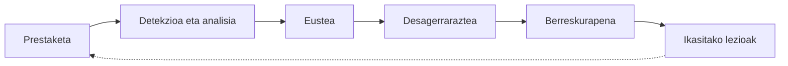

# SGSI — Ugarteburu Torlojuak

Dokumentu honek Ugarteburu Torlojuak enpresaren Informazioaren Segurtasuna Kudeatzeko Sistemaren (SGSI) oinarrizko hiru atalak jasotzen ditu:

1. [Arriskuak eta mehatxuak kudeatzea](#1-arriskuak-eta-mehatxuak-kudeatzea)
2. [Gorabeheren erantzunaren plangintza](#2-gorabeheren-erantzunaren-plangintza)
3. [Gertaerak komunikatzeko plana](#3-gertaerak-komunikatzeko-plana)

---

## 0. Testuingurua eta irismena

| Elementua | Deskribapena |
|---|---|
| Enpresa | Ugarteburu Torlojuak |
| Egoitzak | **EN** (egoitza nagusia, Proxmox) eta **U1** (bigarren egoitza, IsardVDI) |
| Sare-ingurunea | EN: pfSense (VLAN 64 zerbitzariak, 80 bezeroak, 112 sistemak, DMZ 192.168.50.0/24). U1: PA-IT (U1-IT 192.168.20.0/24, DMZ-IT 192.168.10.0/24) eta PA-OT (DMZ-OT eta OT) |
| Egoitzen arteko lotura | Site-to-site VPNa (pfSense ↔ Palo Alto) |
| Zerbitzu kritikoak | Active Directory (taldea1l.an), ziurtagiri-zerbitzaria (EN-CertServ), DMZko web zerbitzaria, ekoizpen-sarea (OT) |

**Irismena:** bi egoitzetako IT eta OT sareak, haien zerbitzariak, sare-gailuak (firewallak, MikroTik, switcha) eta bertan kudeatzen den informazioa.

---

## 1. Arriskuak eta mehatxuak kudeatzea

### 1.1 Metodologia

Arriskua honela kalkulatzen da (MAGERIT / ISO 27005 ereduan oinarrituta):

**Arriskua = Probabilitatea × Eragina**

| Balioa | Probabilitatea | Eragina |
|---|---|---|
| 1 | Oso baxua (urtean behin baino gutxiago) | Oso txikia (ez du zerbitzurik eteten) |
| 2 | Baxua | Txikia (zerbitzu ez-kritiko bat eteten da) |
| 3 | Ertaina | Ertaina (zerbitzu kritiko bat ordu batzuetan) |
| 4 | Altua | Larria (ekoizpena gelditzen da edo datuak galtzen dira) |
| 5 | Oso altua (hilero edo maizago) | Katastrofikoa (ekoizpena egunetan geldirik, datu pertsonalen ihesa) |

| Emaitza | Maila | Ekintza |
|---|---|---|
| 1–6 | 🟢 Baxua | Onartu eta monitorizatu |
| 7–14 | 🟡 Ertaina | Mitigatzeko neurriak 3 hilabeteko epean |
| 15–25 | 🔴 Altua | Berehalako neurriak |

### 1.2 Aktiboak

| ID | Aktiboa | Kokapena | Kritikotasuna |
|---|---|---|---|
| A1 | Windows Server / Active Directory (taldea1l.an, U1-WS) | EN VLAN 64, U1-IT | Altua |
| A2 | Ziurtagiri-zerbitzaria (EN-CertServ) | EN VLAN 64 | Altua |
| A3 | Firewallak (pfSense, PA-IT, PA-OT) | EN, U1 | Altua |
| A4 | Egoitzen arteko VPNa | EN ↔ U1 | Altua |
| A5 | DMZko web zerbitzaria | DMZ | Ertaina |
| A6 | Ekoizpen-sarea (OT: PLCak, SCADA) | U1 OT | Oso altua |
| A7 | Langileen ekipoak | EN VLAN 80, U1-IT | Ertaina |
| A8 | Bezeroen eta langileen datuak | A1, A7 | Altua |

### 1.3 Mehatxuen eta arriskuen azterketa

| ID | Mehatxua | Aktiboak | Ahultasuna | P | E | Arriskua |
|---|---|---|---|---|---|---|
| R1 | **Ransomwarea** | A1, A6, A7, A8 | Phishinga, adabaki gabeko sistemak, segmentazio eskasa | 4 | 5 | 🔴 20 |
| R2 | **Phishinga eta kredentzialen lapurreta** | A1, A7, A8 | Langileen kontzientziazio falta, MFA eza | 5 | 4 | 🔴 20 |
| R3 | **IT sarretik OT sarera mugimendu laterala** | A3, A6 | Firewall-arau zabalegiak PA-IT eta PA-OT artean | 3 | 5 | 🔴 15 |
| R4 | **DMZko web zerbitzariaren ustiapena** (SQLi, RCE…) | A5, A3 | Software zaharkitua, WAF eza | 4 | 3 | 🟡 12 |
| R5 | **VPNaren erorketa edo konpromisoa** | A4, A3 | Gako ahulak, ziurtagiri iraungiak | 2 | 4 | 🟡 8 |
| R6 | **Barneko mehatxua** (langile maltzurra edo arduragabea) | A1, A8 | Pribilegio gehiegi, auditoriarik eza | 2 | 4 | 🟡 8 |
| R7 | **Zerbitzu-ukapena (DDoS)** | A5, A4 | Interneteko lotura bakarra | 3 | 3 | 🟡 9 |
| R8 | **Hardware-akatsa edo datu-galera** | A1, A2, A3 | Babeskopia probatu gabeak | 2 | 4 | 🟡 8 |

### 1.4 Tratamendu-plana

| ID | Estrategia | Kontrolak / neurriak | Detekzio-tresna | Arduraduna |
|---|---|---|---|---|
| R1 | Mitigatu | 3-2-1 babeskopiak (bat offline/immutablea), EDR ekipoetan, adabaki-politika, IT/OT segmentazioa | EDR / Wazuh alertak, fitxategi-aldaketa masiboen detekzioa | Sistema-administratzailea |
| R2 | Mitigatu | MFA VPNan eta posta elektronikoan, kontzientziazio-saioak, phishing-simulazioak, SPF/DKIM/DMARC | Posta-iragazkia, AD-ko saio-hasiera huts eginen alertak | Segurtasun-arduraduna |
| R3 | Mitigatu | Zerrenda zuria PA-IT ↔ PA-OT arauetan (beharrezko portuak bakarrik), DMZ-OT bitartekari gisa, jauzi-zerbitzaria (jump host) | Palo Alto-ren Threat logak, IDS/IPS | Sare-administratzailea |
| R4 | Mitigatu | Eguneratzeak, WAF, DNAT-ean portu minimoak, HTTPS EN-CertServ-eko ziurtagiriarekin | Palo Alto / pfSense (Suricata) IPS, web logak | Sare-administratzailea |
| R5 | Mitigatu | IKEv2 + AES-256, ziurtagiri bidezko autentifikazioa, iraungitzeen kontrola | VPN egoeraren monitorizazioa, tunela erortzean alerta | Sare-administratzailea |
| R6 | Mitigatu | Pribilegio minimoaren printzipioa, rol bidezko sarbidea AD-n, kontu partekaturik ez | AD auditoria-logak, SIEMa | Sistema-administratzailea |
| R7 | Transferitu / mitigatu | ISParen anti-DDoS zerbitzua, rate-limiting firewallean | Trafiko-monitorizazioa | Sare-administratzailea |
| R8 | Mitigatu | Babeskopia automatikoak Proxmox-en, berreskuratze-probak hiruhilero, konfigurazioen esportazioa | Babeskopia-lanen alertak | Sistema-administratzailea |

**Arrisku hondarra:** neurriak ezarri ondoren, arrisku guztiek 🟢/🟡 mailara jaitsi behar dute. Arriskuen analisia urtean behin berrikusiko da, edo azpiegituran aldaketa handi bat dagoenean.

---

## 2. Gorabeheren erantzunaren plangintza

NIST SP 800-61 eta INCIBEren gidan oinarritutako 6 faseko eredua.

### 2.1 Erantzun-taldea (CSIRT)

| Rola | Ardurak |
|---|---|
| Gorabeheren koordinatzailea | Erantzuna zuzendu, erabakiak hartu, zuzendaritzarekin harremana |
| Analista teknikoa | Logak aztertu, ebidentziak bildu, euste-neurriak aplikatu |
| Sistema/sare-administratzailea | Sistemak isolatu, berreskuratu, babeskopiak leheneratu |
| Komunikazio-arduraduna | Barne- eta kanpo-komunikazioak (ikus 3. atala) |
| DBO / legezko aholkularia | Datu pertsonalen gaineko erabakiak, AEPDri jakinarazpena |

### 2.2 Larritasun-sailkapena

| Maila | Deskribapena | Adibidea | Erantzun-denbora |
|---|---|---|---|
| **K1 – Kritikoa** | Ekoizpena geldirik edo datu pertsonalen ihesa | Ransomwarea OT sarean | < 1 ordu |
| **K2 – Altua** | Zerbitzu kritiko bat kaltetuta | AD zerbitzaria konprometituta | < 4 ordu |
| **K3 – Ertaina** | Zerbitzu ez-kritiko bat kaltetuta | Web zerbitzariaren defacement | < 24 ordu |
| **K4 – Baxua** | Eraginik gabeko saiakera | Portu-eskaneatze bat blokeatuta | Hurrengo lanegunean |

### 2.3 Erantzunaren pausuak

#### 1. pausua — Prestaketa
- CSIRTa izendatu eta harremanetarako zerrenda eguneratuta eduki.
- Detekzio-tresnak martxan: Palo Alto-ren Threat/URL logak, pfSense + Suricata, Windows Event Log, SIEMa (Wazuh).
- Babeskopiak eta berreskuratze-prozedurak probatuta.
- Playbookak prestatu (ransomwarea, phishinga, DMZko intrusioa, VPN erorketa).
- Ebidentziak biltzeko kit-a (irudi forentseak, hash-ak, kustodia-katea).

#### 2. pausua — Detekzioa eta analisia
- Alerta jaso (SIEM, IPS, EDR, erabiltzailearen txostena).
- Positibo faltsua den ala ez egiaztatu.
- Irismena zehaztu: zein aktibo, zein sare (IT, OT, DMZ), zein egoitza.
- Larritasuna esleitu (K1–K4) eta gorabehera erregistroan ireki (ID, data, ordua, deskribapena).

#### 3. pausua — Eustea (contención)
- **Epe laburrean:** kaltetutako ekipoa isolatu (VLAN berezira mugitu edo firewall-arau bidez blokeatu), konprometitutako kontuak desgaitu, IP maltzurrak blokeatu.
- Beharrezkoa bada, VPN tunela edo IT↔OT lotura moztu kutsadura egoitzen artean ez zabaltzeko.
- **Epe luzean:** sistema garbiak behin-behinean zerbitzuan jarri.
- Ebidentziak gorde ezer ezabatu aurretik (memoria, diskoa, logak).

#### 4. pausua — Desagerraraztea (erradikazioa)
- Malwarea, atzeko ateak eta sortutako kontu maltzurrak ezabatu.
- Ahultasuna zuzendu (adabakia, konfigurazio-aldaketa).
- Pasahitz guztiak aldatu eta, behar izanez gero, ziurtagiriak ezeztatu eta berriak sortu EN-CertServ-en.

#### 5. pausua — Berreskurapena
- Sistemak babeskopia garbietatik leheneratu.
- Zerbitzuak pixkanaka martxan jarri, lehentasunaren arabera: firewallak → AD → VPN → OT → gainerakoak.
- Monitorizazio areagotua 15–30 egunez, gorabehera berriro ez dela gertatzen egiaztatzeko.

#### 6. pausua — Ikasitako lezioak
- Gorabeheraren txostena idatzi (gertaeren kronologia, kausa, eragina, hartutako neurriak).
- Bilera 2 asteko epean: zer funtzionatu du, zer ez.
- Arriskuen analisia (1. atala), playbookak eta prozedurak eguneratu.

### 2.4 Fluxu-diagrama

---

## 3. Gertaerak komunikatzeko plana

### 3.1 Printzipioak
- **Ezagutu beharra:** informazioa behar duenari bakarrik ematen zaio.
- **Bozeramaile bakarra:** kanpo-komunikazio guztiak komunikazio-arduradunaren bidez.
- **Kanal seguruak:** gorabehera batean ezin da konprometitutako kanala erabili (adib. posta elektronikoa erasotua badago, telefonoa edo kanal alternatiboa).
- **Erregistroa:** komunikazio guztiak dataz eta orduz erregistratzen dira.

### 3.2 Komunikazio-mailak

#### 1. maila — Barne teknikoa (CSIRTa eta IT saila)
| Nori | Noiz | Kanala | Edukia |
|---|---|---|---|
| CSIRTa, sistema- eta sare-administratzaileak | Berehala, detektatu bezain laster | Telefonoa, barne-txata, ticket sistema | Alerta teknikoa, IoC-ak, kaltetutako aktiboak, hartu beharreko neurriak |

#### 2. maila — Zuzendaritza eta barne-langileak
| Nori | Noiz | Kanala | Edukia |
|---|---|---|---|
| Zuzendaritza | K1/K2: < 1 ordu. K3: egunean bertan | Telefonoa / bilera | Egoeraren laburpena, negozioan eragina, erabaki beharrekoak |
| Kaltetutako langileak | Euste-fasean | Barne-posta, oharra | Zer egin behar duten (adib. pasahitza aldatu, ekipoa ez piztu), ekiditeko jarraibideak |
| OT / ekoizpen-arduraduna | OT sarea kaltetuta badago, berehala | Telefonoa | Ekoizpena gelditu behar den ala ez |

#### 3. maila — Kanpokoak (agintariak, bezeroak, hornitzaileak)
| Nori | Noiz | Kanala | Edukia |
|---|---|---|---|
| **AEPD** (Datuak Babesteko Agentzia) | Datu pertsonalen urraketa badago, **72 orduko** epean (DBEO 33. art.) | AEPDren egoitza elektronikoa | Urraketaren izaera, kaltetutakoak, neurriak |
| **BCSC** (Basque Cybersecurity Centre) / **INCIBE-CERT** | K1/K2 gorabeheretan | Haien jakinarazpen-inprimakia / posta | Datu teknikoak, IoC-ak, laguntza-eskaera |
| **Ertzaintza** (delitu informatikoen saila) | Delitua badago (estortsioa, lapurreta) | Salaketa formala | Ebidentziak, kustodia-katea |
| Bezeroak eta hornitzaileak | Haien datuak edo zerbitzua kaltetuta badaude | Posta ofiziala, telefonoa | Gertatutakoa, eragina, hartutako neurriak, kontaktua |
| Komunikabideak | Zuzendaritzak erabakitzen badu | Prentsa-oharra | Mezu ofizial bakarra, xehetasun teknikorik gabe |

> **Oharra:** NIS2 zuzentarauak (eta Espainiako transposizioak) enpresa ekoizleei ere eragin diezaieke. Hala bada, gorabehera esanguratsuak **24 orduko** abisu goiztiarrarekin eta **72 orduko** jakinarazpenarekin komunikatu beharko lirateke.

### 3.3 Eskalatze-matrizea

| Larritasuna | 1. maila (teknikoa) | 2. maila (zuzendaritza/langileak) | 3. maila (kanpokoak) |
|---|---|---|---|
| K1 – Kritikoa | ✅ Berehala | ✅ < 1 ordu | ✅ Beharrezkoa (AEPD 72h, BCSC/INCIBE) |
| K2 – Altua | ✅ Berehala | ✅ < 4 ordu | ⚠️ Datu pertsonalak badaude |
| K3 – Ertaina | ✅ Egunean bertan | ⚠️ Txosten laburra | ❌ |
| K4 – Baxua | ✅ Erregistroan | ❌ | ❌ |
