# U1 – PA-IT konfigurazioa

## 1. Makina birtuala (IsardVDI)

PA-VM IsardVDI-n dago. Lehen sare-txartela kudeaketa-ataka da, eta hurrengoak ethernet1/1, ethernet1/2 eta ethernet1/3; ordena horrek zehazten du sare bakoitza zein interfazetan dagoen. Kudeaketa-ataka Default sarean dago, Isard-ek ez baitu sare bera bi aldiz gehitzen uzten.

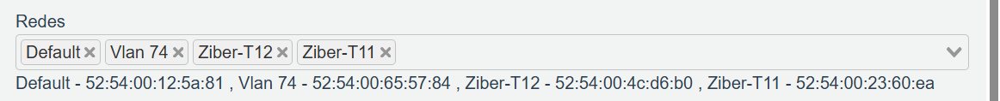

## 2. Hasierako konfigurazioa (CLI)

Fabrikako konfiguraziotik abiatu da. Kontsolatik gutxieneko konfigurazioa egin da IT saretik web interfazera sartu ahal izateko; gainerakoa web interfazetik egin da.

```
request system private-data-reset

configure
set network profiles interface-management-profile MGMT-IT https yes ssh yes ping yes
set network interface ethernet ethernet1/2 layer3 ip 192.168.20.1/24
set network interface ethernet ethernet1/2 layer3 interface-management-profile MGMT-IT
set zone U1-IT network layer3 ethernet1/2
set network virtual-router default interface ethernet1/2
commit
```

## 3. Zonak

Sare bakoitza bere zonan dago (WAN, IT eta DMZ), zonen arteko trafiko guztia segurtasun-politiken bidez kontrolatzeko.

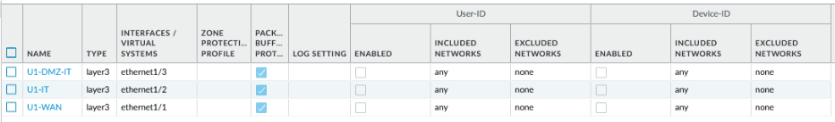

## 4. Interfazeak

Interfaze guztiak Layer3 moduan daude, eta PA-IT da sare bakoitzaren gateway-a. Kudeaketa-profila IT interfazean soilik dago; WAN eta DMZ interfazeek ez dute administrazio-zerbitzurik eskaintzen.

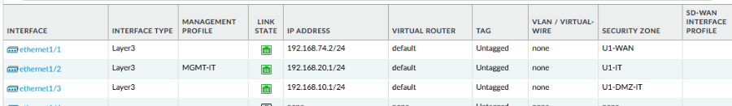

## 5. Kudeaketa-profila

Administrazioa HTTPS eta SSH bidez soilik egiten da (HTTP eta Telnet desgaituta), eta administrazio-ekipotik (192.168.20.10) bakarrik.

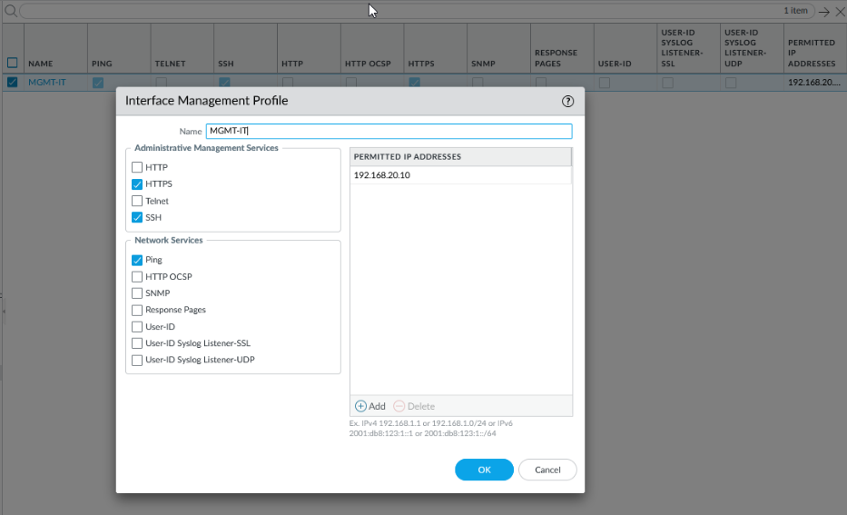

## 6. Bideratzea

Ibilbide lehenetsiak Internetera doan trafikoa vlan74-ko gateway-ra (192.168.74.254) bidaltzen du. Bideratze-taulan ibilbidea aktibo dagoela eta sare konektatuak egiaztatzen dira.

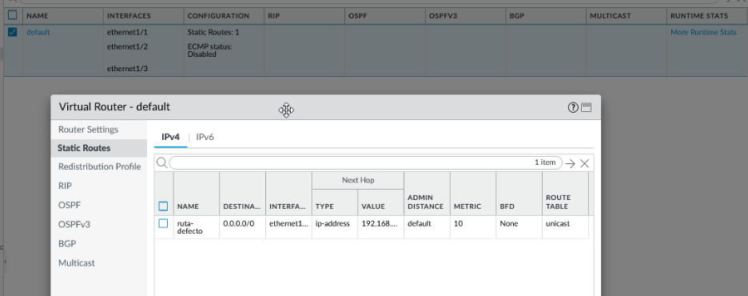

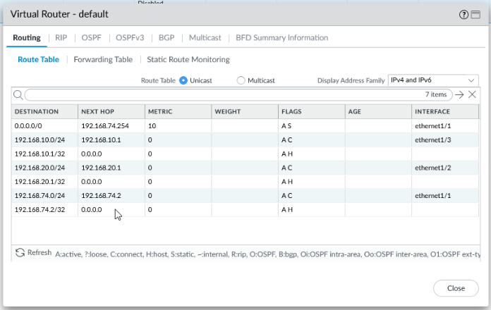

## 7. Sistema

Hostname-ak gailua identifikatzen du kudeaketan eta log-etan. DNS zerbitzariak suebakiaren beraren izen-ebazpenerako dira.

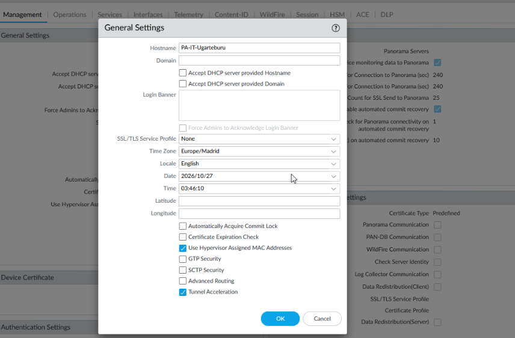

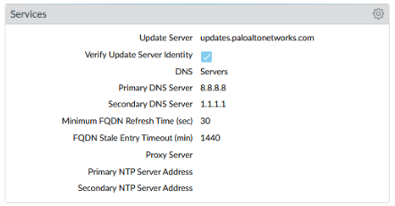

## 8. NAT

SNAT bakarra dago, Internetera irten behar duen IT sarearentzat soilik. Trafikoa WAN interfazearen IP-arekin itzultzen da (Dynamic IP and Port).

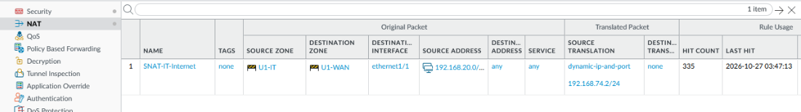

## 9. Segurtasun-politikak

"Dena debekatuta, beharrezkoa bakarrik baimenduta" printzipioa aplikatu da. DMZ-tik barneko sarera ez dago komunikaziorik; IT-tik DMZ-ra web trafikoa soilik baimentzen da, eta SSH administrazio-ekipotik bakarrik. Internetera aplikazio zehatzak baino ez dira baimentzen. Gainerako trafikoa interzone-default arauak ukatzen du eta log-etan erregistratzen da.

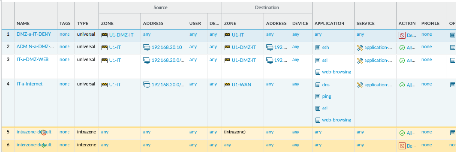

## 10. Pasahitz-politika

Administratzaileen pasahitzek gutxienez 8 karaktere eta karaktere-mota guztiak izan behar dituzte; 90 egunean behin aldatu behar dira eta ezin dira azken 5ak berrerabili.

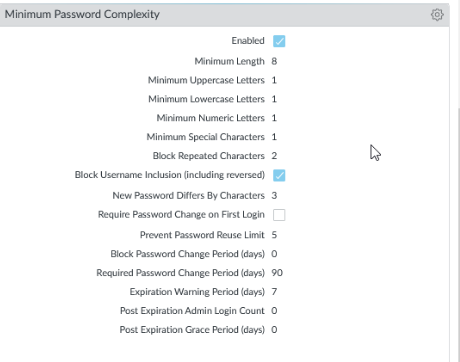

## 11. Autentifikazio-ezarpenak

5 saiakera huts egin ondoren kontua 10 minutuz blokeatzen da, indar hutsezko erasoak saihesteko. Erabili gabeko saioak 10 minuturen buruan ixten dira.

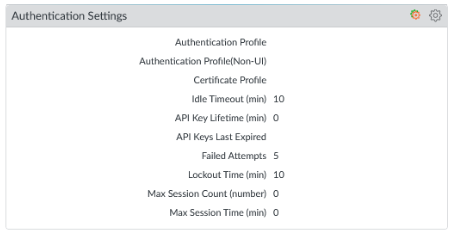

## 12. Administratzaileak

Taldekide bakoitzak bere erabiltzailea du, log-etan nork zer egin duen jakiteko. admin kontua larrialdietarako gordetzen da. Pasahitz guztiak pasahitz-kudeatzailean daude.

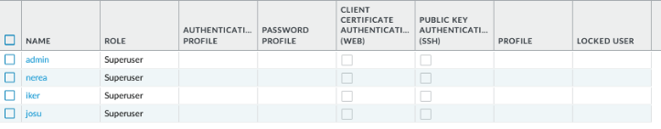
