# U1 – PA-OT konfigurazioa

## 1. Makina birtuala (IsardVDI)

PA-VM IsardVDI-n dago, PA-IT-ren txantiloi beretik sortuta (2 vCPU, Isard-eko kuota dela eta). Lehen sare-txartela kudeaketa-ataka da (Default); ethernet1/1 U1-IT sarean (Ziber-T12) dago, eta hortik konektatzen da PA-IT-ra. ethernet1/2 U1-OT (Ziber-T13) eta ethernet1/3 U1-DMZOT (Ziber-T14) dira.

## 2. Hasierako konfigurazioa (CLI)

Fabrikako konfiguraziotik abiatu da. Kontsolatik gutxieneko konfigurazioa egin da IT saretik web interfazera sartu ahal izateko; gainerakoa web interfazetik egin da.

```
request system private-data-reset

configure
set network profiles interface-management-profile MGMT-OT https yes ssh yes ping yes
set network profiles interface-management-profile MGMT-OT permitted-ip 192.168.20.10
set network interface ethernet ethernet1/1 layer3 ip 192.168.20.254/24
set network interface ethernet ethernet1/1 layer3 interface-management-profile MGMT-OT
set zone U1-IT network layer3 ethernet1/1
set network virtual-router default interface ethernet1/1
commit
```

## 3. Zonak

Sare bakoitza bere zonan dago (U1-IT, U1-OT eta U1-DMZOT), IT eta OT arteko trafiko guztia segurtasun-politiken bidez kontrolatzeko.

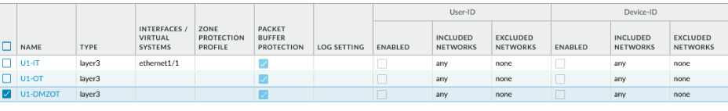

## 4. Interfazeak

Interfaze guztiak Layer3 moduan daude, eta PA-OT da OT eta DMZ-OT sareen gateway-a. Kudeaketa-profila IT aldeko interfazean soilik dago; OT eta DMZ-OT interfazeek ez dute administrazio-zerbitzurik eskaintzen.

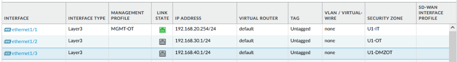

## 5. Kudeaketa-profila

Administrazioa HTTPS eta SSH bidez soilik egiten da (HTTP eta Telnet desgaituta), eta administrazio-ekipotik (192.168.20.10) bakarrik.
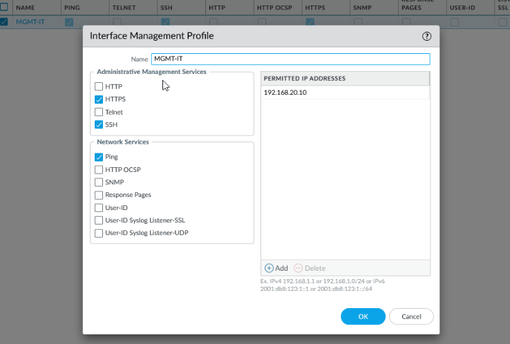

## 6. Bideratzea

Ibilbide lehenetsiak OT aldetik irteten den trafikoa PA-IT-ra (192.168.20.1) bidaltzen du.

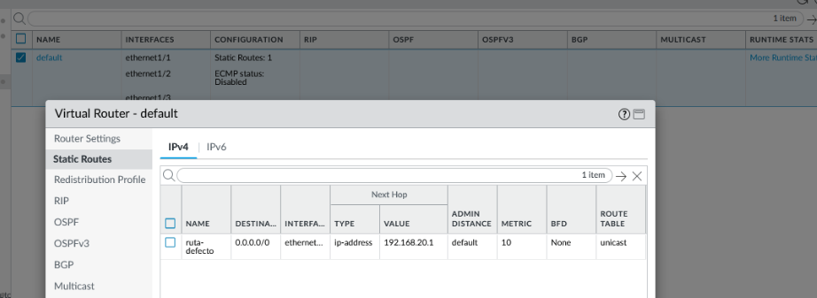

## 7. Sistema

Hostname-ak gailua identifikatzen du kudeaketan eta log-etan. DNS zerbitzariak suebakiaren beraren izen-ebazpenerako dira.

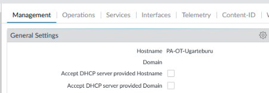

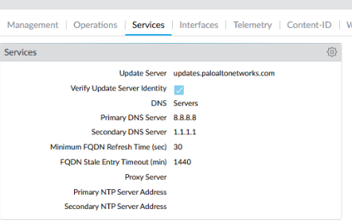

## 8. Segurtasun-politikak

IT eta OT sareak bereizita daude. DMZ-OT-tik OT sarera ez dago komunikaziorik, eta IT-tik DMZ-OT-ra SSH bidezko administrazioa baino ez da baimentzen, administrazio-ekipotik bakarrik. Gainerako trafikoa interzone-default arauak ukatzen du eta log-etan erregistratzen da. Ez dago NAT-ik: OT sareek ez dute Internetera irteerarik.

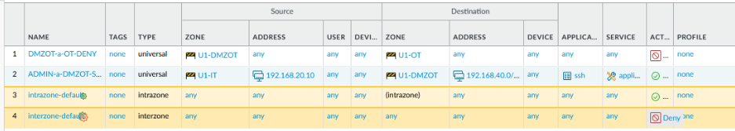

## 9. Pasahitz-politika

Administratzaileen pasahitzek gutxienez 8 karaktere eta karaktere-mota guztiak izan behar dituzte; 90 egunean behin aldatu behar dira eta ezin dira azken 5ak berrerabili.

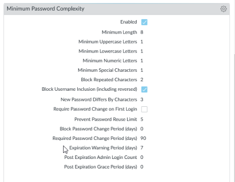

## 10. Autentifikazio-ezarpenak

5 saiakera huts egin ondoren kontua 10 minutuz blokeatzen da, indar hutsezko erasoak saihesteko. Erabili gabeko saioak 10 minuturen buruan ixten dira.

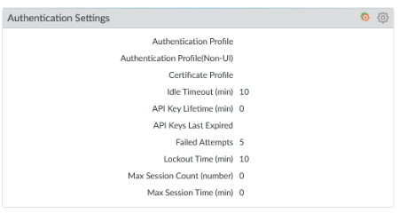

## 11. Administratzaileak

Taldekide bakoitzak bere erabiltzailea du, log-etan nork zer egin duen jakiteko. admin kontua larrialdietarako gordetzen da. Pasahitz guztiak pasahitz-kudeatzailean daude.

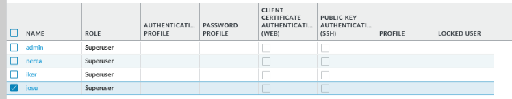

## 12. PA-IT: OT sareetarako ibilbideak

PA-IT-n OT eta DMZ-OT sareetarako ibilbide estatikoak gehitu dira, next hop PA-OT (192.168.20.254) dela. Horrela, sare horietara doan trafikoa PA-OT-ra bidaltzen da eta ez WAN-era; sarbidea PA-OT-ren politikek kontrolatzen dute.

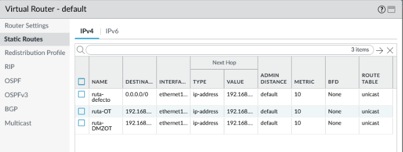

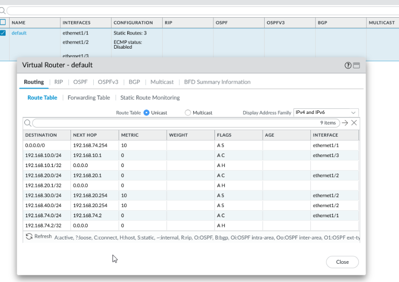

## 13. Administrazio-ekipoa

PA-OT administrazio-ekipoaren sare berean dagoenez (U1-IT), ekipoan ibilbide iraunkorrak gehitu dira, OT sareetarako trafikoa zuzenean PA-OT-ra joan dadin eta joan-etorriko bideak berdinak izan daitezen.

```
route -p add 192.168.30.0 mask 255.255.255.0 192.168.20.254
route -p add 192.168.40.0 mask 255.255.255.0 192.168.20.254
```
