# Gailuetarako sarbide segurua, izenarekin (FQDN)

Gailuak izenarekin (FQDN) administratzen dira, ez IP-arekin. Konexio guztiak seguruak dira:

- Web interfazeek enpresako PKI-ak sinatutako HTTPS ziurtagiriak erabiltzen dituzte.
- SSH zerbitzuetan gako bidez sartzen da, ez pasahitzarekin.
- Administrazio-sareetatik bakarrik sar daiteke.

| Gailua | Zerbitzua | FQDN | IP |
|---|---|---|---|
| EN-pfSense | WebGUI | `pfsense.talde1.lan` | `192.168.112.1` |
| U1-PaloAlto-IT | WebGUI | `pa-it.talde1.lan` | `192.168.20.1` |
| EN-CertServ | SSH | `certserv.talde1.lan` | `192.168.111.20` |
| EN-MikroTik | WebGUI, SSH, Winbox | `mikrotik.talde1.lan` | `192.168.112.2` |
| EN-Web | HTTPS (web publikoa) | `www.talde1.lan` | `192.168.50.10` |

## 1. DNS erregistroak

`talde1.lan` zonan (AD-n) A erregistro bat sortu dugu gailu bakoitzeko. IP-a gailuaren kudeaketa-interfazearena da:

- pfSense-ren WebGUI-a SISTEMAK saretik bakarrik dago eskuragarri.
- PA-IT-ren WebGUI-a U1-IT interfazetik bakarrik dago eskuragarri.

Zona bi DC-en artean erreplikatzen da. Horrela egoitza bakoitzak bere DC-an ebazten ditu izenak.


## 2. Web ziurtagiriak

Ziurtagiriak EN-CertServ-eko Intermediate CA-k sinatzen ditu (ikus [PKI dokumentazioa](../pki/README.md)). VPN ziurtagiriekin alderatuta, desberdintasun hauek dituzte:

- `extendedKeyUsage = serverAuth` bakarrik.
- SAN-ean FQDN-a eta kudeaketa-IP-a daude. Horrela nabigatzaileak izenarekin zein IP-arekin onartzen du.
- Iraupena 398 egunekoa da. Nabigatzaileek ez dute iraupen luzeagoko zerbitzari-ziurtagiririk onartzen.

```bash
cd /root/ca/intermediate
openssl req -new -newkey rsa:2048 -nodes -keyout private/web-pfsense.key -out csr/web-pfsense.csr \
  -subj "/C=ES/O=Ugarteburu Torlojuak/OU=EN/CN=pfsense.talde1.lan"
openssl ca -config openssl.cnf -extfile web-pfsense.ext -days 398 -notext \
  -in csr/web-pfsense.csr -out certs/web-pfsense.crt
```


## 3. pfSense

Ziurtagiria eta gakoa *Cert Manager*-en inportatu ditugu. SISTEMAK-eko administrazio-ekipotik SSH bidez kopiatu genituen.


Hostname-a eta domeinua (`pfsense.talde1.lan`) ziurtagiriarekin bat datoz. Hori beharrezkoa da. Bestela pfSense-k izenarekin sartzea blokeatzen du (*DNS rebind* babesa).


WebGUI-ak HTTPS eta `WEB-pfsense` ziurtagiria erabiltzen ditu.


## 4. CA ziurtagirien banaketa GPO bidez

Nabigatzaileek ziurtagiriak onartzeko, domeinuko ekipo guztiek PKI-an konfiantza izan behar dute.

Horretarako `PKI-Ziurtagiriak` GPO-a sortu eta domeinuari lotu diogu:

- Root CA *Entidades de certificación raíz de confianza* atalean dago.
- Intermediate CA *Entidades de certificación intermedias* atalean dago.

Horrela domeinuko ekipo guztiek jasotzen dute konfigurazioa, bi egoitzetan, leku bakar batetik.


Emaitza: SISTEMAK-WIN-etik `https://pfsense.talde1.lan` abisurik gabe irekitzen da.


Firefox-ek bere ziurtagiri-biltegia erabiltzen du, eta ez du GPO-ko Root CA-a ikusten.

## 5. PA-IT

Ziurtagiria gako zifratuarekin inportatu dugu, Palo Alto-k ez duelako pasahitz gabeko gakorik onartzen. Gakoa esportatzea blokeatuta dago.


`WEB-pa-it-profile` SSL/TLS profilak ziurtagiria eta gutxieneko TLS bertsioa (1.2) zehazten ditu. Profil hau kudeaketa-ezarpenetan aplikatzen da.


Commit egin ondoren, PA-k fabrikako ziurtagiri autosinatua erabiltzen jarraitu zuen. Ziurtagiri berria gailua berrabiarazi ondoren kargatu zen.


U1-admin domeinuan sartu ondoren (GPO-a U1-WS-tik jasotzen du), `https://pa-it.talde1.lan` abisurik gabe irekitzen da.


## 6. SSH: EN-CertServ

Administratzaileak gako bidez sartzen dira (Ed25519, pasahitz-esaldiarekin). Gako publikoa `pki` erabiltzailearen `authorized_keys` fitxategian dago.


Lehen konexioan zerbitzariaren hatz-marka egiaztatu dugu. Zerbitzaria lehen aldiz piztean sortutakoaren berdina da (`SHA256:kvjf7ul140…`). Beraz, benetako zerbitzaria da.


`sshd` zerbitzua `/etc/ssh/sshd_config.d/10-gotortzea.conf` fitxategian gotortu dugu:

| Aukera | Zertarako |
|---|---|
| `PermitRootLogin no` | root ezin da zuzenean sartu |
| `PasswordAuthentication no`, `KbdInteractiveAuthentication no` | gakoarekin bakarrik, pasahitzik ez |
| `AllowUsers pki@192.168.112.0/24 pki@192.168.20.10` | `pki` bakarrik, SISTEMAK-etik eta U1-eko administratzailetik |
| `MaxAuthTries 3`, `LoginGraceTime 30` | indar hutsezko erasoak mugatu |
| `X11Forwarding no` | behar ez den funtzioa desgaitu |


### Probak

Gakoarekin sartzen da (gakoaren pasahitz-esaldia eskatzen du):


root ezin da sartu:


Pasahitzarekin ezin da sartu:


## 7. MikroTik

### 7.1 Trunk-aren egiaztapena

MikroTik-ak (CRS112, RouterOS 6.49) aurreko erronkako konfigurazioa zuen, eta jada 110-113 VLANetarako prest zegoen:

| Ataka | Funtzioa |
|---|---|
| `ether1` | Trunk-a klaseko switchera (110-113 etiketatuta, etiketadun trafikoa bakarrik) |
| `ether3` / `ether4` / `ether5` | Sarbidea: 110 BEZEROAK / 111 ZERBITZARIAK / 112 SISTEMAK |
| `vlan112-kudeaketa` | Kudeaketa-IP-a `192.168.112.2`, gateway-a pfSense (`.1`) |

Erabiltzen ez diren atakak desgaituta daude.

Bide osoa pfSense-tik egiaztatu dugu: pfSense → rack-eko switcha → zuntza → klaseko switcha → MikroTik.

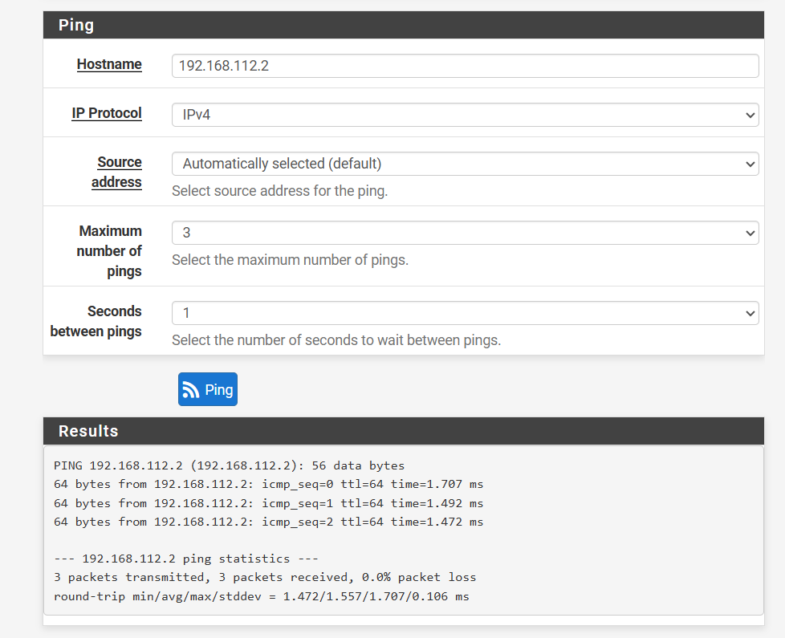

Administrazio-ekipoa `ether5`-era konektatuta dago. IP-a AD-tik jasotzen du, DHCP relay bidez.

SISTEMAK-eko esparruak helbide bakarra du (`.200`). Erreserba bat da, administratzailearen ekipoaren MAC-ari lotuta. Beraz, beste ekipo ezezagun batek ez du IP-rik jasotzen.

Esparruari 003 aukera (gateway-a) falta zitzaion, eta gehitu egin genuen.

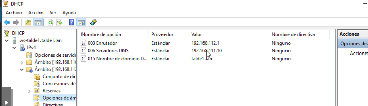

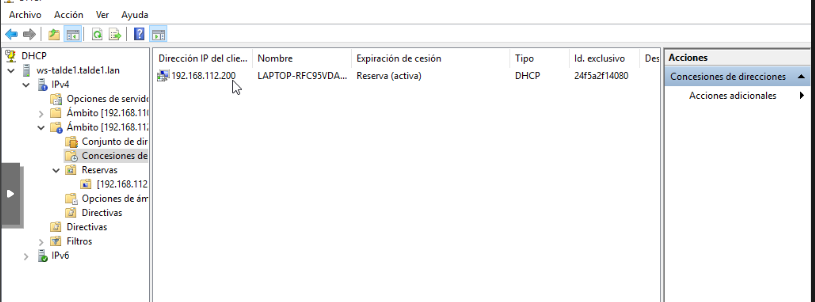

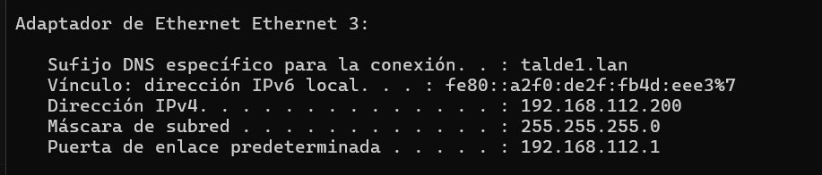

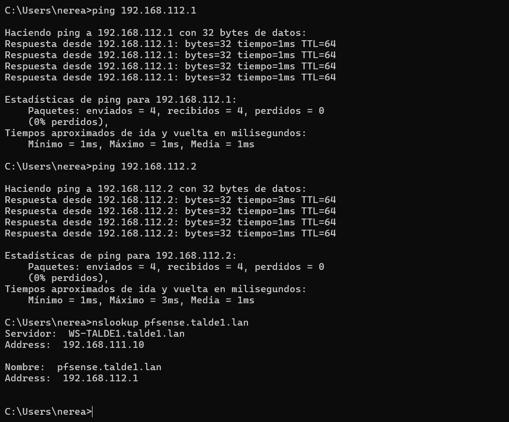

### 7.2 FQDN eta HTTPS

pfSense-n bezala egin dugu:

1. DNS erregistroa sortu: `mikrotik.talde1.lan` → `192.168.112.2`.
2. PKI-n ziurtagiria sortu.
3. Ziurtagiria eta gako zifratua Winbox-eko *Files* atalera igo eta inportatu. Ziurtagiriak `K` (gako pribatua) eta `T` (konfiantzazkoa) markak ditu.
4. Inportatu ondoren fitxategiak ezabatu.

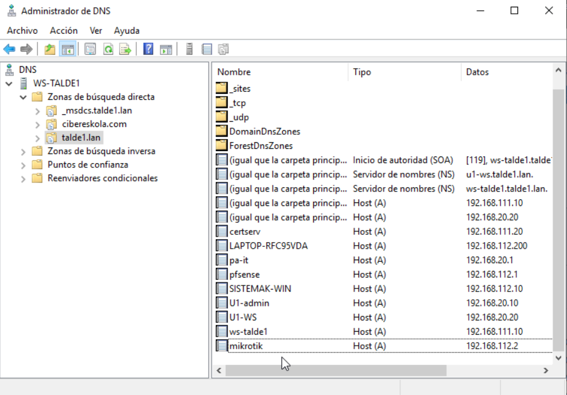

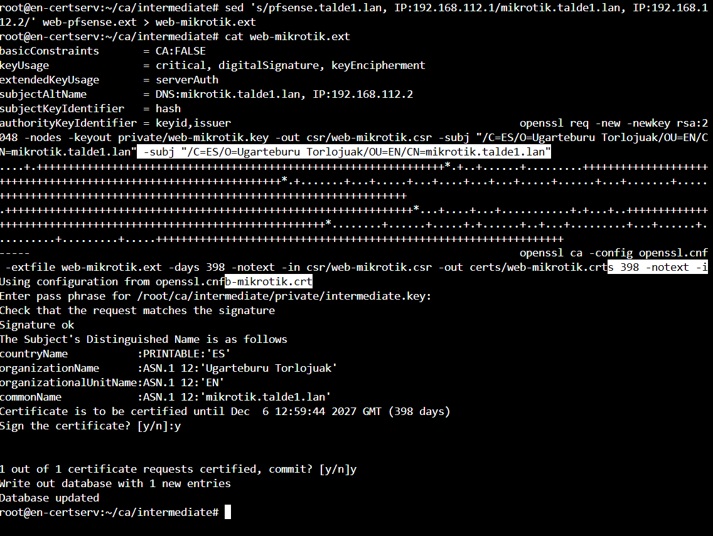

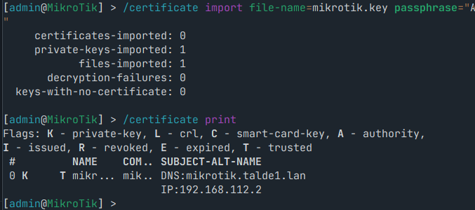

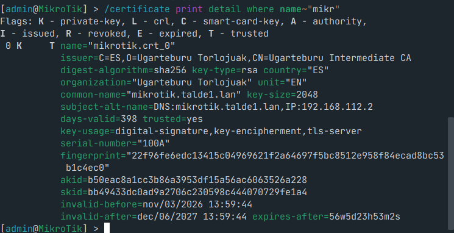

Zerbitzuak:

```
/ip service set www-ssl certificate=mikrotik.crt_0 disabled=no address=192.168.112.0/24,192.168.114.0/24
/ip service set winbox address=192.168.112.0/24,192.168.114.0/24
/ip service set ssh address=192.168.112.0/24,192.168.114.0/24
/ip ssh set strong-crypto=yes
```

- Aktibo daudenak: ssh, www-ssl eta winbox. SISTEMAK eta OpenVPN sareetatik bakarrik.
- Desgaituta daudenak: telnet, ftp, www (HTTP) eta api.

Aldaketak *Safe Mode*-n egin ditugu. Horrela konexioa galtzen bada, aldaketak automatikoki desegiten dira.

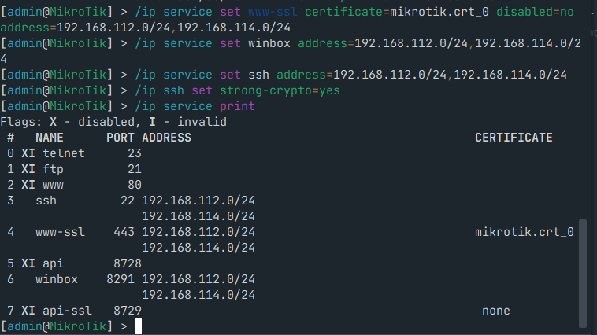

RouterOS 6-k bere ziurtagiria bakarrik bidaltzen du, katerik gabe. Beraz bezeroak Intermediate CA izan behar du bere biltegian. Domeinuko ekipoek GPO bidez dute. Domeinutik kanpoko ekipoan eskuz inportatu dugu (`certutil -user -addstore CA intermediate.crt`).

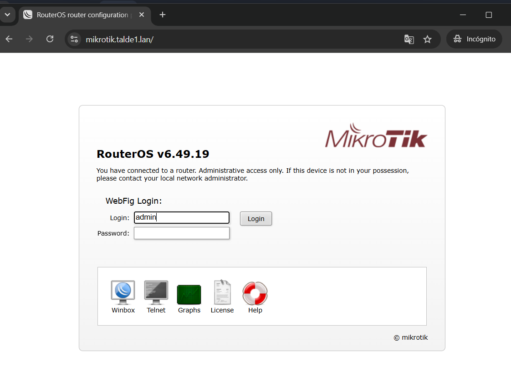

## 8. Web zerbitzaria (DMZ): HTTPS

EN-ko DMZ-ko web zerbitzaria (`www.talde1.lan`, `192.168.50.10`) Docker edukiontzi batean dago, 8090 atakan eta HTTP soilarekin.

HTTPS emateko, Apache **alderantzizko proxy** (reverse proxy) bezala konfiguratu dugu:

- 443 atakan entzuten du, PKI-ko ziurtagiriarekin (`www.talde1.lan`, ikus [PKI dokumentazioa](../pki/README.md)). Eskaerak edukiontzira bidaltzen ditu.
- 80 atakan jasotzen dena 443-ra bidaltzen du.
- Edukiontziaren kodea ez da aldatu.

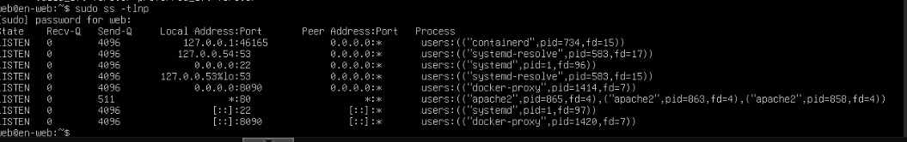

Apache-ren konfigurazioa (`/etc/apache2/sites-available/www-ssl.conf`):

```apache
<VirtualHost *:80>
    ServerName www.talde1.lan
    Redirect permanent / https://www.talde1.lan/
</VirtualHost>

<VirtualHost *:443>
    ServerName www.talde1.lan
    SSLEngine on
    SSLCertificateFile      /etc/apache2/ssl/web-www.crt
    SSLCertificateKeyFile   /etc/apache2/ssl/web-www.key
    SSLCertificateChainFile /etc/apache2/ssl/ca-chain.crt
    ProxyPreserveHost On
    RequestHeader set X-Forwarded-Proto "https"
    ProxyPass        / http://127.0.0.1:8090/
    ProxyPassReverse / http://127.0.0.1:8090/
</VirtualHost>
```

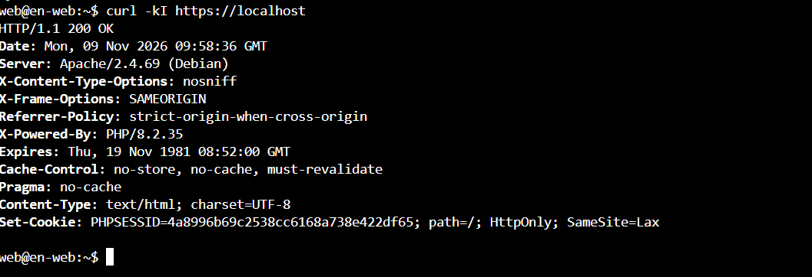

**Argitalpena:** pfSense-k WAN-eko 80 eta 443 portuak DMZ-ko web zerbitzarira (`EN_WEB` = `192.168.50.10`) bidaltzen ditu (DNAT). Bakoitzak bere firewall araua du.

**DNS:** AD-n `www.talde1.lan` → `192.168.50.10` erregistroa dago.

- Domeinuko eta VPN-eko ekipoak izenarekin sartzen dira. Nabigatzaileak PKI-an konfiantza duenez, giltzarrapoa agertzen da.
- Kanpoko ekipoek (klaseko 74 sarea) ez dute gure DNS-a erabiltzen. Horregatik `hosts` fitxategian `192.168.74.1  www.talde1.lan` lerroa jarri behar dute. Horrela DNS publiko bat simulatzen dugu.

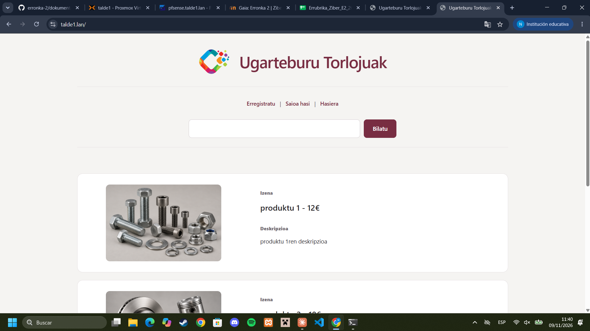
