# Gailuetarako atzipen ziurtatua eta FQDN bidez

Ugarteburu Torlojuak · 2. Erronka

Gailuen administrazioa izen bidez (FQDN) egiten da, ez IP bidez, eta kanal guztiak ziurtatuta daude: web interfazeak enpresako PKI-ak sinatutako HTTPS ziurtagiriekin, eta SSH zerbitzuak gako bidezko autentifikazioarekin. Gainera, administrazio-sareetatik bakarrik dago sarbidea.

| Gailua | Zerbitzua | FQDN | IP | Egoera |
|---|---|---|---|---|
| EN-pfSense | WebGUI | `pfsense.talde1.lan` | `192.168.112.1` | ✅ |
| U1-PaloAlto-IT | WebGUI | `pa-it.talde1.lan` | `192.168.20.1` | ✅ |
| EN-CertServ | SSH | `certserv.talde1.lan` | `192.168.111.20` | ✅ |
| EN-MikroTik | WebGUI | | | Egiteko |
| U1-PaloAlto-OT | WebGUI | | | Egiteko (2. zatia) |
| U1-DMZIT-XAMP | SSH | | | Egiteko (2. zatia) |
| U1-DMZOT-Ubuntu | SSH | | | Egiteko (2. zatia) |

## 1. DNS erregistroak

`talde1.lan` zonan (AD-n integratuta) A erregistro bat sortu da gailu bakoitzeko. IP-a gailuaren kudeaketa-interfazearena da: pfSense-ren WebGUI-a SISTEMAK saretik bakarrik eskuragarri dago, eta PA-IT-rena U1-IT interfazetik. Zona bi DC-en artean erreplikatzen denez, egoitza bakoitzak bertan ebazten ditu izenak.

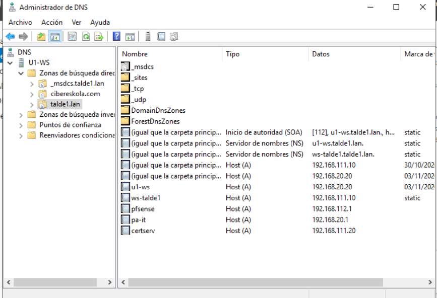

## 2. Web ziurtagiriak

Ziurtagiriak EN-CertServ-eko Intermediate CA-k sinatzen ditu (ikus [PKI dokumentazioa](../pki/README.md)). VPN ziurtagiriekiko desberdintasunak:

- `extendedKeyUsage = serverAuth` bakarrik.
- SAN-ean FQDN-a eta kudeaketa-IP-a, nabigatzaileak izen zein IP bidez onar dezan.
- Iraupena 398 egunekoa, nabigatzaileek ez baitute iraupen luzeagoko zerbitzari-ziurtagiririk onartzen.

```bash
cd /root/ca/intermediate
openssl req -new -newkey rsa:2048 -nodes -keyout private/web-pfsense.key -out csr/web-pfsense.csr \
  -subj "/C=ES/O=Ugarteburu Torlojuak/OU=EN/CN=pfsense.talde1.lan"
openssl ca -config openssl.cnf -extfile web-pfsense.ext -days 398 -notext \
  -in csr/web-pfsense.csr -out certs/web-pfsense.crt
```

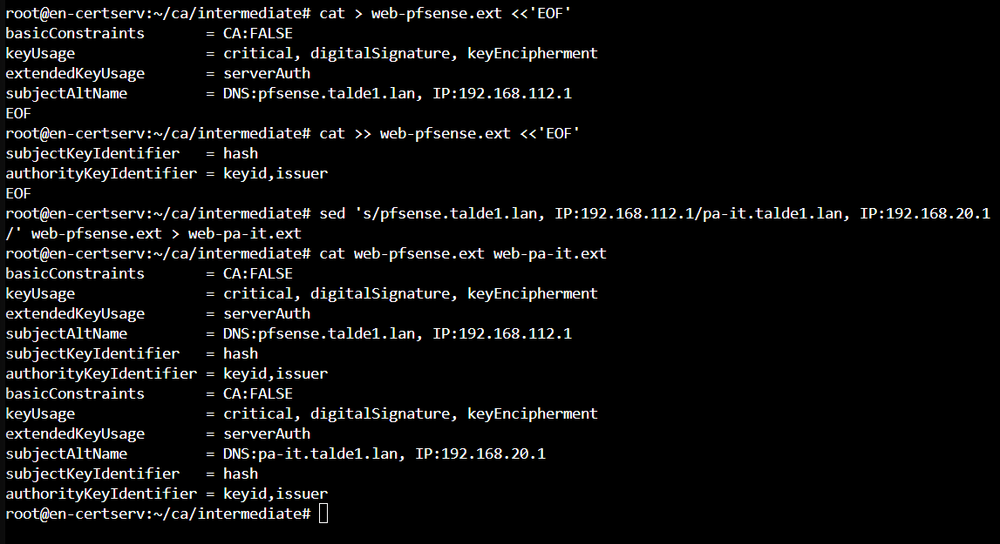

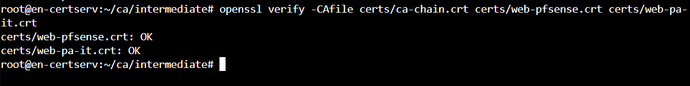

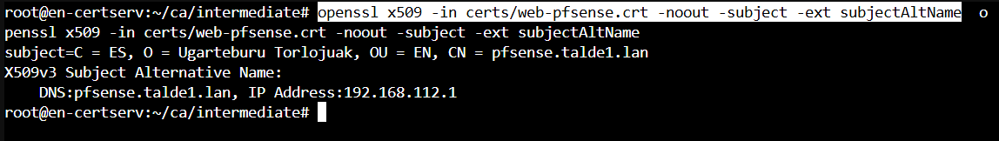

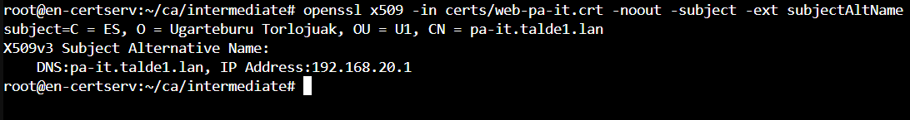

## 3. pfSense

Ziurtagiria eta gakoa *Cert Manager*-en inportatu dira, SISTEMAK-eko administrazio-ekipotik SSH bidez kopiatuta.

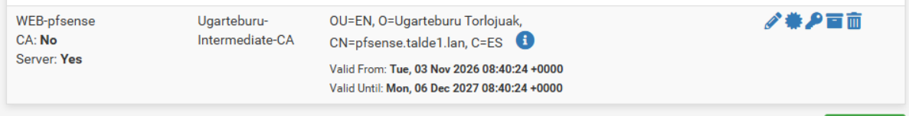

Hostname-a eta domeinua (`pfsense.talde1.lan`) ziurtagiriarekin bat datoz. Bestela pfSense-k izen bidezko sarbidea blokeatzen du (*DNS rebind* babesa).

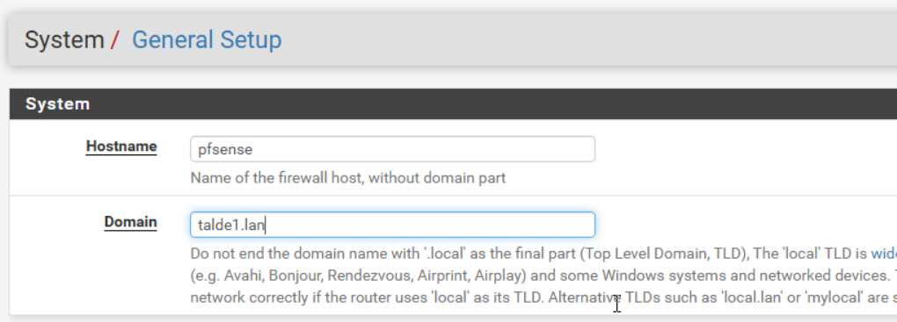

WebGUI-ak HTTPS eta `WEB-pfsense` ziurtagiria erabiltzen ditu.

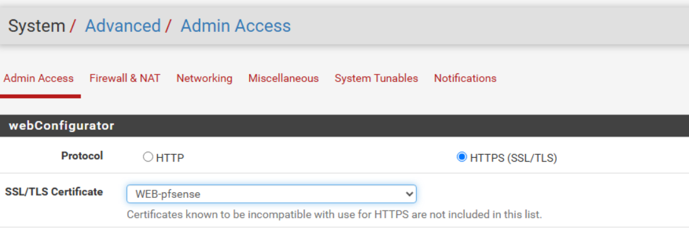

## 4. Root CA-ren banaketa GPO bidez

Nabigatzaileek ziurtagiriak onar ditzaten, domeinuko ekipo guztiek PKI-an konfiantza izan behar dute. `PKI-Ziurtagiriak` GPO-a domeinuari lotu zaio, eta bertan Root CA *Entidades de certificación raíz de confianza*-n eta Intermediate CA *Entidades de certificación intermedias*-en daude. Horrela segurtasun-politika modu zentralizatuan aplikatzen zaie domeinuko ekipo guztiei, bi egoitzetan.

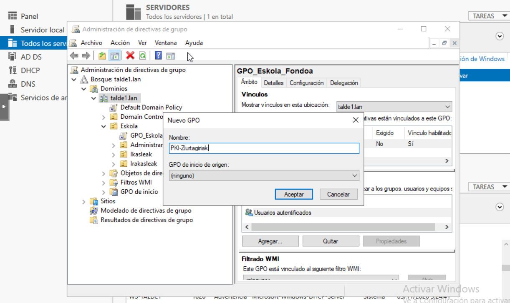

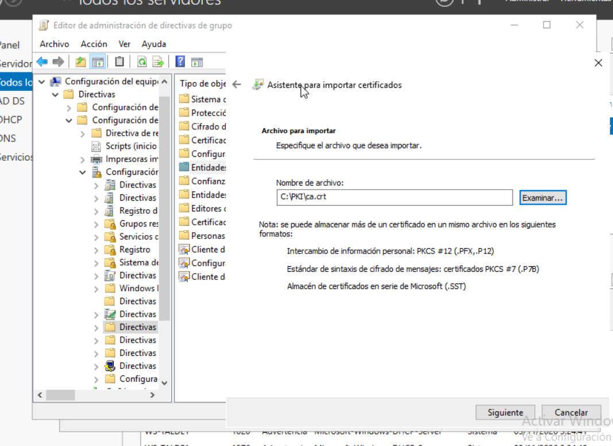

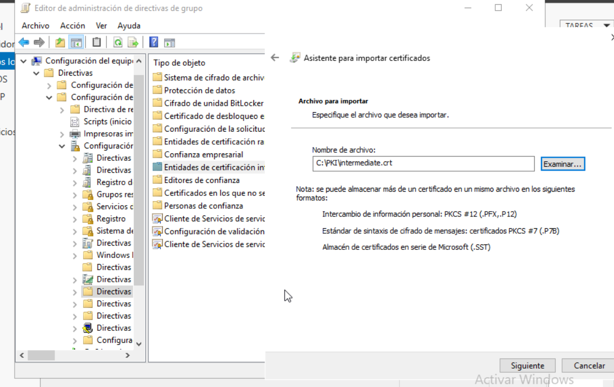

Emaitza: SISTEMAK-WIN-etik `https://pfsense.talde1.lan` abisurik gabe irekitzen da.

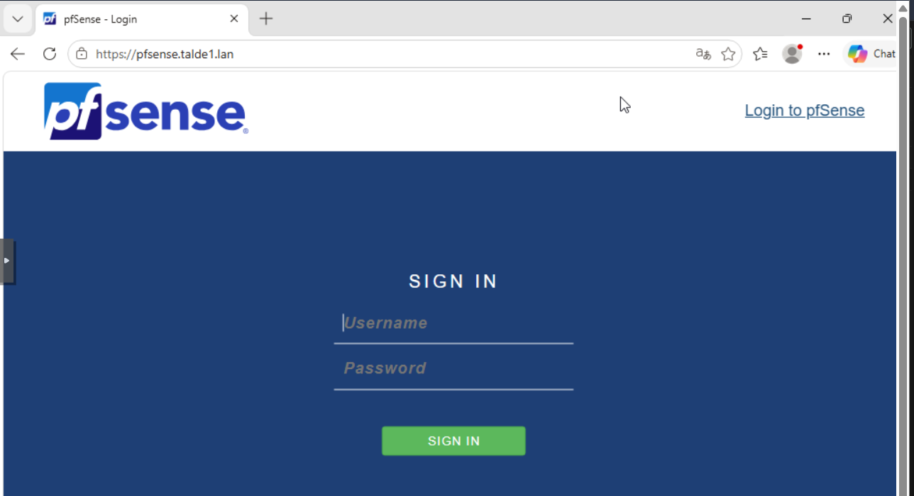

Firefox-ek bere ziurtagiri-biltegia erabiltzen du eta ez du GPO-ko Root CA-a ikusten. **Hobekuntza:** Firefox-en ADMX txantiloiekin *Importar raíces empresariales* politika gaitzea GPO berean.

## 5. PA-IT

Ziurtagiria gako zifratuarekin inportatu da (Palo Alto-k pasahitz gabeko gakorik ez du onartzen), eta gakoaren esportazioa blokeatuta dago.

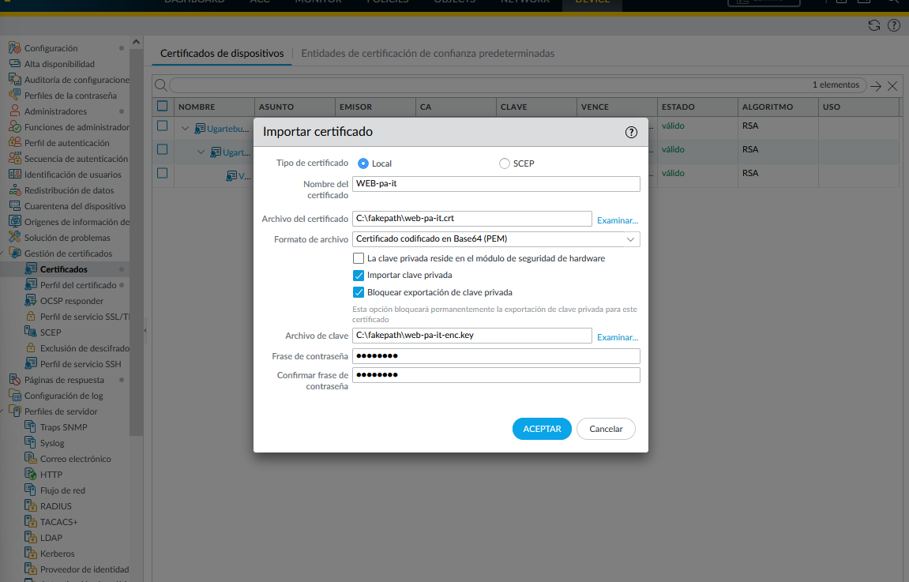

`WEB-pa-it-profile` SSL/TLS profilak ziurtagiria eta gutxieneko bertsioa (TLS 1.2) zehazten ditu, eta kudeaketa-ezarpenetan aplikatzen da.

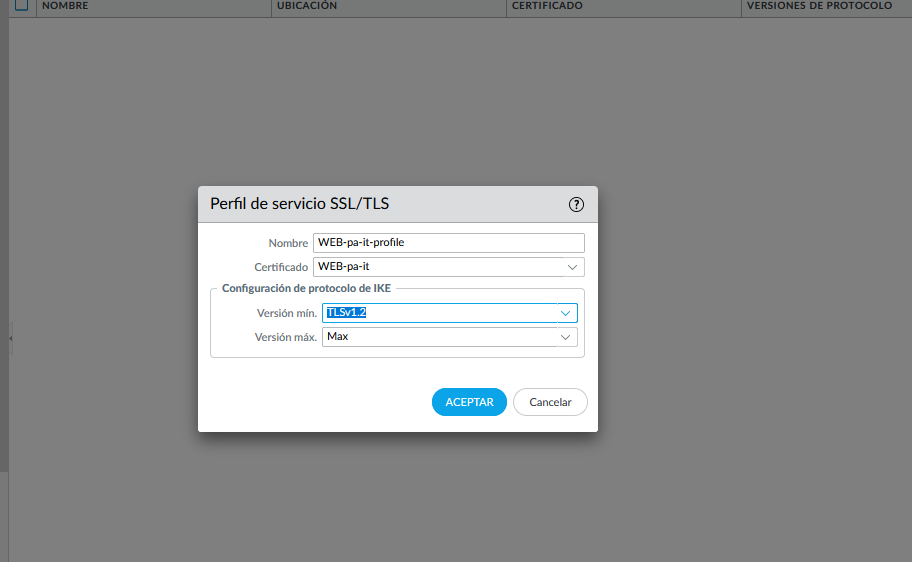

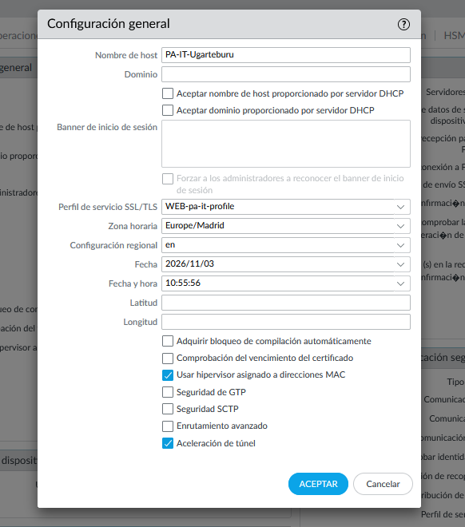

Commit-aren ondoren PA-k fabrikako ziurtagiri autosinatua erabiltzen jarraitu zuen; web zerbitzaria berrabiarazi arte (gailua berrabiaraziz) ez zuen ziurtagiri berria kargatu.

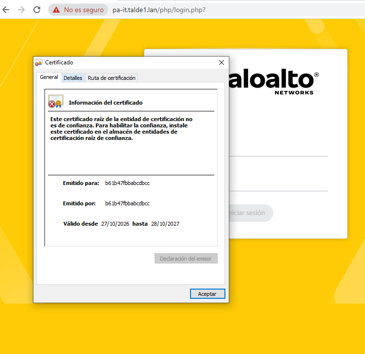

U1-admin domeinuan sartu ondoren (GPO-a U1-WS-tik jasotzen du), `https://pa-it.talde1.lan` abisurik gabe irekitzen da.

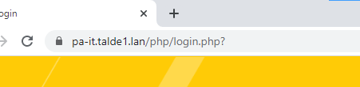

## 6. SSH: EN-CertServ

Administratzaileak gako bidez autentifikatzen dira (Ed25519, pasahitz-esaldiarekin). Gako publikoa `pki` erabiltzailearen `authorized_keys` fitxategian dago.

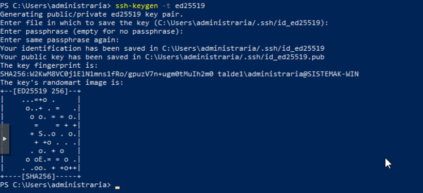

Lehen konexioan zerbitzariaren hatz-marka egiaztatu da: lehen abiaraztean sortutakoaren berdina da (`SHA256:kvjf7ul140…`), beraz benetako zerbitzaria da.

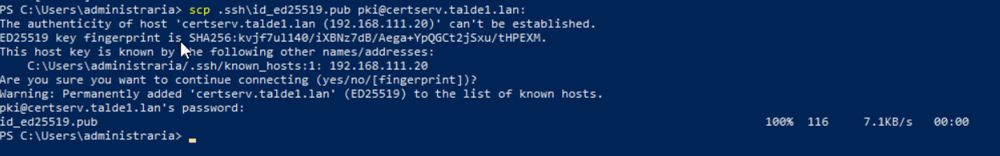

`sshd` zerbitzuaren gotortzea `/etc/ssh/sshd_config.d/10-gotortzea.conf` fitxategian:

| Aukera | Zertarako |
|---|---|
| `PermitRootLogin no` | root ezin da zuzenean sartu |
| `PasswordAuthentication no`, `KbdInteractiveAuthentication no` | gakoa bakarrik, pasahitzik ez |
| `AllowUsers pki@192.168.112.0/24 pki@192.168.20.10` | `pki` bakarrik, SISTEMAK-etik eta U1-eko administratzailetik |
| `MaxAuthTries 3`, `LoginGraceTime 30` | indar hutsezko erasoak mugatu |
| `X11Forwarding no` | behar ez den funtzionalitatea desgaitu |

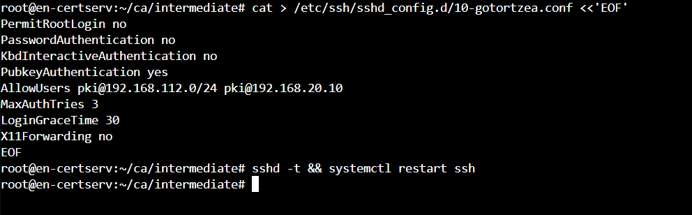

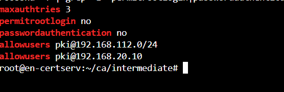

### Probak

Gakoarekin sartzen da (gakoaren pasahitz-esaldia eskatzen du):

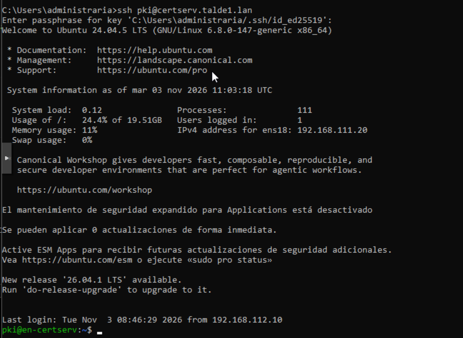

root-ek ezin du sartu:

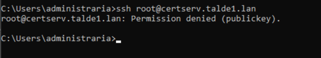

Pasahitzarekin ezin da sartu:

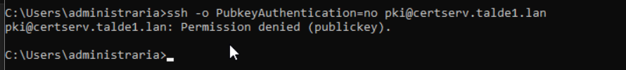

## 7. Egiteko

- MikroTik-a, PA-OT eta DMZ-ko zerbitzariak (2. zatia) prozedura berarekin.
- Taldekide bakoitzak bere SSH gakoa izatea.
- Firefox-en *Importar raíces empresariales* GPO bidez.
