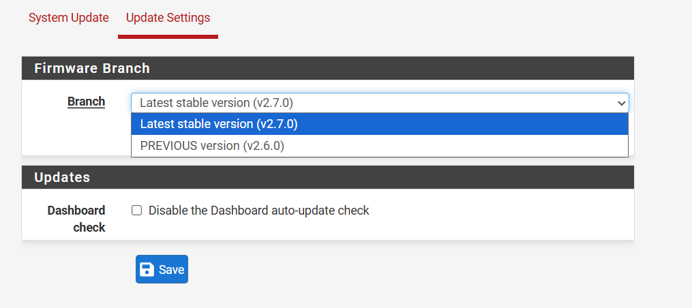
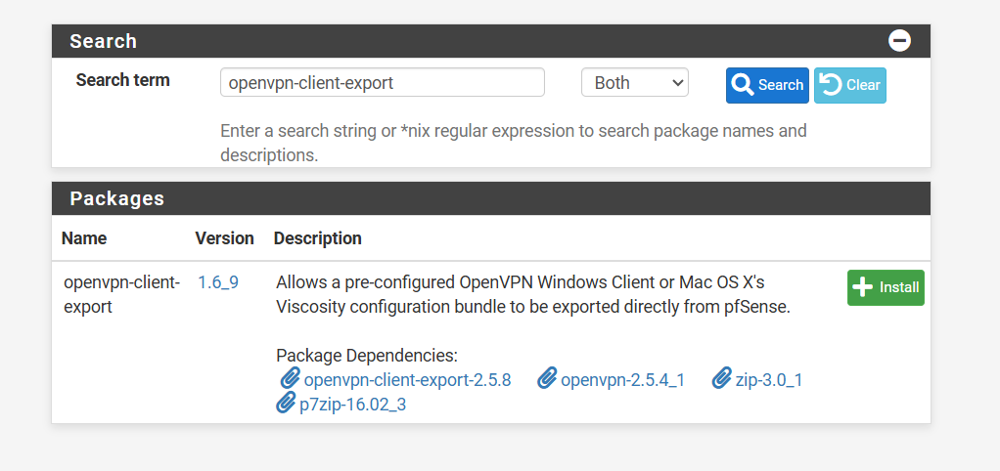
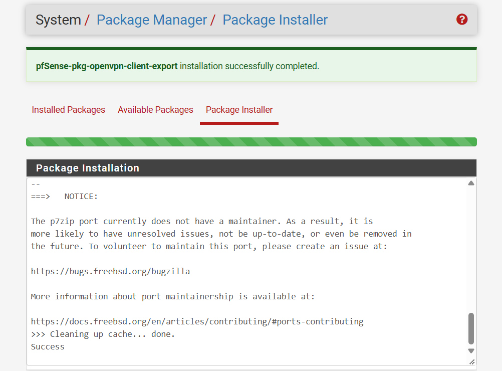
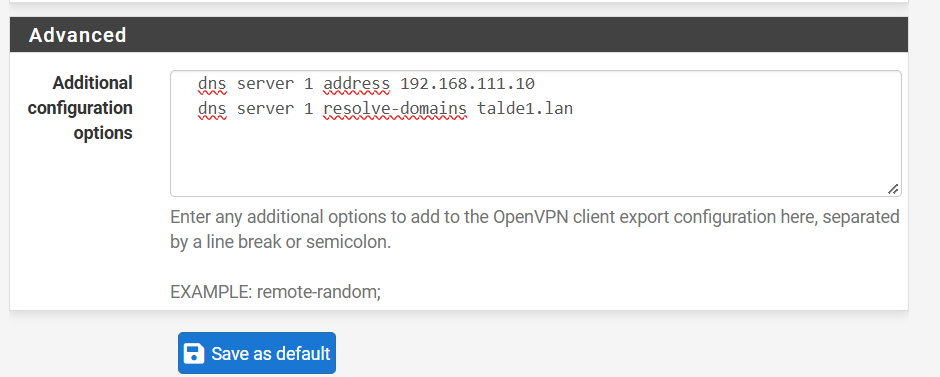
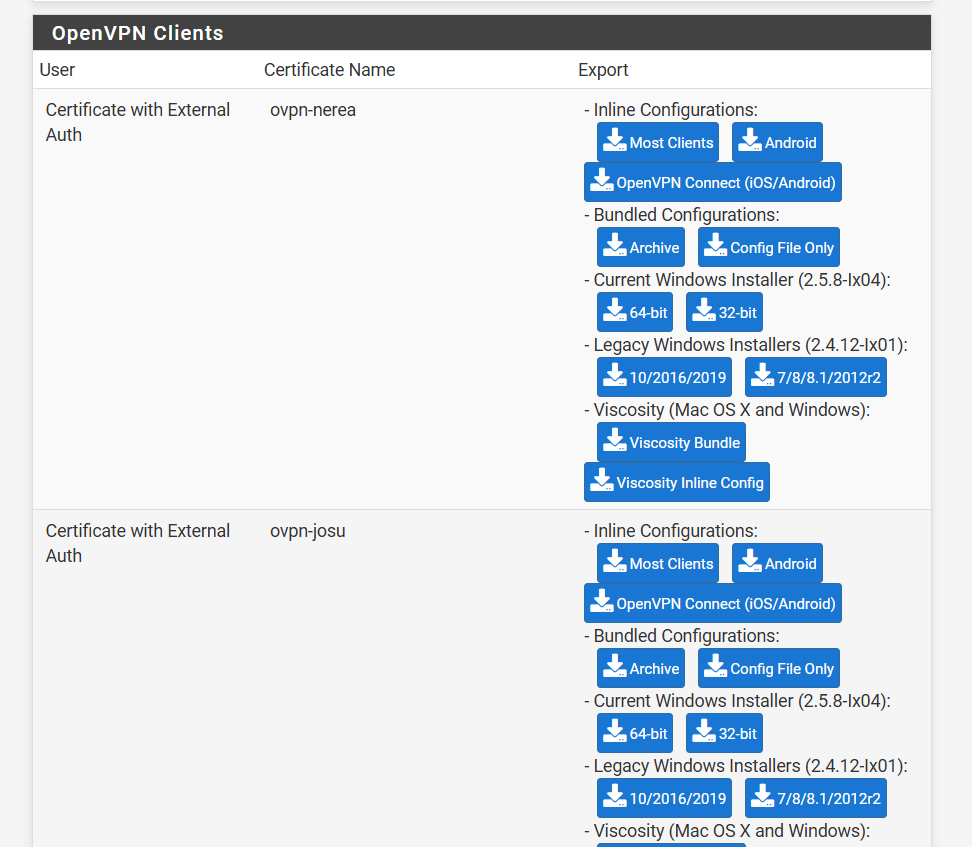

# EN – Urrutiko atzipena (OpenVPN)

Taldeko administratzaileek (nerea, josu eta iker) kanpotik EN-ko sarera konektatu behar dute. Horretarako OpenVPN zerbitzari bat dago pfSense-n.

Autentifikazioa bikoitza da:

1. **Ziurtagiria:** erabiltzaile bakoitzak bere bezero-ziurtagiria du, enpresako PKI-ak sinatuta (ikus [PKI dokumentazioa](../pki/README.md)).
2. **Erabiltzailea eta pasahitza:** Active Directory-n egiaztatzen dira. `VPN-Erabiltzaileak` taldeko kideak bakarrik sar daitezke.

Gainera, pfSense-k egiaztatzen du ziurtagiriaren CN-a eta erabiltzaile-izena berdinak direla. Horrela, norbaitek ziurtagiri bat lapurtzen badu, ezin du erabili jabearen pasahitzik gabe. Eta beste erabiltzaile baten pasahitzarekin ere ezin du.

| Parametroa | Balioa |
|---|---|
| Zerbitzaria | pfSense WAN, `192.168.74.1`, UDP 1194 |
| Modua | Remote Access (SSL/TLS + User Auth), tun |
| Tunel-sarea | `192.168.114.0/24` |
| Zifratzea | AES-256-GCM, SHA256, ECDH |
| Kontrol-kanala | tls-crypt (TLS Encryption and Authentication) |
| Sare eskuragarriak | `192.168.110-113.0/24`, DMZ `192.168.50.0/24` (split tunnel) |
| DNS | `192.168.111.10`, `talde1.lan` domeinuarentzat bakarrik |

## 1. Active Directory

`Ugarteburu` OU-an hauek sortu ditugu:

- Hiru erabiltzaileak.
- `VPN-Erabiltzaileak` segurtasun-talde globala.
- `svc-pfsense` zerbitzu-kontua (pasahitza ez da iraungitzen). Kontu honi esker pfSense-k AD-n bilaketak egin ditzake, administratzaile-kontua erabili gabe.


## 2. Ziurtagiriak

Zerbitzariaren ziurtagiriak `serverAuth` bakarrik du. Bezeroenak `clientAuth` bakarrik dute. Horrela bezero-ziurtagiri batekin ezin da zerbitzariaren itxura egin. Bezero-ziurtagirien CN-a erabiltzaile-izena da.

| Ziurtagiria | CN | EKU | Iraupena |
|---|---|---|---|
| `ovpn-server` | `openvpn.talde1.lan` (SAN: IP `192.168.74.1`) | serverAuth | 825 egun |
| `ovpn-nerea` / `ovpn-josu` / `ovpn-iker` | `nerea` / `josu` / `iker` | clientAuth | 365 egun |


Ziurtagiriak pfSense-ra eramateko pauso hauek egin ditugu:

1. Ziurtagiria eta gakoa PKCS#12 fitxategi batean batu (pasahitzarekin babestuta).
2. Fitxategia SISTEMAK-WIN-era kopiatu, `scp` bidez.
3. *Cert Manager*-en inportatu.
4. Fitxategiak bi aldeetan ezabatu.

```bash
openssl pkcs12 -export -inkey private/ovpn-$c.key -in certs/ovpn-$c.crt \
  -name ovpn-$c -out /home/pki/ovpn/ovpn-$c.p12 -passout env:P
```


## 3. LDAP autentifikazio-zerbitzaria

*System › User Manager › Authentication Servers*: `AD-talde1` sortu dugu, WS-TALDE1 zerbitzariaren kontra (`192.168.111.10:389`).

Bilaketa `OU=Ugarteburu` barruan egiten da. *Extended query* honekin taldeko kideak bakarrik onartzen dira:

```
memberOf=CN=VPN-Erabiltzaileak,OU=Ugarteburu,DC=talde1,DC=lan
```


Proba (*Diagnostics › Authentication*): `nerea` ondo sartzen da. Taldean ez dagoen erabiltzaile batek huts egiten du.


## 4. OpenVPN zerbitzaria


Aukera kriptografikoak:

- **TLS Key (tls-crypt):** kontrol-kanala zifratu eta autentifikatzen du. Gakoa ez duenaren paketeak erantzunik gabe baztertzen dira. Horrela portua irekita egon arren, zerbitzua ez da ikusten. Eskaneatzeen eta DoS erasoen aurka babesten du.
- **Peer Certificate Authority:** Intermediate CA.
- **Certificate Depth: Two:** katean Intermediate CA dagoelako.
- **Strict User-CN Matching:** ziurtagiriaren CN-a eta erabiltzailea berdinak izan behar dira.
- **Client Certificate Key Usage Validation:** `clientAuth` EKU-a duten ziurtagiriak bakarrik onartzen dira.


Tunelaren ezarpenak:

- *Split tunnel*: Internet trafikoa ez da VPN-tik pasatzen.
- Gehienez 3 konexio.
- Konpresioa ukatuta (VORACLE motako erasoen aurka).
- Bezeroak ezin dira elkarren artean komunikatu.
- Erabiltzaile bakoitzak saio bakarra izan dezake.


Bezeroei DNS zerbitzaria (AD) eta `talde1.lan` domeinua bidaltzen zaizkie. Horrela gailuak izenarekin (FQDN) administra daitezke.


## 5. Firewall arauak

**WAN:** UDP 1194 portua irekita dago klaseko saretik (`192.168.74.0/24`, gure "Internet"-a) WAN helbidera.


**OpenVPN fitxa:** konektatutako administratzaileek SISTEMAK sarearen sarbide bera dute.


EN-CertServ-eko SSH-an VPN sarea gehitu dugu `AllowUsers` aukeran:


## 6. Bezero-fitxategiak

`openvpn-client-export` paketea instalatzean errore bat agertu zen. Arrazoia hau zen: pfSense-k 2.7.0 bertsioaren pakete-biltegia erabiltzen zuen, eta han paketeak PHP bertsio berriago baterako daude.

pfSense eguneratu gabe konpontzeko, eguneraketa-adarra **PREVIOUS version (v2.6.0)** jarri dugu (*System › Update › Update Settings*). Horrela instalatutako bertsioaren biltegia erabiltzen du. Sistema ez dugu eguneratu. Aldaketa egin aurretik konfigurazioaren babeskopia (XML) atera genuen.







*VPN › OpenVPN › Client Export* atalean hau konfiguratu dugu:

- WAN interfazearen IP-a.
- `verify-x509-name` automatikoa.
- DNS zatitua egiteko bi aukera gehigarri:

```
dns server 1 address 192.168.111.10
dns server 1 resolve-domains talde1.lan
```

`dns` aukerak Windows-en NRPT arau bat sortzen du. Horrela `*.talde1.lan` izenak bakarrik bidaltzen dira AD-ra.

Aukera honek OpenVPN 2.6 edo berriagoa behar du bezeroan. Horregatik *Most Clients* fitxategia (inline `.ovpn`) erabiltzen dugu, OpenVPN Community 2.6+ bezeroarekin. Paketeak dakarren 2.5.8 instalatzailea ez dugu erabiltzen.



Bezero bakoitza bere ziurtagiriarekin agertzen da (*Certificate with External Auth*, erabiltzailea AD-n dagoelako). Fitxategi bakoitzean jabearen gako pribatua dago. Horregatik modu pribatuan banatzen da, eta ez da GitHub-era igotzen.



Paketea instalatu aurretik, fitxategiak eskuz sortu genituen EN-CertServ-en. Paketeak egiten duen gauza bera egin genuen: CA katea, bezero-ziurtagiria, gakoa eta `tls-crypt` gakoa `.ovpn` fitxategi bakarrean. 7. ataleko proba fitxategi horrekin egin genuen. Paketea instalatu ondoren eskuzko fitxategiak ezabatu ditugu.

## 7. Probak

Klaseko sareko (`192.168.74.0/24`) PC batetik konektatu gara, OpenVPN GUI erabiliz eta `nerea` erabiltzailearekin:


`nslookup`-ek beti adaptadore nagusiaren DNS-a erabiltzen du (Google). Hala ere, AD-ren DNS-ak tuneletik erantzuten du:


DNS zatituari esker, Windows-ek `talde1.lan` izenak AD-ra bidaltzen ditu:


pfSense-ren WebGUI-a VPN-tik eta izenarekin (FQDN) administratzen da (`admin@192.168.114.2`). PC hau ez dago domeinuan. Horregatik Root CA eskuz inportatu dugu erabiltzailearen biltegian (`certutil -user -addstore Root ca.crt`). Domeinuko ekipoek GPO bidez jasotzen dute.


Zerbitzariaren egoera (konexiorik gabe):


### 7.1 Linux bezeroa (josu)

`josu` erabiltzailea Linux batetik konektatu da (Parrot OS, OpenVPN 2.6.14), pfSense-tik esportatutako fitxategiarekin:

```bash
sudo apt install openvpn
sudo openvpn --config pfsense-UDP4-1194-josu-config.ovpn
```

Linux-en `dns` aukerak ez du DNS-a automatikoki konfiguratzen. Horregatik DNS zatitua `systemd-resolved`-ekin jartzen dugu, konektatu ondoren:

```bash
sudo resolvectl dns tun0 192.168.111.10
sudo resolvectl domain tun0 '~talde1.lan'
```

Emaitza: bezeroak `192.168.114.3` IP-a jaso du, eta barne-sareetara (`192.168.111.20`) eta pfSense-ren WebGUI-ra sar daiteke.

**Arazo bat eta konponbidea:**

Lehen saiakeran bezeroak IP-a jaso zuen eta `192.168.114.1` helbideak erantzuten zuen. Baina ez zen barne-sareetara iristen. pfSense-ko pakete-harrapaketan ez zen ezer agertzen. Log-ean ikusi genuen arrazoia:

```
TUN/TAP device tun1 opened
sitnl_send: rtnl: generic error (-17): File exists   (x5)
```

Zer gertatu zen:

1. NetworkManager-ekin lehenago egindako konexio bat (`tun0`) oraindik aktibo zegoen.
2. Konexio berriak `tun1` sortu zuen.
3. Bost ibilbideak ezin izan ziren gehitu, jada `tun0`-ra zuzenduta zeudelako.
4. pfSense-k konexio zaharra moztu zuen, erabiltzaile bakoitzak saio bakarra izan dezakeelako.
5. Ondorioz, trafikoa jada ez zebilen tunel batera zihoan.

Konponbidea: OpenVPN eta NetworkManager-eko VPN guztiak itxi (`sudo killall openvpn`, `nmcli connection down …`), `tun` interfazerik ez dagoela egiaztatu, eta berriro konektatu.

**Ziurtagiriak:** ekipo hau ez dago domeinuan. Horregatik Root eta Intermediate CA-ak `.ovpn` fitxategiko `<ca>` blokeetik atera eta sisteman instalatu ditugu. Firefox-en eskuz inportatu behar dira, bere biltegi propioa erabiltzen duelako.

```bash
sed -n '/<ca>/,/<\/ca>/p' pfsense-UDP4-1194-josu-config.ovpn | grep -v 'ca>' > ugarteburu-ca.crt
sudo cp ugarteburu-ca.crt /usr/local/share/ca-certificates/
sudo update-ca-certificates
```

## 8. Egiteko / hobekuntzak

- iker erabiltzailearekin proba egin, eta hiru konexioak batera erakutsi (*Status › OpenVPN*).
- LDAP-tik LDAPS-era pasatu (DC-arentzat PKI-ko ziurtagiri bat sortuz).
- CRL-a argitaratu eta OpenVPN-en gaitu, ziurtagiriak errebokatu ahal izateko.
- Proban zehar, Nerearen gako pribatua eta tls-crypt gakoa txat batean partekatu ziren. Benetako enpresa batean, ziurtagiri hori errebokatu eta tls-crypt gakoa berritu beharko litzateke.
