# EN – Urrutiko atzipena (OpenVPN)

Ugarteburu Torlojuak · 2. Erronka

Taldeko administratzaileak (nerea, josu, iker) kanpotik EN-ko sarera konekta daitezen, OpenVPN zerbitzari bat dago pfSense-n. Autentifikazioa bikoitza da:

1. **Ziurtagiria:** erabiltzaile bakoitzak bere bezero-ziurtagiria du, enpresako PKI-ak sinatuta (ikus [PKI dokumentazioa](../pki/README.md)).
2. **Erabiltzailea eta pasahitza:** Active Directory-ren kontra egiaztatzen dira, `VPN-Erabiltzaileak` taldeko kideek bakarrik sar daitezke.

Gainera, pfSense-k egiaztatzen du ziurtagiriaren CN-a eta erabiltzaile-izena berdinak direla: ziurtagiri bat lapurtuta ere, jabearen pasahitzik gabe ezin da erabili, eta beste baten pasahitzarekin ere ez.

| Parametroa | Balioa |
|---|---|
| Zerbitzaria | pfSense WAN, `192.168.74.1`, UDP 1194 |
| Modua | Remote Access (SSL/TLS + User Auth), tun |
| Tunel-sarea | `192.168.114.0/24` |
| Zifratzea | AES-256-GCM, SHA256, ECDH |
| Kontrol-kanala | tls-crypt (TLS Encryption and Authentication) |
| Sare eskuragarriak | `192.168.110-113.0/24`, DMZ `192.168.50.0/24` (split tunnel) |
| DNS | `192.168.111.10`, `talde1.lan` domeinuarentzat bakarrik |

## 1. Active Directory

`Ugarteburu` OU-an sortu dira hiru erabiltzaileak, `VPN-Erabiltzaileak` segurtasun-talde globala eta `svc-pfsense` zerbitzu-kontua (pasahitza ez da iraungitzen). Zerbitzu-kontu horrek pfSense-ri AD-n bilaketak egiteko balio du, administratzaile-kontua erabili gabe.

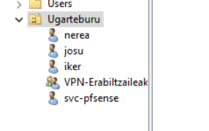

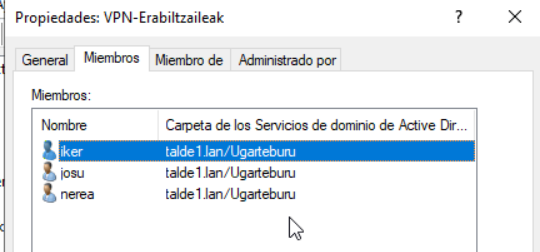

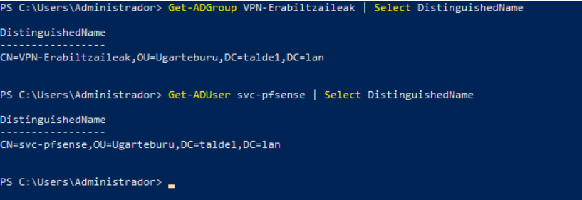

## 2. Ziurtagiriak

Zerbitzariaren ziurtagiriak `serverAuth` bakarrik du, eta bezeroenak `clientAuth` bakarrik. Horrela bezero-ziurtagiri batekin ezin da zerbitzaria ordezkatu. Bezero-ziurtagirien CN-a erabiltzaile-izena da.

| Ziurtagiria | CN | EKU | Iraupena |
|---|---|---|---|
| `ovpn-server` | `openvpn.talde1.lan` (SAN: IP `192.168.74.1`) | serverAuth | 825 egun |
| `ovpn-nerea` / `ovpn-josu` / `ovpn-iker` | `nerea` / `josu` / `iker` | clientAuth | 365 egun |

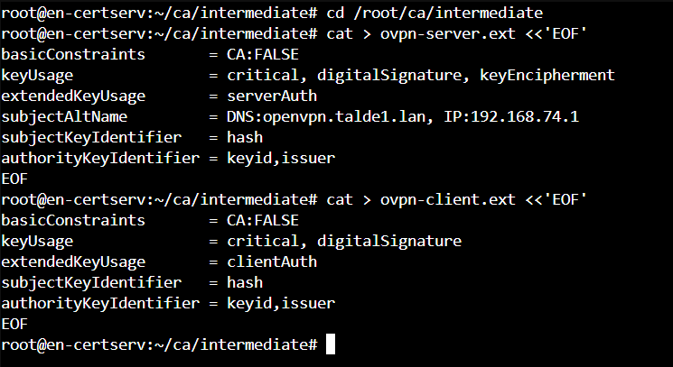

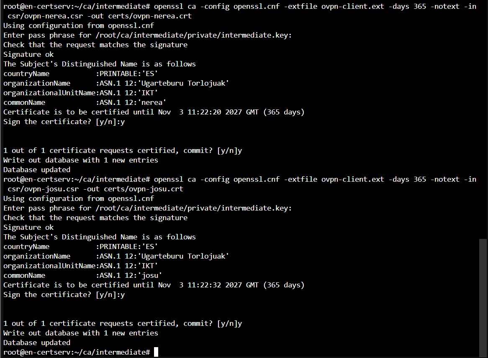

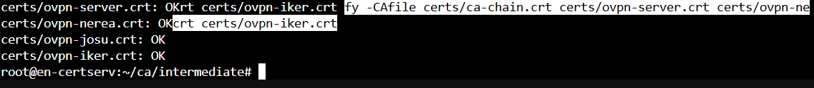

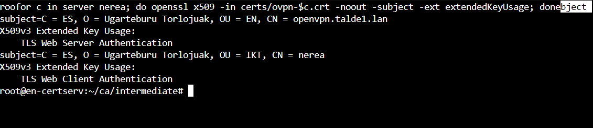

pfSense-ra eramateko, ziurtagiria eta gakoa PKCS#12 fitxategi batean bildu dira (pasahitzarekin babestuta), SISTEMAK-WIN-era `scp` bidez kopiatu eta *Cert Manager*-en inportatu. Gero fitxategiak ezabatu ziren bi aldeetan.

```bash
openssl pkcs12 -export -inkey private/ovpn-$c.key -in certs/ovpn-$c.crt \
  -name ovpn-$c -out /home/pki/ovpn/ovpn-$c.p12 -passout env:P
```

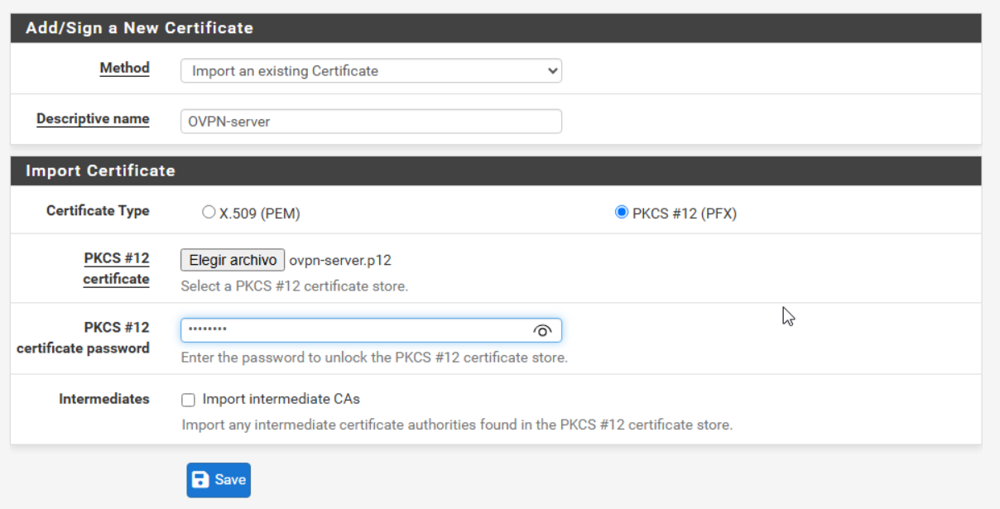

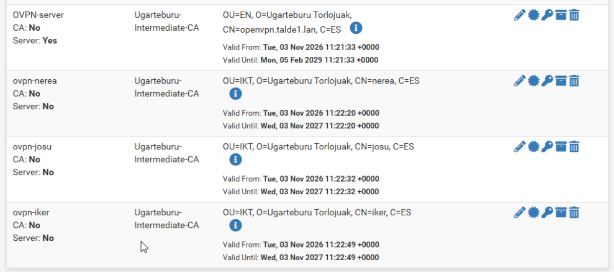

## 3. LDAP autentifikazio-zerbitzaria

*System › User Manager › Authentication Servers*: `AD-talde1`, WS-TALDE1-en kontra (`192.168.111.10:389`). Bilaketa `OU=Ugarteburu` edukiontzian egiten da, eta *Extended query*-ak taldeko kideak bakarrik onartzen ditu:

```
memberOf=CN=VPN-Erabiltzaileak,OU=Ugarteburu,DC=talde1,DC=lan
```

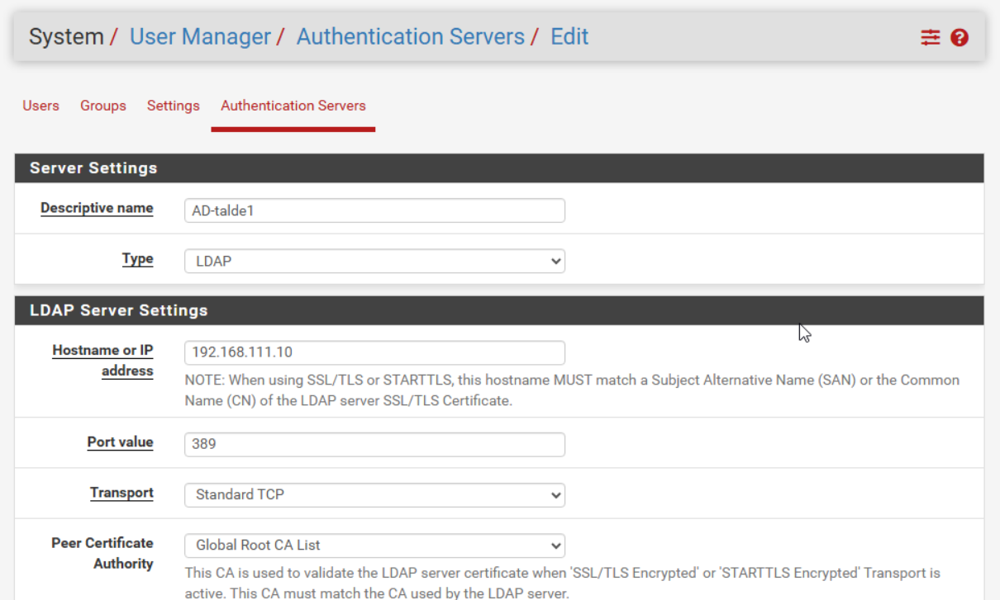

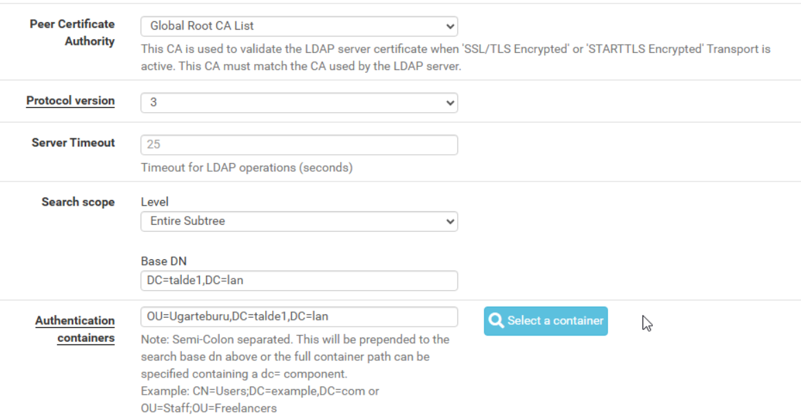

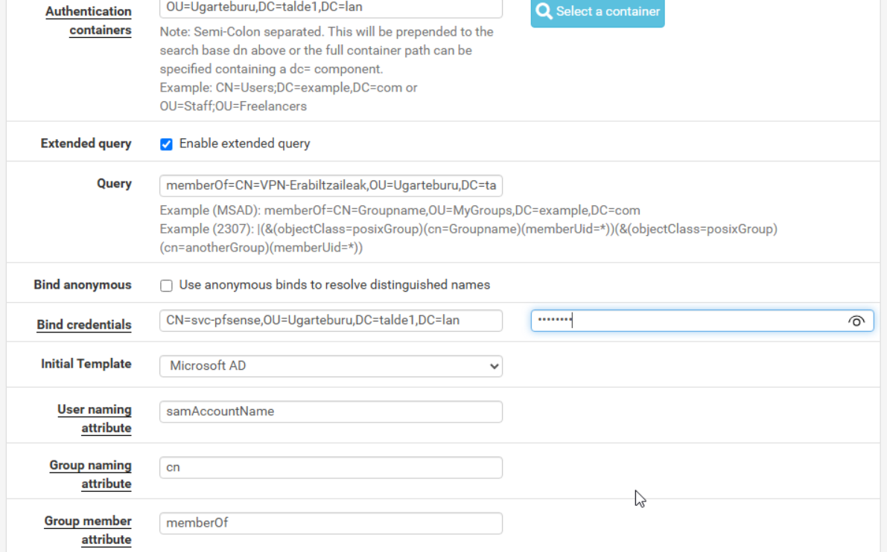

Proba (*Diagnostics › Authentication*): `nerea` autentifikatzen da; taldetik kanpoko erabiltzaile batek huts egiten du.

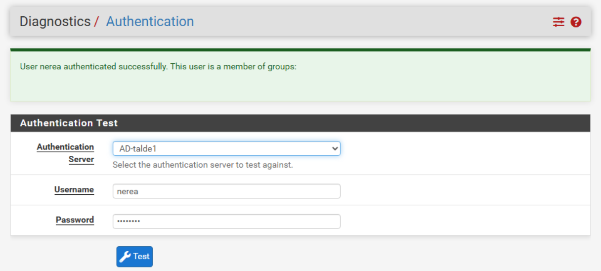

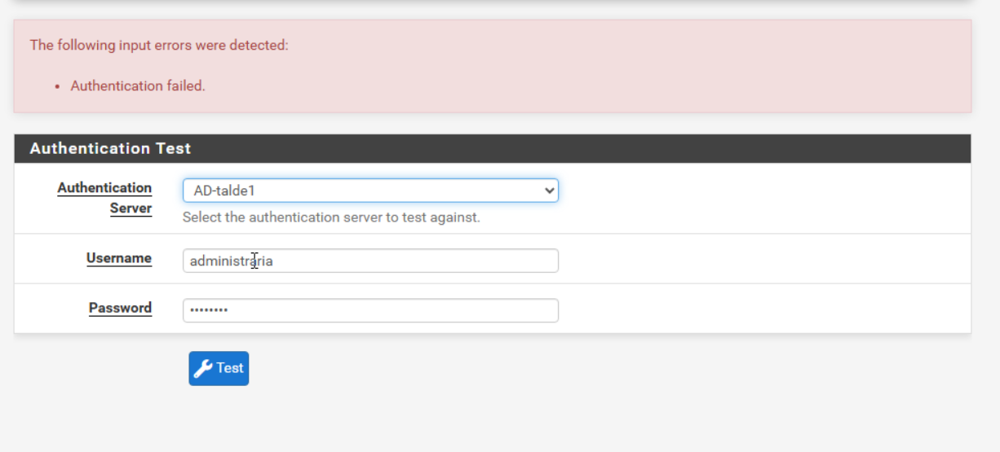

## 4. OpenVPN zerbitzaria

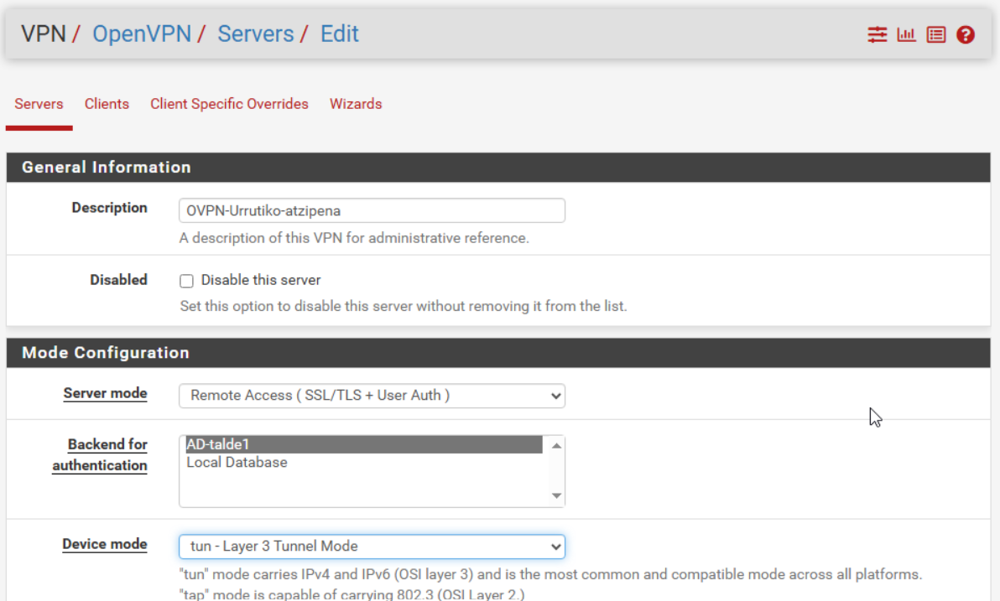

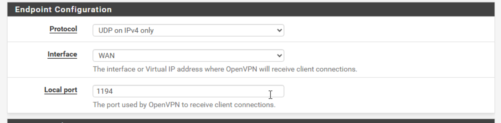

Aukera kriptografikoak:

- **TLS Key (tls-crypt):** kontrol-kanala zifratu eta autentifikatzen du. Gakoa ez duen edonoren paketeak erantzunik gabe baztertzen dira, beraz portua irekita egonda ere zerbitzua ez da ikusten (eskaneatzeen eta DoS-en aurka).
- **Peer Certificate Authority:** Intermediate CA.
- **Certificate Depth: Two:** katean Intermediate CA dago.
- **Strict User-CN Matching:** ziurtagiriaren CN-a = erabiltzailea.
- **Client Certificate Key Usage Validation:** `clientAuth` EKU-a duten ziurtagiriak bakarrik.

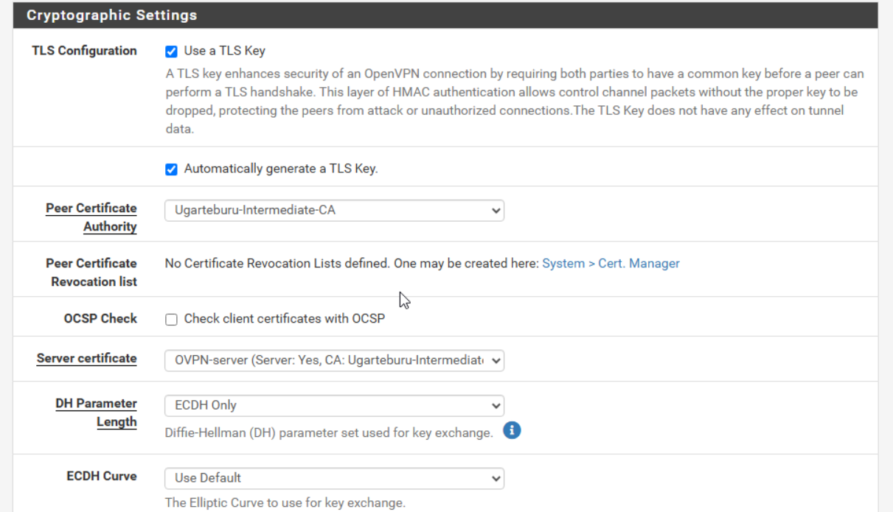

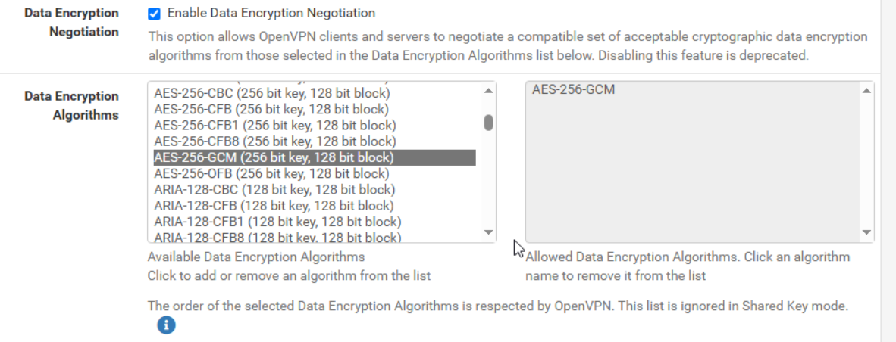

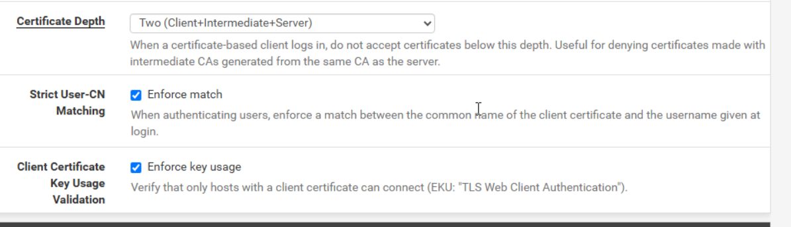

Tunelaren ezarpenak: *split tunnel* (Internet trafikoa ez da VPN-tik pasatzen), gehienez 3 konexio, konpresioa ukatuta (VORACLE motako erasoen aurka), bezeroen arteko komunikaziorik ez eta erabiltzaile bakoitzeko saio bakarra.

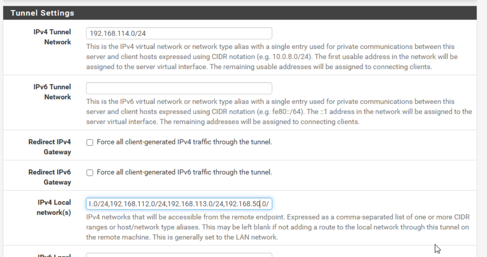

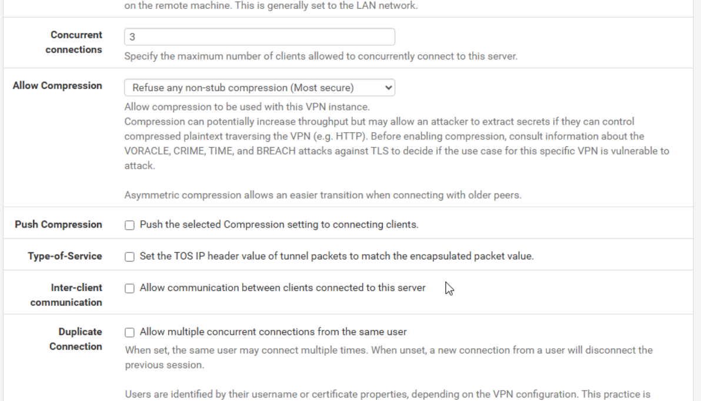

Bezeroei DNS zerbitzaria (AD) eta `talde1.lan` domeinua bidaltzen zaizkie, FQDN bidez administratu ahal izateko.

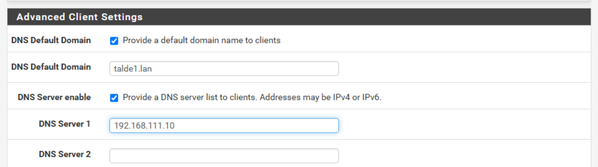

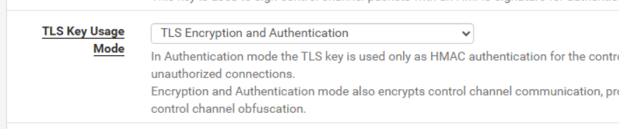

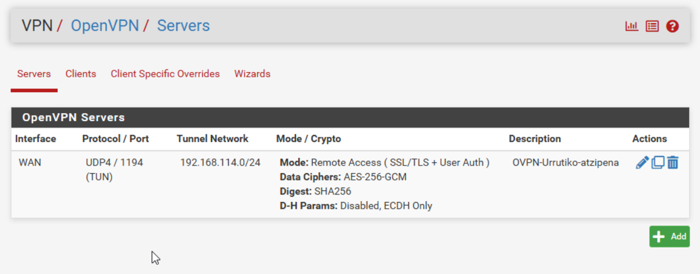

## 5. Firewall arauak

**WAN:** UDP 1194 klaseko saretik (`192.168.74.0/24`, gure "Internet"-a) WAN helbidera.

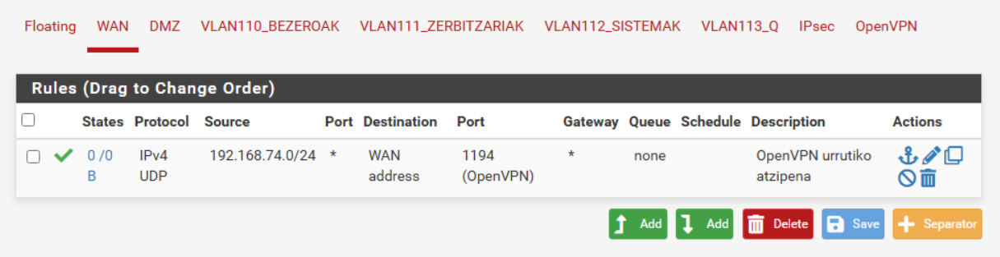

**OpenVPN fitxa:** konektatutako administratzaileek SISTEMAK-ek duen sarbide bera dute.

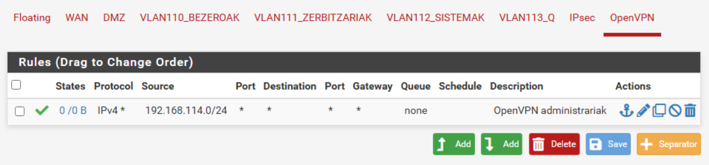

EN-CertServ-eko SSH-an VPN sarea gehitu da `AllowUsers`-en:

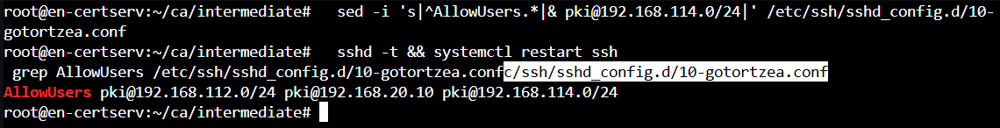

## 6. Bezero-fitxategiak

pfSense 2.6.0 bertsioan `openvpn-client-export` paketea ezin da instalatu (pakete-biltegiak pfSense eguneratzea eskatzen du). pfSense eguneratu beharrean, `.ovpn` fitxategiak eskuz sortu dira EN-CertServ-en, pakete horrek egiten duena bera eginez:

```bash
for u in nerea josu iker; do
{
cat <<'EOF'
client
dev tun
proto udp4
remote 192.168.74.1 1194
resolv-retry infinite
nobind
persist-key
persist-tun
remote-cert-tls server
verify-x509-name "openvpn.talde1.lan" name
data-ciphers AES-256-GCM
auth SHA256
auth-user-pass
dns server 1 address 192.168.111.10
dns server 1 resolve-domains talde1.lan
verb 3
EOF
echo "<ca>"; cat certs/ca-chain.crt; echo "</ca>"
echo "<cert>"; openssl x509 -in certs/ovpn-$u.crt; echo "</cert>"
echo "<key>"; cat private/ovpn-$u.key; echo "</key>"
echo "<tls-crypt>"; cat /home/pki/ta.key; echo "</tls-crypt>"
} > /home/pki/ovpn/$u.ovpn
done
```

- `remote-cert-tls server` eta `verify-x509-name`: bezeroak zerbitzari-ziurtagiri bat eta `openvpn.talde1.lan` izena eskatzen ditu (MITM-aren aurka).
- `dns server … resolve-domains talde1.lan`: DNS zatitua. Windows-en NRPT arau bat sortzen da, `*.talde1.lan` bakarrik AD-ra bidaltzeko; gainerako izenak ohiko DNS-ari.
- Fitxategi bakoitzak jabearen gako pribatua dauka, beraz modu pribatuan banatzen da eta ez da GitHub-era igotzen.

`tls-crypt` gakoa pfSense-tik SISTEMAK-WIN-era kopiatu eta `scp` bidez igo zen EN-CertServ-era; fitxategiak sortu ondoren ezabatu zen.

## 7. Probak

Klaseko saretik (`192.168.74.0/24`) dagoen PC batetik, OpenVPN GUI-rekin, `nerea` erabiltzailearekin:

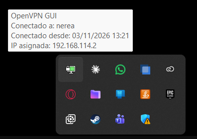

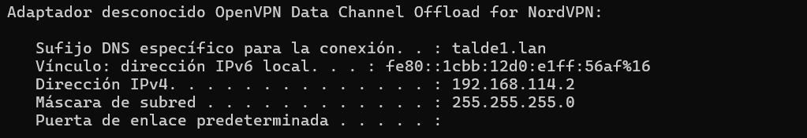

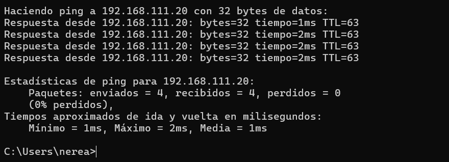

`nslookup`-ek beti adaptadore nagusiaren DNS-a erabiltzen du (Google), baina AD-ren DNS-a tuneletik erantzuten du:

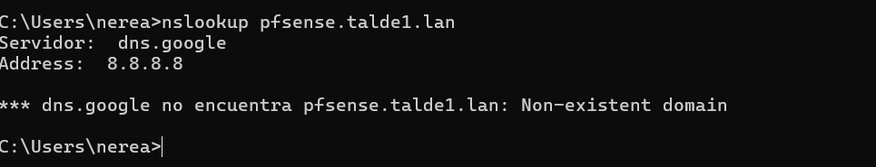

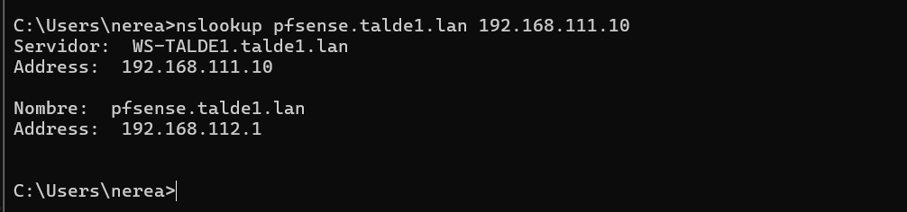

DNS zatituarekin Windows-en ebazlea `talde1.lan` AD-ra bidaltzen du:

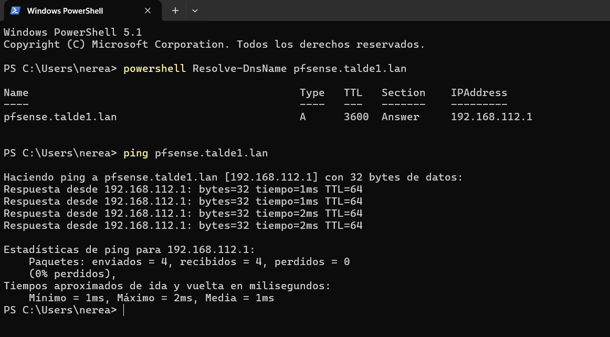

pfSense-ren WebGUI-a FQDN bidez VPN-tik administratzen da (`admin@192.168.114.2`). PC hau domeinutik kanpo dagoenez, Root CA eskuz inportatu da erabiltzailearen biltegian (`certutil -user -addstore Root ca.crt`); domeinuko ekipoek GPO bidez jasotzen dute.

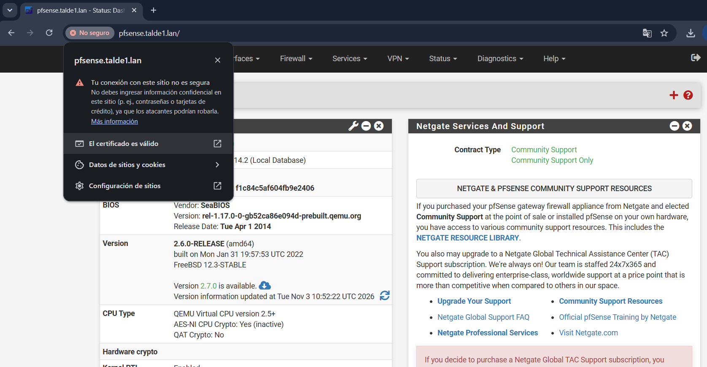

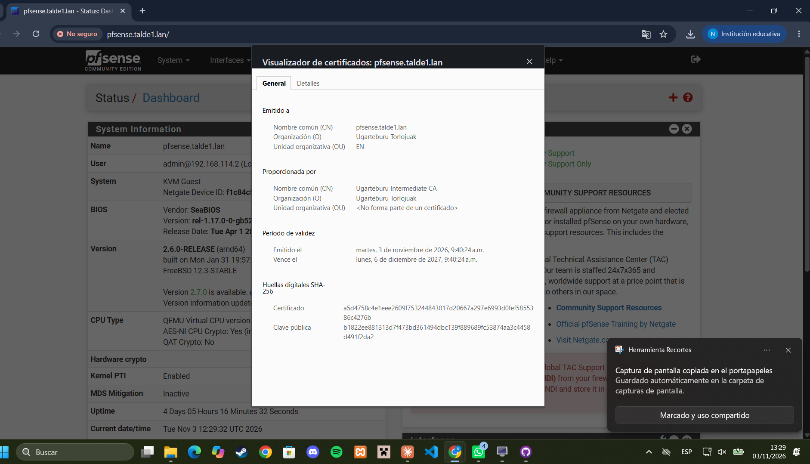

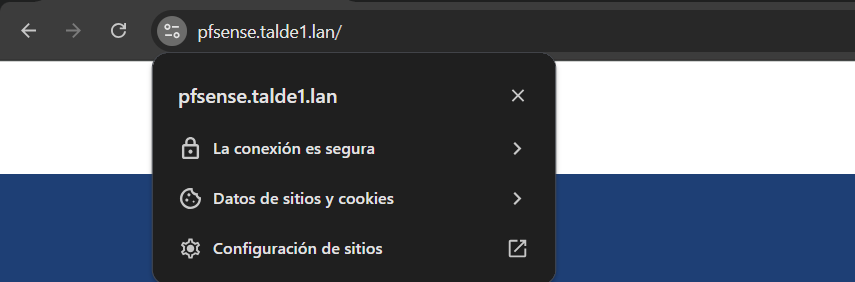

Zerbitzariaren egoera (konexiorik gabe):

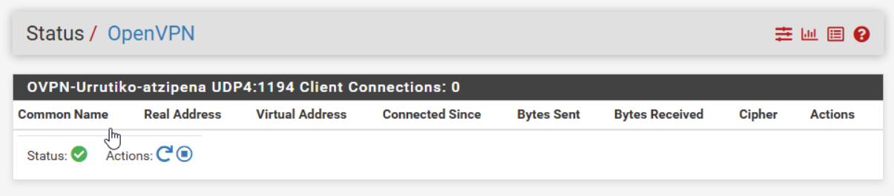

## 8. Egiteko / hobekuntzak

- josu eta iker erabiltzaileekin proba egin eta hiru konexioak batera erakutsi.
- LDAP-a LDAPS-era pasa (DC-arentzat PKI-ko ziurtagiria).
- CRL-a argitaratu eta OpenVPN-en gaitu, ziurtagiriak errebokatu ahal izateko.
- Nerearen gako pribatua eta tls-crypt gakoa txat batean partekatu ziren proban zehar; ingurune erreal batean ziurtagiria errebokatu eta tls-crypt gakoa berritu beharko litzateke.
