# EN – pfSense konfigurazioa

## 1. Makina birtuala (Proxmox)

pfSense makina birtualak (VM 104) hiru sare-txartel ditu Proxmox-en:

- `vtnet0` → vmbr0: klaseko sarea (WAN).
- `vtnet1` → vmbr1: EN-DMZIT. Ez du portu fisikorik.
- `vtnet2` → vmbr2: MikroTik-erako trunk-a, tag gabe.

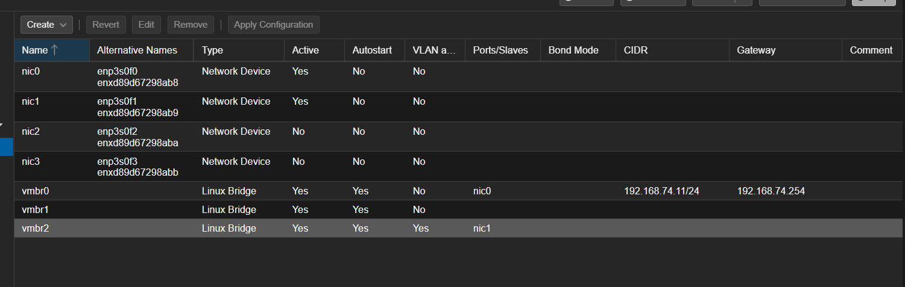

## 2. VLANak

LAN aldeko lau VLANak `vtnet2`-ren gainean sortu ditugu: 110 BEZEROAK, 111 ZERBITZARIAK, 112 SISTEMAK eta 113 Q.

VLAN bakoitzaren azpisareak VLAN zenbaki bera du. Adibidez: `192.168.110.0/24`, `192.168.111.0/24`…

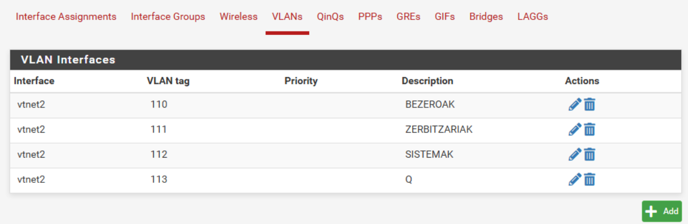

## 3. Interfazeak

- WAN: `192.168.74.1/24` IP-a, `192.168.74.254` gateway-arekin.
- DMZ: `192.168.50.1/24`.
- VLAN bakoitzean pfSense `.1` helbidea da, sare horren gateway-a.

`vtnet2` ez dago interfaze gisa esleituta. Horrela trunk-etik etiketadun trafikoa bakarrik pasatzen da.

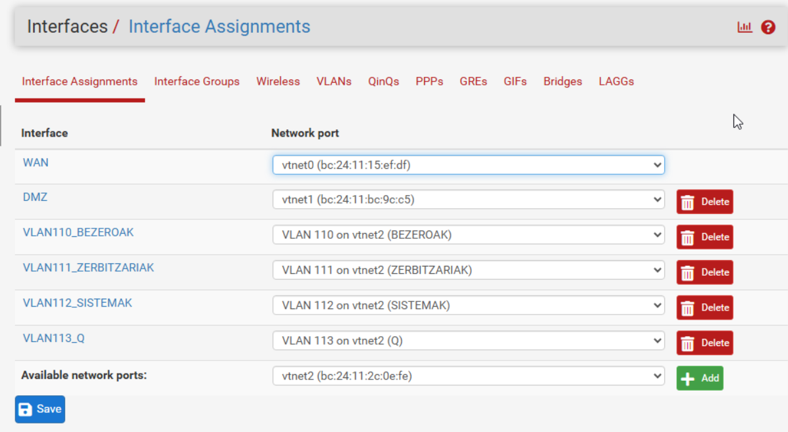

## 4. DHCP

DHCP zerbitzaria Windows Server-a da (`192.168.111.10`). pfSense-k BEZEROAK eta SISTEMAK sareetako eskaerak zerbitzari horretara bidaltzen ditu, *DHCP Relay* bidez.

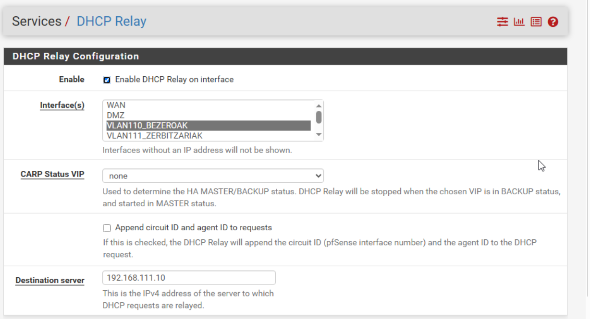

- BEZEROAK sareak `192.168.110.100`–`149` tarteko helbideak banatzen ditu.
- SISTEMAK sarean erreserba bakarra dago, administratzailearen ekipoarentzat (`192.168.112.200`).
- ZERBITZARIAK eta Q sareek IP finkoak erabiltzen dituzte.

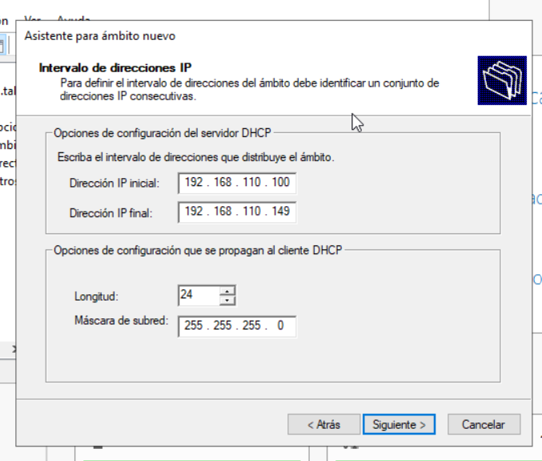

Proba: Erabiltzaile1-ek IP-a jasotzen du VLAN 110ean.

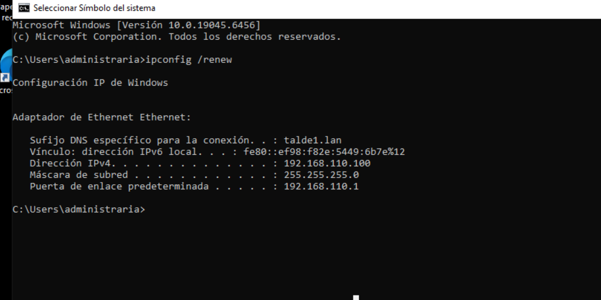

## 5. Aliasak

Arauak errazago irakurtzeko, alias hauek sortu ditugu:

- `BARNE_SAREAK`: sare pribatu guztiak.
- `EN_DC`: domeinu-kontrolatzailea.
- `EN_WEB`: DMZ-ko web zerbitzaria.
- `AD_PORTUAK`: Active Directory-ren portuak.
- `WEB_PORTUAK`: 80 eta 443 portuak.

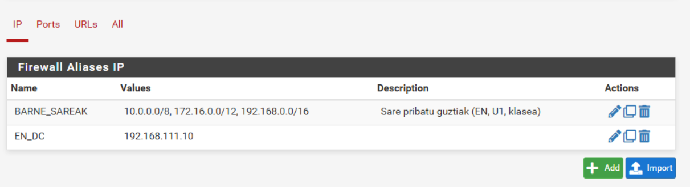

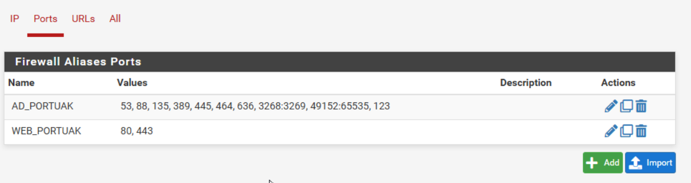

## 6. Firewall arauak

**WAN:** ez dago araurik. Kanpotik sartzen den guztia blokeatuta dago.

**BEZEROAK:** domeinu-kontrolatzailera AD-ren portuetara bakarrik sar daitezke. Beste barne-sare guztiak blokeatuta daude (log-arekin). Internetera irten daitezke.

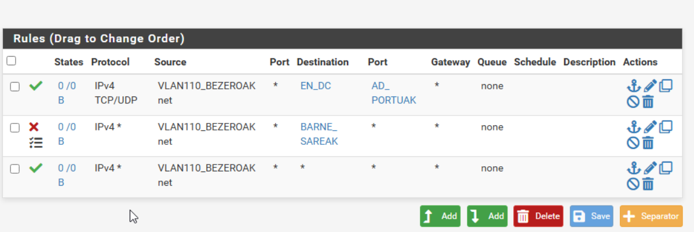

**ZERBITZARIAK:** Internetera bakarrik irten daitezke, eta DNS, NTP eta HTTP/HTTPS bidez bakarrik. Laugarren arauak DC-aren erantzunak onartzen ditu, DHCP relay-ak funtziona dezan.

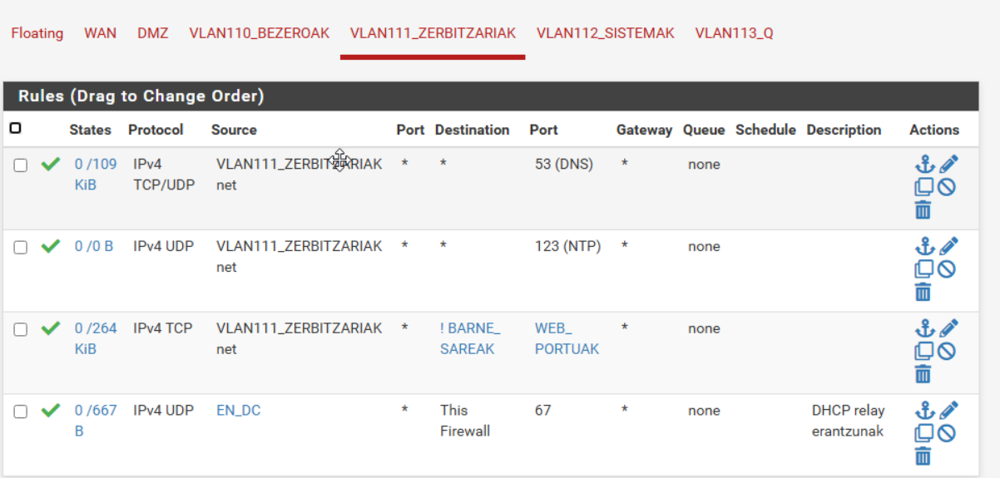

**SISTEMAK:** administratzaileen sarea da. Sarbide osoa du.

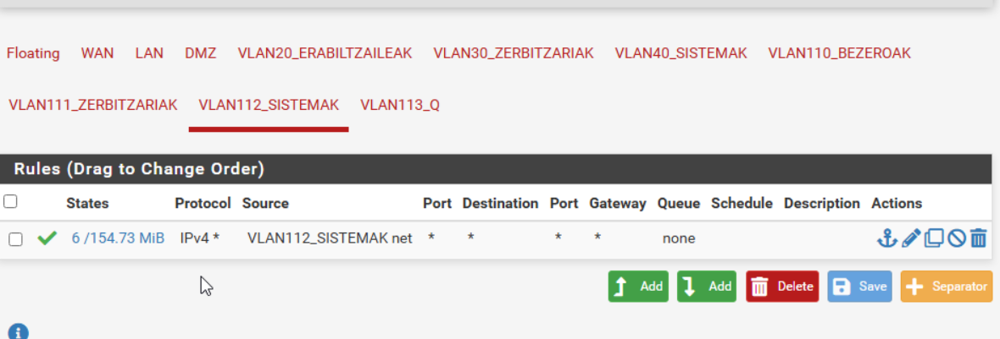

**Q:** dena blokeatuta dago (log-arekin).

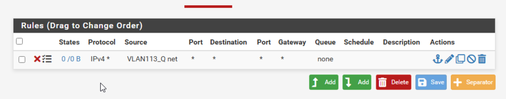

**DMZ:** web zerbitzaria Internetera irten daiteke, baina ezin da barne-sareetara sartu. Datu-baserako araua desgaituta dago, oraingoz ez delako erabiltzen.

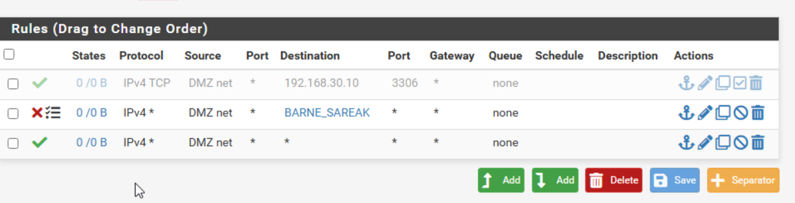

## 7. NAT

**DNAT:** WAN-eko 80 eta 443 portuak DMZ-ko web zerbitzarira (`EN_WEB`) bidaltzen dira.

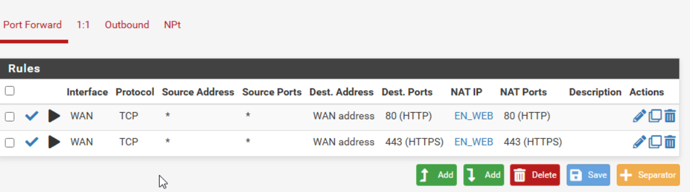

**SNAT:** irteerako NAT-a eskuz konfiguratu dugu (*Manual Outbound NAT*). Modu automatikoak barne-sare guztiak itzultzen ditu, baita behar ez dutenak ere. Eskuzko moduan, Internetera irten behar duten sareak bakarrik itzultzen dira WAN-eko IP-ra.

| Sarea | SNAT | Zergatik |
|---|---|---|
| 110 BEZEROAK | ✅ | Erabiltzaileek nabigatzen dute |
| 111 ZERBITZARIAK | ✅ | Eguneraketak, NTP, DNS |
| 112 SISTEMAK | ✅ | Administrazioa |
| 50 DMZ | ✅ | Web zerbitzariaren eguneraketak |
| 113 Q | ❌ | Isolatuta |
| 114 OpenVPN | ❌ | *Split tunnel*: bezeroen Internet trafikoa ez da hemendik pasatzen |

Sare hauek `NAT_SAREAK` aliasean daude, eta arau bakarra dago. IPsec tuneleko trafikoa (U1-era doana) ez da itzultzen, ez delako WAN-etik zuzenean irteten.

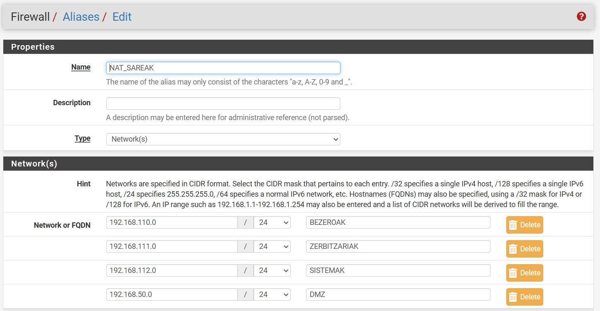

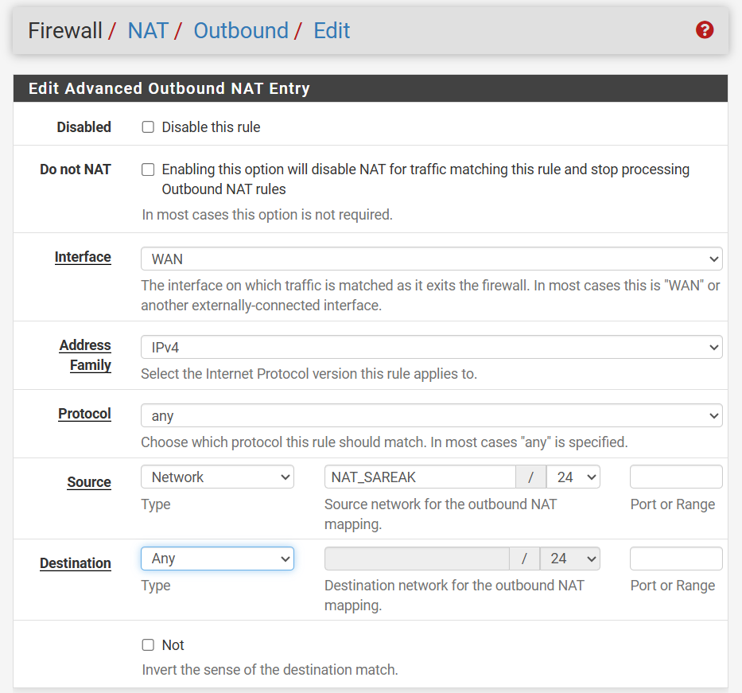

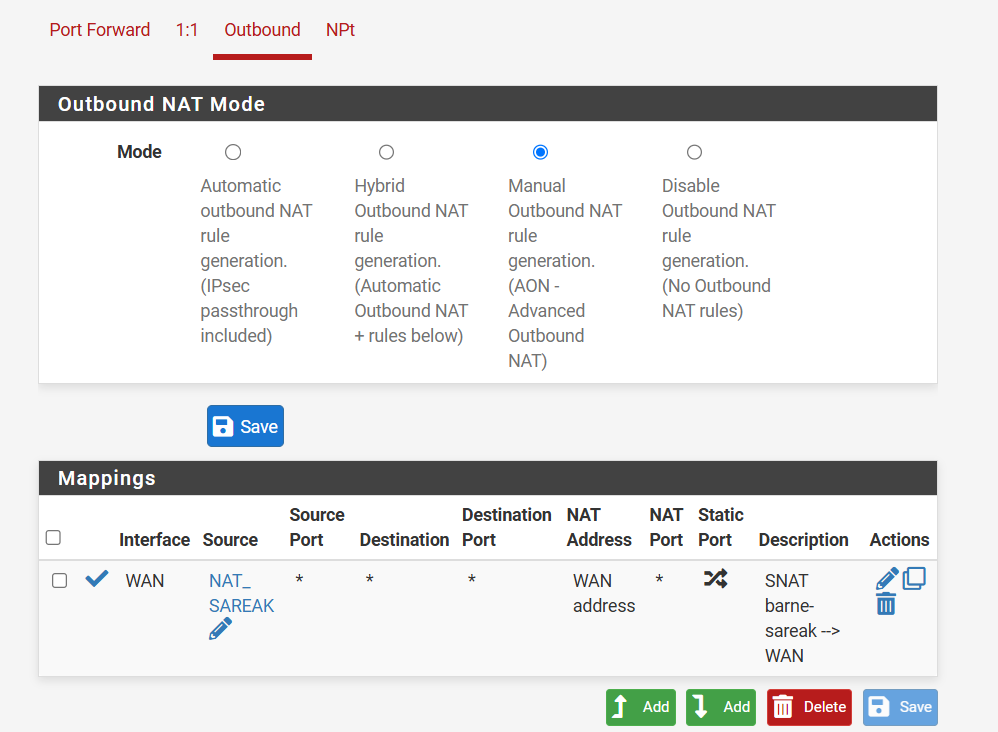

Probak: ZERBITZARIAK saretik (EN-CertServ) eta SISTEMAK saretik Internetera irten daiteke.

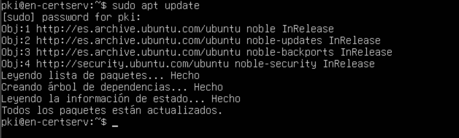

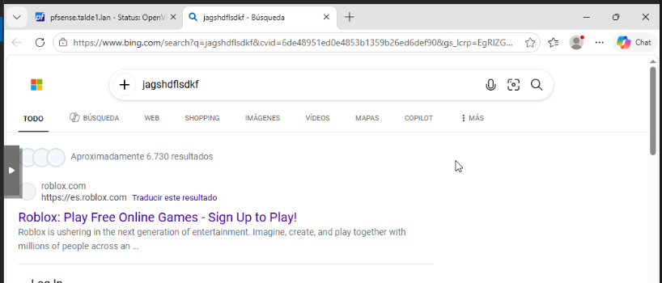

## 8. Kudeaketa

WebGUI-ra izenarekin sartzen gara: `https://pfsense.talde1.lan` (`192.168.112.1`). Enpresako PKI-ak sinatutako ziurtagiria erabiltzen du (ikus [kudeaketa-atzipena](../kudeaketa-atzipena/README.md)).

Administrazio-sareetatik bakarrik sar daiteke:

- SISTEMAK.
- OpenVPN.
- U1-eko administrazio-ekipoa (IPsec tuneletik).

Anti-lockout araua desgaitu dugu. Horrela sarbidea firewall arauek bakarrik kontrolatzen dute.

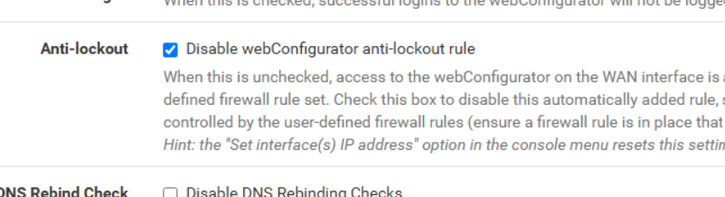
