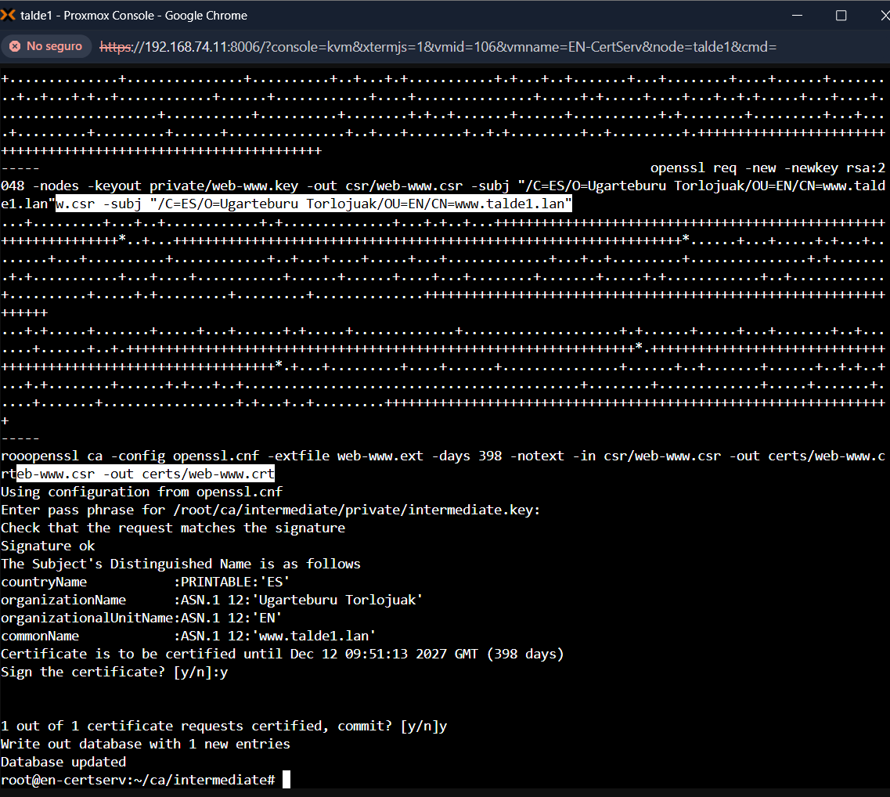

# EN – PKI (Root CA + Intermediate CA)

Enpresako ziurtagiri guztiak (VPN, HTTPS…) enpresaren PKI-ak sortzen ditu, ez ekipoek beraiek. Bi mailako PKI bat da, eta bi makinatan banatuta dago:

- **EN-RootCA** (Root CA): Intermediate CA bakarrik sinatzen du. Hori egin ondoren, makina **itzalita** (offline) geratzen da. Horrela Root CA-ren gako pribatua ez dago sarera konektatuta, eta erasotzaile batek ezin du lortu.
- **EN-CertServ** (Intermediate CA): piztuta (online) dago, eta egunero zerbitzuen ziurtagiriak sinatzen ditu (VPN, HTTPS…).

Diseinu honen abantailak:

- Root CA-ren gakoa ia inoiz ez da erabiltzen.
- Intermediate CA arriskuan badago, errebokatu eta berri bat sor daiteke Root CA ukitu gabe.

| | Root CA | Intermediate CA |
|---|---|---|
| Makina | EN-RootCA (offline) | EN-CertServ (online) |
| CN | Ugarteburu Root CA | Ugarteburu Intermediate CA |
| Gakoa | RSA 4096, AES-256 bidez zifratuta | RSA 4096, AES-256 bidez zifratuta |
| Iraupena | 20 urte | 10 urte |
| Zer sinatzen du | Intermediate CA | Zerbitzuen ziurtagiriak (VPN, HTTPS…) |

## 1. Makina birtualak (Proxmox)

**EN-CertServ** (Intermediate, online):

- Ubuntu Server 24.04 LTS.
- 2 vCPU, 2 GB RAM eta 20 GB-eko diskoa.
- Sare-txartela trunk-eko bridge-an dago, **VLAN tag 111**-rekin (ZERBITZARIAK).
- Serie-ataka bat ere badu, kontsolarako (ikus 3. atala).


**EN-RootCA** (Root, offline):

- Ubuntu Server minimoa.
- 1 vCPU eta 1 GB RAM.
- Intermediate CA sinatu ondoren itzali dugu, eta sare-txartela deskonektatuta dago.
- Bakarrik piztuko da Intermediate berri bat edo CRL bat sinatu behar bada.

## 2. Sarea

EN-CertServ-ek IP finkoa du ZERBITZARIAK sarean:

| | |
|---|---|
| Hostname | `en-certserv` |
| IP | `192.168.111.20/24` |
| Gateway | `192.168.111.1` (pfSense) |
| DNS | `192.168.111.10` (AD) |

pfSense-n, ZERBITZARIAK sareak DNS, NTP eta HTTP/HTTPS bidez bakarrik irten daiteke (ikus [pfSense dokumentazioa](../pfsense/README.md)). Zerbitzari honek horixe behar du: paketeak eguneratzea eta ordua sinkronizatzea.

ICMP (ping) ez dago baimenduta. Horregatik konexioa `apt update` eta `curl` erabiliz egiaztatzen da.

Ordua zuzena izatea oso garrantzitsua da PKI batean. Ordua gaizki badago, ziurtagiriak "oraindik ez baliozko" edo "iraungita" bezala ager daitezke.

```bash
sudo timedatectl set-timezone Europe/Madrid
timedatectl        # System clock synchronized: yes
```


EN-RootCA offline dagoenez, ez du sare-konfiguraziorik behar.

## 3. Serie-kontsola (xterm.js)

Proxmox-eko noVNC kontsolan ezin da testua itsatsi, eta konfigurazio-fitxategiak luzeak dira. Horregatik makinei serie-ataka bat gehitu diegu (*Hardware › Add › Serial Port 0*) eta `getty` gaitu dugu:

```bash
sudo systemctl enable serial-getty@ttyS0
```

Makina berrabiarazi ondoren, *Console › xterm.js* kontsolan kopiatu eta itsatsi daiteke.

Serie-kontsolak testu luzeetan karaktereak gal ditzake. Horregatik fitxategiak zati txikitan sortu ditugu: lehen zatia `cat > … <<'EOF'` bidez, eta hurrengoak `cat >> …` bidez.

## 4. Karpeten egitura

Makina bakoitzean dena `root` erabiltzailearen etxean dago. Horrela beste erabiltzaileek ezin dute sartu. Gako pribatuen karpetek `700` baimenak dituzte.

**EN-RootCA** (Root CA):

```
/root/ca/
├── openssl.cnf          Root CA-ren konfigurazioa
├── certs/ca.crt         Root CA-ren ziurtagiria
├── private/ca.key       Root CA-ren gako pribatua (makina honetan BAKARRIK)
├── index.txt, serial    Sinatutako ziurtagirien datu-basea
└── newcerts/            Sinatutako ziurtagiriak (Intermediate CA)
```

**EN-CertServ** (Intermediate CA):

```
/root/ca/
├── certs/ca.crt              Root CA-ren ziurtagiria (publikoa, katea osatzeko)
├── private/                 (hutsik — Root-en gakoa ez dago makina honetan)
└── intermediate/
    ├── openssl.cnf
    ├── certs/               intermediate.crt, ca-chain.crt, vpn-*.crt, web-*.crt, ovpn-*.crt
    ├── private/             intermediate.key eta zerbitzu-gakoak
    ├── csr/
    └── index.txt, serial
```

EN-CertServ-ek Root CA-ren **ziurtagiria** (`ca.crt`) du, katea osatzeko. Ziurtagiri hori publikoa da. Baina **ez du Root CA-ren gako pribatua**. Gako hori EN-RootCA-n bakarrik dago.

## 5. OpenSSL konfigurazioa

`openssl.cnf` fitxategian hauek definitzen dira:

- CA-ren karpetak.
- `policy_loose` politika: CN derrigorrezkoa da, eta beste eremuak aukerakoak.
- Bi luzapen-profil:
  - `v3_ca`: Root CA-rentzat (`CA:true`, `keyCertSign`, `cRLSign`).
  - `v3_intermediate_ca`: Intermediate CA-rentzat. `pathlen:0` jartzen du. Horrek esan nahi du Intermediate-k ezin duela beste CA bat sinatu, azken ziurtagiriak bakarrik.


Intermediate-ren konfigurazioa (EN-CertServ-en) berdina da. Karpetak eta gakoaren izena bakarrik aldatzen dira:

```bash
sed -e 's#^dir *= /root/ca#dir           = /root/ca/intermediate#' \
    -e 's#private/ca.key#private/intermediate.key#' \
    -e 's#certs/ca.crt#certs/intermediate.crt#' \
    openssl.cnf > /root/ca/intermediate/openssl.cnf
```

## 6. Root CA (EN-RootCA)

Gakoa AES-256 bidez zifratuta sortzen da. Ziurtagiria autosinatua da:

```bash
cd /root/ca
openssl genrsa -aes256 -out private/ca.key 4096
openssl req -config openssl.cnf -key private/ca.key -new -x509 -days 7300 \
  -subj "/C=ES/O=Ugarteburu Torlojuak/CN=Ugarteburu Root CA" -out certs/ca.crt
```

Root CA-ren fitxategiak EN-RootCA-n gordetzen dira.

Gakoa eta ziurtagiria bikote bat direla egiaztatzeko, biei `modulus`-aren `md5` ateratzen zaie. Emaitza berdina izan behar da:

```bash
openssl x509 -noout -modulus -in certs/ca.crt | openssl md5
openssl rsa  -noout -modulus -in private/ca.key | openssl md5
```


## 7. Intermediate CA (EN-CertServ)

Pausoak:

1. EN-CertServ-en Intermediate-ren gakoa eta CSR-a sortzen dira.
2. EN-RootCA-n **Root CA-k CSR-a sinatzen du**, `v3_intermediate_ca` profilarekin.
3. EN-CertServ-en `ca-chain.crt` fitxategia sortzen da (Intermediate + Root). Horrela zerbitzuek kate osoa egiazta dezakete.

```bash
# EN-CertServ-en: gakoa eta CSR-a
openssl genrsa -aes256 -out intermediate/private/intermediate.key 4096
openssl req -config intermediate/openssl.cnf -new -key intermediate/private/intermediate.key \
  -subj "/C=ES/O=Ugarteburu Torlojuak/CN=Ugarteburu Intermediate CA" -out intermediate/csr/intermediate.csr

# Root CA-k (EN-RootCA) CSR-a sinatzen du v3_intermediate_ca profilarekin

# EN-CertServ-en: katea osatu
cat intermediate/certs/intermediate.crt certs/ca.crt > intermediate/certs/ca-chain.crt
openssl verify -CAfile certs/ca-chain.crt intermediate/certs/intermediate.crt
```

Katea ondo dago (`OK`):


## 8. VPN ziurtagiriak

Egoitzen arteko IPsec VPN-a ziurtagiriekin autentifikatzen da, ez gako partekatu batekin (PSK). Mutur bakoitzak bere ziurtagiria du:

| | pfSense (EN) | PA-IT (U1) |
|---|---|---|
| CN | `vpn-en.talde1.lan` | `vpn-u1.talde1.lan` |
| SAN | `DNS:vpn-en.talde1.lan`, `IP:192.168.74.1` | `DNS:vpn-u1.talde1.lan`, `IP:192.168.74.2` |
| Gakoa | RSA 2048 | RSA 2048 |
| Iraupena | 825 egun | 825 egun |

Luzapenak `.ext` fitxategi batean daude, mutur bakoitzeko bat:

- `basicConstraints = CA:FALSE`: azken ziurtagiria da. Ezin du beste ziurtagiririk sinatu.
- `keyUsage = digitalSignature, keyEncipherment`: IKE negoziazioan sinatzeko.
- `extendedKeyUsage = serverAuth, clientAuth, 1.3.6.1.5.5.8.2.2`: azken OID-a *IKE Intermediate* da, IPsec-erako. Bi muturrek has dezakete konexioa. Horregatik server eta client biak jartzen dira.
- `subjectAltName`: VPN-ko identitatea (FQDN) eta WAN IP-a. Phase 1-eko identitateak SAN honekin bat etorri behar du.

```bash
cd /root/ca/intermediate
cat > vpn-en.ext <<'EOF'
basicConstraints       = CA:FALSE
keyUsage               = critical, digitalSignature, keyEncipherment
extendedKeyUsage       = serverAuth, clientAuth, 1.3.6.1.5.5.8.2.2
subjectAltName         = DNS:vpn-en.talde1.lan, IP:192.168.74.1
subjectKeyIdentifier   = hash
authorityKeyIdentifier = keyid,issuer
EOF
```

`vpn-u1.ext` fitxategia berdina da, baina `DNS:vpn-u1.talde1.lan, IP:192.168.74.2` balioekin.


Gakoa eta CSR-a sortu, eta Intermediate CA-rekin sinatu:

```bash
openssl req -new -newkey rsa:2048 -nodes -keyout private/vpn-en.key -out csr/vpn-en.csr \
  -subj "/C=ES/O=Ugarteburu Torlojuak/OU=EN/CN=vpn-en.talde1.lan"
openssl ca -config openssl.cnf -extfile vpn-en.ext -days 825 -notext \
  -in csr/vpn-en.csr -out certs/vpn-en.crt
```

`vpn-u1`-rekin gauza bera egiten da. Egiaztapena:

```bash
openssl verify -CAfile certs/ca-chain.crt certs/vpn-en.crt certs/vpn-u1.crt
openssl x509 -in certs/vpn-en.crt -noout -subject -ext subjectAltName
openssl x509 -in certs/vpn-u1.crt -noout -subject -ext subjectAltName
```


HTTPS eta OpenVPN ziurtagiriak modu berean sortzen dira. Xehetasunak [kudeaketa-atzipena](../kudeaketa-atzipena/README.md) eta [OpenVPN](../openvpn/README.md) dokumentuetan daude.

## 9. Web zerbitzariaren ziurtagiria (www.talde1.lan)

EN-ko DMZ-ko web zerbitzariak (`192.168.50.10`) HTTPS ziurtagiri bat behar du, PKI-ak sinatua. Profila beste HTTPS ziurtagirien berdina da: `serverAuth` bakarrik, eta SAN-ean FQDN-a eta DMZ-ko IP-a.

| | |
|---|---|
| CN | `www.talde1.lan` |
| SAN | `DNS:www.talde1.lan`, `IP:192.168.50.10` |
| EKU | `serverAuth` |
| Iraupena | 398 egun |

```bash
cd /root/ca/intermediate
cat > web-www.ext <<'EOF2'
basicConstraints       = CA:FALSE
keyUsage               = critical, digitalSignature, keyEncipherment
extendedKeyUsage       = serverAuth
subjectAltName         = DNS:www.talde1.lan, IP:192.168.50.10
subjectKeyIdentifier   = hash
authorityKeyIdentifier = keyid,issuer
EOF2
openssl req -new -newkey rsa:2048 -nodes -keyout private/web-www.key -out csr/web-www.csr \
  -subj "/C=ES/O=Ugarteburu Torlojuak/OU=EN/CN=www.talde1.lan"
openssl ca -config openssl.cnf -extfile web-www.ext -days 398 -notext \
  -in csr/web-www.csr -out certs/web-www.crt
```



DMZ-a barne-sareetatik isolatuta dago. Horregatik ez dago SSH-rik EN-CertServ eta web zerbitzariaren artean. Ziurtagiria, gakoa eta `ca-chain.crt` kontsola batetik bestera kopiatu genituen (xterm.js). Web zerbitzarian Apache-k erabiltzen ditu, 443 atakan.

## 10. Ziurtagirien banaketa

Ziurtagiriak eta gakoak ez dira sare irekitik bidaltzen. Testu formatuan (PEM) daudenez, kanal seguru batetik kopiatu eta itsatsi egiten dira.

**pfSense (EN):**

1. SISTEMAK sareko administrazio-ekipotik SSH bidez sartzen gara EN-CertServ-era.
2. Fitxategien edukia pantailan erakusten da, eta pfSense-ren web interfazean itsasten da.
3. `pki` erabiltzaileak ezin du `/root` irakurri. Horregatik EN-ko fitxategiak denbora batez `/home/pki/en` karpetara kopiatu genituen (gakoa `chmod 600` baimenekin).
4. Inportatu ondoren gakoa ezabatu genuen.

**PA-IT (U1):**

1. PA-IT kudeatu dezakeen ekipo bakarra U1-eko administrazio-ekipoa da (`192.168.20.10`). Une horretan VPN-a ez zegoen oraindik.
2. Fitxategiak xterm.js kontsolatik kopiatu eta U1-admin-en itsatsi genituen, IsardVDI-ren SPICE bisorearen arbelaren bidez.
3. Palo Alto-k gako pribatuak pasahitzarekin zifratuta bakarrik onartzen ditu. Horregatik gakoaren kopia zifratu bat sortu genuen:

```bash
openssl rsa -aes256 -in private/vpn-u1.key -out private/vpn-u1-enc.key
```

4. Inportatu ondoren kopia hori ezabatu genuen, bai U1-admin-en bai EN-CertServ-en.

Bi suebakiek Root eta Intermediate CA-ren ziurtagiriak bakarrik jasotzen dituzte, gakorik gabe. Inportazioa [VPN dokumentazioan](../vpn/README.md) azaltzen da.

## 11. Segurtasuna

**Root CA offline:** Root CA-ren gako pribatua EN-RootCA makinan bakarrik dago, eta makina hori itzalita dago. EN-CertServ-ek (online) Intermediate-ren gakoa bakarrik du. `/root/ca/private/` karpeta hutsik dago. Hala ere, Intermediate-k katea ondo egiaztatzen du, eguneroko lanerako ez delako Root-en gakoa behar.


**Gakoak zifratuta:** CA-en gako pribatuak AES-256 bidez zifratuta daude. Pasahitzak pasahitz-kudeatzailean daude.

**Erregistroa:** `index.txt` fitxategian sinatutako ziurtagiri guztiak daude. VPN ziurtagirien lehen bertsioa domeinu okerrarekin sortu zen. Ziurtagiri horiek errebokatu (`R`) eta berriak sortu genituen (`V`).

```bash
openssl ca -config openssl.cnf -revoke certs/vpn-en.crt
cat /root/ca/intermediate/index.txt
```


**Hobekuntza:** CRL-a ez da oraindik inon argitaratzen. Horregatik suebakietan CRL/OCSP egiaztapena desgaituta dago. Hurrengo pausoa CRL-a EN-CertServ-etik HTTP bidez argitaratzea izango litzateke.
