# EN – PKI (Root CA + Intermediate CA)

Ugarteburu Torlojuak · 2. Erronka

Enpresako ziurtagiri guztiak (VPN, HTTPS…) enpresaren PKI-ak sortzen ditu, ez ekipoetan bertan. Bi mailako PKI bat da, bi makinatan banatuta:

- **EN-RootCA** — Root CA. Intermediate CA bakarrik sinatzen du. Hori eginda, makina **itzalita** (offline) mantentzen da: horrela Root CA-ren gako pribatua ez dago sarean konektatutako makina batean, eta erasotzaile batek ezin du eskuratu.
- **EN-CertServ** — Intermediate CA. Online dago eta egunerokoan sinatzen ditu zerbitzu-ziurtagiriak (VPN, HTTPS…).

Horrela Root CA-ren gakoa ia inoiz ez da erabiltzen, eta Intermediate CA arriskuan egonez gero, errebokatu eta berri bat sor daiteke Root-a ukitu gabe.

| | Root CA | Intermediate CA |
|---|---|---|
| Makina | EN-RootCA (offline) | EN-CertServ (online) |
| CN | Ugarteburu Root CA | Ugarteburu Intermediate CA |
| Gakoa | RSA 4096, AES-256 bidez zifratuta | RSA 4096, AES-256 bidez zifratuta |
| Iraupena | 20 urte | 10 urte |
| Sinatzen du | Intermediate CA | Zerbitzu-ziurtagiriak (VPN, HTTPS…) |

## 1. Makina birtualak (Proxmox)

**EN-CertServ** (Intermediate, online): Ubuntu Server 24.04 LTS, 2 vCPU, 2 GB RAM eta 20 GB-eko diskoa. Sare-txartela trunk-eko bridge-an dago, **VLAN tag 111**-rekin (ZERBITZARIAK). Serie-ataka bat ere badu, 3. atalean azaltzen den kontsolarako.

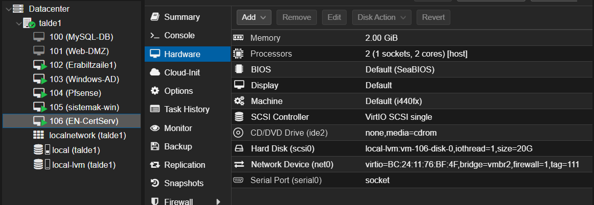

**EN-RootCA** (Root, offline): Ubuntu Server minimoa, 1 vCPU, 1 GB RAM. Intermediate CA sinatu ondoren itzalita dago, eta sare-txartela deskonektatuta. Soilik piztuko litzateke Intermediate berri bat edo CRL bat sinatu behar izanez gero.

## 2. Sarea

EN-CertServ-ek IP finkoa du ZERBITZARIAK sarean:

| | |
|---|---|
| Hostname | `en-certserv` |
| IP | `192.168.111.20/24` |
| Gateway | `192.168.111.1` (pfSense) |
| DNS | `192.168.111.10` (AD) |

pfSense-ko ZERBITZARIAK arauek DNS, NTP eta HTTP/HTTPS irteera bakarrik baimentzen dute (ikus [pfSense dokumentazioa](../pfsense/README.md)), eta horixe da zerbitzari honek behar duena: paketeak eguneratzea eta ordua sinkronizatzea. ICMP ez dagoenez baimenduta, konexioa `apt update` eta `curl` bidez egiaztatzen da.

Ordua zuzena izatea ezinbestekoa da PKI batean: ordua desegokia bada, ziurtagiriak "oraindik ez baliozko" edo "iraungita" gisa ikus daitezke.

```bash
sudo timedatectl set-timezone Europe/Madrid
timedatectl        # System clock synchronized: yes
```

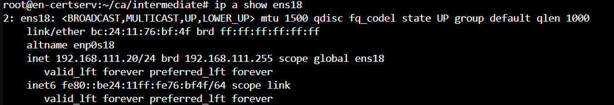

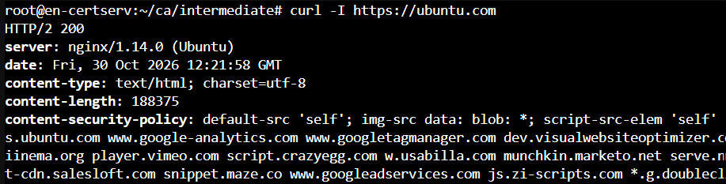

EN-RootCA offline dagoenez, ez du sare-ezarpen iraunkorrik behar.

## 3. Kontsola serie (xterm.js)

Proxmox-eko noVNC kontsolak ez du testua itsasten uzten, eta konfigurazio-fitxategiak luzeak dira. Horregatik VM-ei serie-ataka bat gehitu zaie (*Hardware › Add › Serial Port 0*) eta `getty` gaitu da bertan:

```bash
sudo systemctl enable serial-getty@ttyS0
```

VM-a berrabiarazi ondoren, *Console › xterm.js* kontsolak kopiatu eta itsatsi ahalbidetzen du. Serie-kontsolak testu luzeak itsastean karaktereak gal ditzakeenez, fitxategiak zati txikitan sortu dira (`cat > … <<'EOF'` lehenengoa, `cat >> …` hurrengoak).

## 4. Direktorio-egitura

Makina bakoitzean dena `root`-en etxean dago, gainerako erabiltzaileek sarbiderik izan ez dezaten. Gako pribatuen karpetek `700` baimenak dituzte.

**EN-RootCA** (Root CA):

```
/root/ca/
├── openssl.cnf          Root CA-ren konfigurazioa
├── certs/ca.crt         Root CA-ren ziurtagiria
├── private/ca.key       Root CA-ren gako pribatua (makina honetan BAKARRIK)
├── index.txt, serial    Sinatutako ziurtagirien datu-basea
└── newcerts/            Sinatutako ziurtagiriak (Intermediate CA)
```

**EN-CertServ** (Intermediate CA):

```
/root/ca/
├── certs/ca.crt              Root CA-ren ziurtagiria (publikoa, katea osatzeko)
├── private/                 (hutsik — Root-en gakoa ez dago makina honetan)
└── intermediate/
    ├── openssl.cnf
    ├── certs/               intermediate.crt, ca-chain.crt, vpn-*.crt, web-*.crt, ovpn-*.crt
    ├── private/             intermediate.key eta zerbitzu-gakoak
    ├── csr/
    └── index.txt, serial
```

EN-CertServ-ek Root CA-ren **ziurtagiria** (`ca.crt`, publikoa) du katea osatzeko, baina **ez du Root-en gako pribatua**: hori EN-RootCA-n bakarrik dago.

## 5. OpenSSL konfigurazioa

`openssl.cnf` fitxategiak CA-ren bideak, `policy_loose` politika (CN derrigorrezkoa, gainerakoak aukerakoak) eta bi luzapen-profil definitzen ditu:

- `v3_ca`: Root CA-rentzat (`CA:true`, `keyCertSign`, `cRLSign`).
- `v3_intermediate_ca`: Intermediate CA-rentzat. `pathlen:0`-k esan nahi du Intermediate-k ezin duela beste CA bat sinatu, azken ziurtagiriak bakarrik.

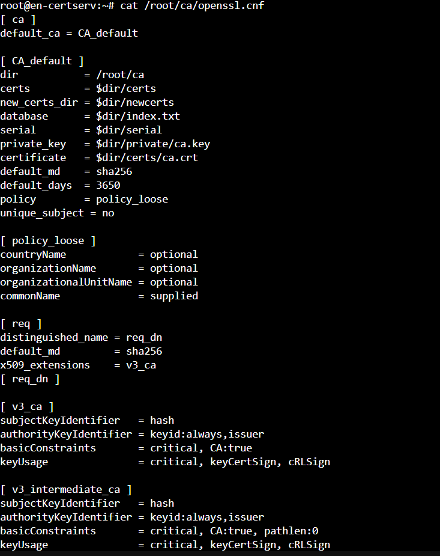

Intermediate-ren konfigurazioa (EN-CertServ-en) bera da, bideak eta gakoaren izena aldatuta:

```bash
sed -e 's#^dir *= /root/ca#dir           = /root/ca/intermediate#' \
    -e 's#private/ca.key#private/intermediate.key#' \
    -e 's#certs/ca.crt#certs/intermediate.crt#' \
    openssl.cnf > /root/ca/intermediate/openssl.cnf
```

## 6. Root CA (EN-RootCA)

Gakoa AES-256 bidez zifratuta sortzen da, eta ziurtagiria autosinatua da:

```bash
cd /root/ca
openssl genrsa -aes256 -out private/ca.key 4096
openssl req -config openssl.cnf -key private/ca.key -new -x509 -days 7300 \
  -subj "/C=ES/O=Ugarteburu Torlojuak/CN=Ugarteburu Root CA" -out certs/ca.crt
```

EN-RootCA-n gordetzen dira Root CA-ren fitxategiak. Gakoaren eta ziurtagiriaren modulus-en `md5` berdina da, biak bikote bat direla egiaztatuz:

```bash
openssl x509 -noout -modulus -in certs/ca.crt | openssl md5
openssl rsa  -noout -modulus -in private/ca.key | openssl md5
```

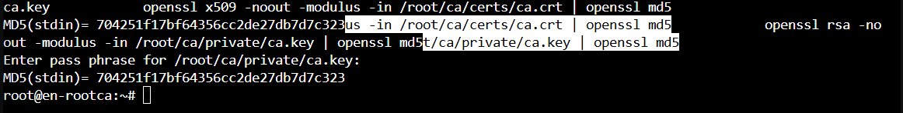

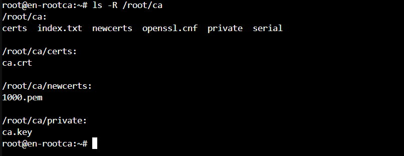

## 7. Intermediate CA (EN-CertServ)

Intermediate-k bere gakoa eta CSR-a sortzen ditu EN-CertServ-en, eta **Root CA-k sinatzen du** (EN-RootCA-n) `v3_intermediate_ca` profilarekin. Ondoren `ca-chain.crt` sortzen da (Intermediate + Root), zerbitzuek kate osoa egiazta dezaten.

```bash
# EN-CertServ-en: gakoa eta CSR-a
openssl genrsa -aes256 -out intermediate/private/intermediate.key 4096
openssl req -config intermediate/openssl.cnf -new -key intermediate/private/intermediate.key \
  -subj "/C=ES/O=Ugarteburu Torlojuak/CN=Ugarteburu Intermediate CA" -out intermediate/csr/intermediate.csr

# Root CA-k (EN-RootCA) CSR-a sinatzen du v3_intermediate_ca profilarekin

# EN-CertServ-en: katea osatu
cat intermediate/certs/intermediate.crt certs/ca.crt > intermediate/certs/ca-chain.crt
openssl verify -CAfile certs/ca-chain.crt intermediate/certs/intermediate.crt
```

Intermediate-ak katea ondo balioztatzen du (`OK`):

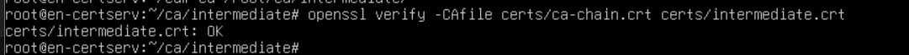

## 8. VPN ziurtagiriak

Egoitzen arteko IPsec VPN-a ziurtagiriekin autentifikatzen da, ez gako partekatu batekin (PSK). Muturreko bakoitzak bere ziurtagiria du:

| | pfSense (EN) | PA-IT (U1) |
|---|---|---|
| CN | `vpn-en.talde1.lan` | `vpn-u1.talde1.lan` |
| SAN | `DNS:vpn-en.talde1.lan`, `IP:192.168.74.1` | `DNS:vpn-u1.talde1.lan`, `IP:192.168.74.2` |
| Gakoa | RSA 2048 | RSA 2048 |
| Iraupena | 825 egun | 825 egun |

Luzapenak `.ext` fitxategi batean definitzen dira muturreko bakoitzeko:

- `basicConstraints = CA:FALSE`: azken ziurtagiria da, ezin du beste bat sinatu.
- `keyUsage = digitalSignature, keyEncipherment`: IKE negoziazioan sinatzeko.
- `extendedKeyUsage = serverAuth, clientAuth, 1.3.6.1.5.5.8.2.2`: azken OID-a *IKE Intermediate* da, IPsec-erako. Bi muturrek hasi dezaketenez konexioa, server eta client biak gehitzen dira.
- `subjectAltName`: VPN-ko identitatea (FQDN) eta WAN IP-a. Phase 1-eko identitateak SAN honekin bat etorri behar du.

```bash
cd /root/ca/intermediate
cat > vpn-en.ext <<'EOF'
basicConstraints       = CA:FALSE
keyUsage               = critical, digitalSignature, keyEncipherment
extendedKeyUsage       = serverAuth, clientAuth, 1.3.6.1.5.5.8.2.2
subjectAltName         = DNS:vpn-en.talde1.lan, IP:192.168.74.1
subjectKeyIdentifier   = hash
authorityKeyIdentifier = keyid,issuer
EOF
```

`vpn-u1.ext` berdina da, `DNS:vpn-u1.talde1.lan, IP:192.168.74.2`-rekin.

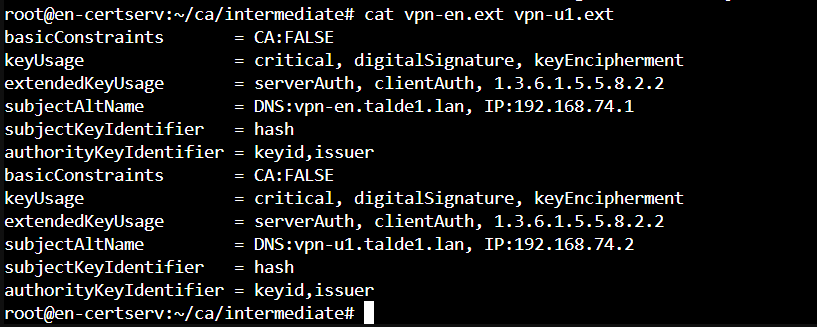

Gakoa eta CSR-a sortu, eta Intermediate CA-rekin sinatu:

```bash
openssl req -new -newkey rsa:2048 -nodes -keyout private/vpn-en.key -out csr/vpn-en.csr \
  -subj "/C=ES/O=Ugarteburu Torlojuak/OU=EN/CN=vpn-en.talde1.lan"
openssl ca -config openssl.cnf -extfile vpn-en.ext -days 825 -notext \
  -in csr/vpn-en.csr -out certs/vpn-en.crt
```

(Berdin `vpn-u1`-rekin.) Egiaztapena:

```bash
openssl verify -CAfile certs/ca-chain.crt certs/vpn-en.crt certs/vpn-u1.crt
openssl x509 -in certs/vpn-en.crt -noout -subject -ext subjectAltName
openssl x509 -in certs/vpn-u1.crt -noout -subject -ext subjectAltName
```

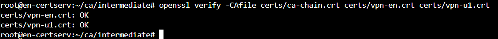

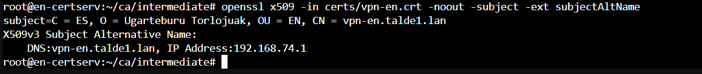

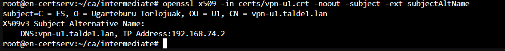

HTTPS eta OpenVPN ziurtagiriak prozedura berarekin sortzen dira; xehetasunak [kudeaketa-atzipenaren](../kudeaketa-atzipena/README.md) eta [OpenVPN-en](../openvpn/README.md) dokumentazioan daude.

## 9. Ziurtagirien banaketa

Ziurtagiriak eta gakoak ez dira sare irekitik bidaltzen. Testu-formatuan (PEM) daudenez, kopiatu eta itsatsi egiten dira kanal seguru batetik:

- **pfSense (EN):** SISTEMAK sareko administrazio-ekipotik SSH bidez sartzen da EN-CertServ-era, fitxategiak pantailaratzen dira eta pfSense-ren web interfazean itsasten dira. `pki` erabiltzaileak ezin duenez `/root` irakurri, EN-ko fitxategiak aldi baterako `/home/pki/en`-ra kopiatu ziren (`chmod 600` gakoarekin), eta gakoa ezabatu egin zen inportatu ondoren.
- **PA-IT (U1):** U1-eko administrazio-ekipoa (`192.168.20.10`) da PA-IT kudeatu dezakeen bakarra, eta VPN-a oraindik ez dago. Fitxategiak xterm.js kontsolatik kopiatu eta U1-admin-en itsatsi ziren IsardVDI-ren SPICE bisorearen arbelaren bidez. Palo Alto-k gako pribatuak pasahitzarekin zifratuta bakarrik onartzen dituenez, gakoaren kopia zifratu bat sortu zen horretarako, eta inportatu ondoren ezabatu egin zen bai U1-admin-en bai EN-CertServ-en:

```bash
openssl rsa -aes256 -in private/vpn-u1.key -out private/vpn-u1-enc.key
```

Bi suebakiek Root eta Intermediate CA-ren ziurtagiriak bakarrik jasotzen dituzte, gakorik gabe. Inportazioa [VPN dokumentazioan](../vpn/README.md) dago.

## 10. Segurtasuna

- **Root CA offline:** Root CA-ren gako pribatua EN-RootCA makinan bakarrik dago, eta makina hori itzalita mantentzen da. EN-CertServ (online) makinak Intermediate-ren gakoa du soilik; `/root/ca/private/` hutsik dago, Root-en gakorik gabe. Hala ere, Intermediate-ak katea ondo balioztatzen du, eguneroko lanerako Root-en gakoa behar ez delako.

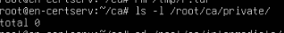

- CA-en gako pribatuak AES-256 bidez zifratuta daude. Pasahitzak pasahitz-kudeatzailean daude.
- `index.txt` fitxategian sinatutako ziurtagiri guztien erregistroa dago. VPN ziurtagirien lehen bertsioa domeinu okerrarekin sortu zen; ziurtagiri horiek errebokatu (`R`) eta berriak sortu ziren (`V`).

```bash
openssl ca -config openssl.cnf -revoke certs/vpn-en.crt
cat /root/ca/intermediate/index.txt
```

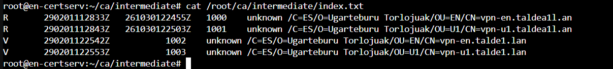

- **Hobekuntza:** CRL-a ez da oraindik inon argitaratzen, eta horregatik suebakietan CRL/OCSP egiaztapena desgaituta dago. Hurrengo pausoa CRL-a EN-CertServ-etik HTTP bidez argitaratzea litzateke.
