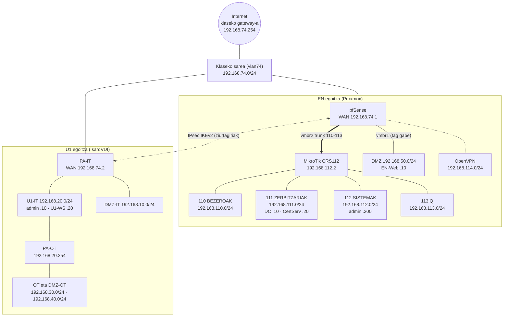

# Sare-eskema eta helbideratzea

Ugarteburu Torlojuak · 2. Erronka

Bi egoitzen sare-lotura guztiak, IP-ak eta gateway-ak. Gailu bakoitzaren konfigurazio xehea bere dokumentuan dago: [pfSense](../pfsense/README.md), [PA-IT](../U1-PA-IT/README.md), [PA-OT](../U1-PA-OT/README.md), [VPN](../vpn/README.md), [OpenVPN](../openvpn/README.md).

## 1. Eskema

## 2. EN egoitza

| Sarea | VLAN / lotura | Azpisarea | Gateway | Ekipoak |
|---|---|---|---|---|
| WAN | Klaseko sarea (vmbr0) | `192.168.74.0/24` | `192.168.74.254` | pfSense `.1` |
| BEZEROAK | 110 (trunk) | `192.168.110.0/24` | pfSense `.1` | DHCP `.100`–`.149` |
| ZERBITZARIAK | 111 (trunk) | `192.168.111.0/24` | pfSense `.1` | DC `.10`, EN-CertServ `.20` |
| SISTEMAK | 112 (trunk) | `192.168.112.0/24` | pfSense `.1` | MikroTik `.2`, administrazio-ekipoa `.200` (erreserba) |
| Q | 113 (trunk) | `192.168.113.0/24` | pfSense `.1` | IP finkoak |
| DMZ | vmbr1, tag gabe | `192.168.50.0/24` | pfSense `.1` | EN-Web `.10` |
| OpenVPN | Tunela | `192.168.114.0/24` | pfSense `.1` | Taldekideen bezeroak |

EN-RootCA itzalita eta saretik deskonektatuta dago (ikus [PKI](../pki/README.md)).

## 3. U1 egoitza

| Sarea | Lotura | Azpisarea | Gateway | Ekipoak |
|---|---|---|---|---|
| WAN | vlan74 | `192.168.74.0/24` | `192.168.74.254` | PA-IT `.2` |
| U1-IT | Ziber-T12 | `192.168.20.0/24` | PA-IT `.1` | U1-admin `.10`, U1-WS `.20`, PA-OT `.254` |
| DMZ-IT | Ziber-T11 | `192.168.10.0/24` | PA-IT `.1` | (2. zatia) |
| U1-OT eta U1-DMZOT | Ziber-T13 / T14 | `192.168.30.0/24`, `192.168.40.0/24` | PA-OT | (2. zatia) |

## 4. Bideratzea eta NAT

| Gailua | Ibilbidea | Next hop |
|---|---|---|
| pfSense | Lehenetsia | `192.168.74.254` |
| pfSense | U1 sareak | IPsec tunela |
| PA-IT | Lehenetsia | `192.168.74.254` |
| PA-IT | `192.168.30.0/24`, `192.168.40.0/24` | PA-OT `192.168.20.254` |
| PA-IT | EN sareak | IPsec tunela |
| PA-OT | Lehenetsia | PA-IT `192.168.20.1` |
| U1-admin | `192.168.30.0/24`, `192.168.40.0/24` | PA-OT `192.168.20.254` (ibilbide iraunkorrak) |

**SNAT:** pfSense-n eskuzkoa, Internetera irten behar duten sareentzat bakarrik (110, 111, 112 eta DMZ); Q eta OpenVPN ez. PA-IT-n U1-IT sarearentzat bakarrik. Tuneleko trafikoa ez da itzultzen.

**DNAT:** pfSense-ren WAN-eko 80 eta 443 portuak EN-Web-era (`192.168.50.10`).

Lotura guztien egiaztapena (ping, ibilbideak eta NAT) gailu bakoitzaren dokumentuan dago, eta sareen arteko iragazkia [Zero Trust probetan](../zero-trust/README.md).
