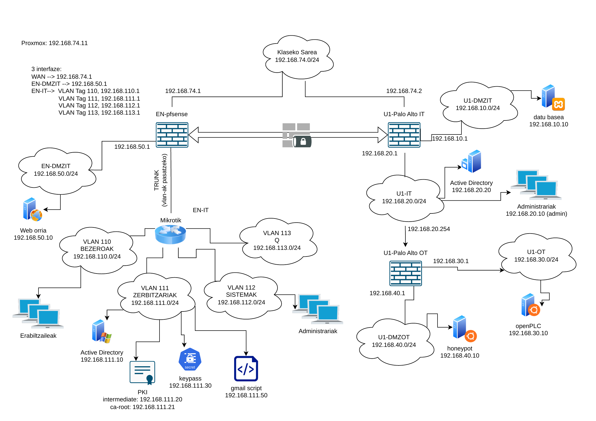

# Sarearen azalpena

Enpresak bi egoitza ditu: EN eta U1. Biak klaseko sarearen bidez (`192.168.74.0/24`) daude lotuta. Sare hori gure "Internet"-a balitz bezala erabiltzen dugu.

Egoitza bakoitzak bere suebakia du. Bi suebakien artean IPsec VPN tunel bat dago, bulego batetik bestera modu seguruan komunikatzeko (ikus [VPN](../vpn/README.md)).

## EN egoitza

EN-ko suebakia pfSense da (`192.168.74.1`). Makina birtual bat da, Proxmox-en (`192.168.74.11`).

Barneko sareak VLANetan banatuta daude. pfSense-tik MikroTik switchera trunk bidez iristen dira. VLAN bakoitzak bere funtzioa du:

- **110 BEZEROAK** (`192.168.110.0/24`): langileen ekipoak. IP-a DHCP bidez jasotzen dute.
- **111 ZERBITZARIAK** (`192.168.111.0/24`): domeinu-kontrolatzailea (`.10`), PKI-a (Intermediate CA `.20` eta Root CA `.21`, orain itzalita), pasahitz-kudeatzailea (`.30`) eta email-scripta (`.50`).
- **112 SISTEMAK** (`192.168.112.0/24`): administratzaileen sarea.
- **113 Q** (`192.168.113.0/24`): sare isolatua. Ez du beste sarerik ikusten.

Horiez gain, **DMZ** bat dago (`192.168.50.0/24`) web orriarentzat (`.10`). Kanpotik sar daitekeen sare bakarra da. Horregatik barne-saretik bereizita dago.

Taldekideak etxetik **OpenVPN** bidez konekta daitezke (`192.168.114.0/24`).

pfSense da sare guztien gateway-a (`.1` helbidea). Internetera doan trafikoa klaseko gateway-ra (`192.168.74.254`) bidaltzen du.

## U1 egoitza

U1-eko suebakia PA-IT da (Palo Alto, `192.168.74.2`). Bi sare ditu:

- **U1-IT** (`192.168.20.0/24`): U1-eko domeinu-kontrolatzailea (`.20`) eta administrazio-ekipoa (`.10`).
- **U1-DMZIT** (`192.168.10.0/24`): datu-basea (`.10`).

Fabrika (OT) bigarren suebaki baten atzean dago: PA-OT (`192.168.20.254`). Horrela bulegoko sarea eta produkzioa bereizita daude. PA-OT-k bi sare ditu:

- **U1-OT** (`192.168.30.0/24`): openPLC-a (`.10`).
- **U1-DMZOT** (`192.168.40.0/24`): honeypot-a (`.10`).

## Internetera irteera

Barneko helbideak ezin dira zuzenean Internetera irten. Horregatik suebakiek helbide horiek beren WAN helbidera itzultzen dituzte (SNAT). Hori behar duten sareekin bakarrik egiten da. Q eta OpenVPN sareekin ez da egiten.

Kanpotik web orrira iristeko, pfSense-k 80 eta 443 portuak DMZ-ko web zerbitzarira bidaltzen ditu (DNAT).

Xehetasun gehiago [pfSense](../pfsense/README.md) eta [PA-IT](../U1-PA-IT/README.md) dokumentuetan daude.
