# EN ↔ U1 – IPsec VPN

Ugarteburu Torlojuak · 2. Erronka

EN egoitza (pfSense) eta U1 egoitza (PA-IT) site-to-site IPsec tunel baten bidez lotzen dira klaseko sarearen gainetik (vlan74). Autentifikazioa ziurtagiri digitalekin egiten da, enpresako PKI-ak sinatuta (ikus [PKI dokumentazioa](../pki/README.md)).

## 1. Diseinua

| | EN | U1 |
|---|---|---|
| Suebakia | pfSense | PA-IT (Palo Alto) |
| Peer IP (WAN) | `192.168.74.1` | `192.168.74.2` |
| IKE identitatea (FQDN) | `vpn-en.talde1.lan` | `vpn-u1.talde1.lan` |
| Ziurtagiria | `VPN-EN` | `VPN-U1` |

| Parametroa | Balioa |
|---|---|
| IKE bertsioa | IKEv2 |
| Phase 1 | AES-256-CBC, SHA256, DH 14. taldea, 28800 s |
| Phase 2 (ESP) | AES-256-GCM, PFS 14. taldea, 3600 s |
| Autentifikazioa | Ziurtagiriak (RSA) |

**Zergatik ziurtagiriak eta ez PSK:** gako partekatu bat bi muturretan idatzita dago eta inork ezin du jakin norbaitek kopiatu duen. Ziurtagiriekin muturreko bakoitzak bere gako pribatua du, beste muturrak CA-aren bidez egiaztatzen du nor den, eta arriskuan dagoen ziurtagiri bat errebokatu daiteke bestea ukitu gabe.

## 2. Ziurtagiriak pfSense-n (EN)

**CA-ak:** *System › Cert Manager › CAs › Add › Import an existing Certificate Authority*. Root eta Intermediate CA-ren ziurtagiriak bakarrik inportatzen dira, gako pribaturik gabe; horregatik *Internal* zutabean ✗ agertzen da. Intermediate-ren *Issuer* `Ugarteburu-Root-CA` da, beraz katea ondo lotuta dago.


**Ziurtagiria:** *Certificates › Add/Sign › Import an existing Certificate*, `vpn-en.crt` eta bere gakoa. *Issuer*: `Ugarteburu-Intermediate-CA`.


## 3. Ziurtagiriak PA-IT-n (U1)

*Device › Certificate Management › Certificates › Import*, ordena honetan:

1. `Ugarteburu-Root-CA` — `ca.crt`, gakorik gabe.
2. `Ugarteburu-Intermediate-CA` — `intermediate.crt`, gakorik gabe.
3. `VPN-U1` — `vpn-u1.crt`, *Import Private Key* markatuta eta gako zifratuarekin. *Block Private Key Export* ere markatu da, gakoa suebakitik atera ez dadin.


Zerrendan hiru ziurtagiriak habiaratuta agertzen dira (Root › Intermediate › VPN-U1); CA-ak gakorik gabe eta VPN-U1 gakoarekin.


**Ziurtagiri-profila:** *Certificate Profile* `VPN-EN-Profile`, Root eta Intermediate CA-ekin. Phase 1-ean erabiltzen da pfSense-ren ziurtagiria zein CA-rekin egiaztatu behar den adierazteko. CRL eta OCSP desgaituta daude, PKI-ak oraindik ez baitu CRL-rik argitaratzen.


## 4. Tunela pfSense-n (EN)

### 4.1 WAN interfazea

Klaseko sarea pribatua da (`192.168.74.0/24`), eta PA-IT-ren IKE trafikoa IP pribatu batetik dator. Horregatik WAN interfazean *Block private networks* desgaituta dago; bestela pfSense-k IKE paketeak baztertuko lituzke VPN arauetara iritsi aurretik.

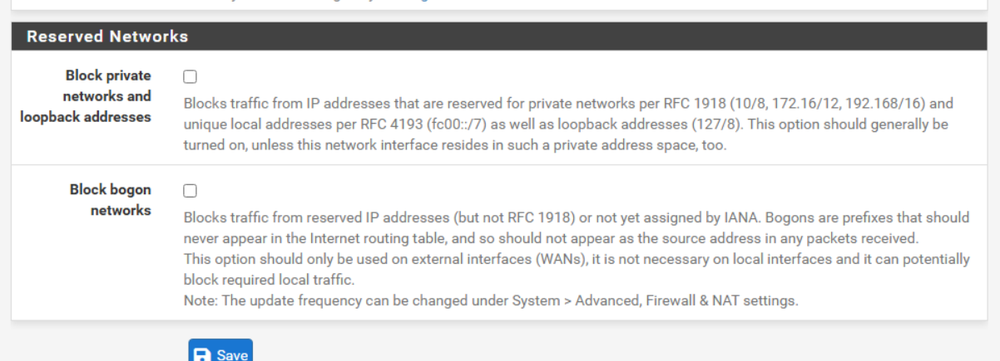

### 4.2 Phase 1

*VPN › IPsec › Tunnels › Add P1*. IKEv2, WAN interfazea eta urruneko gateway-a `192.168.74.2`.

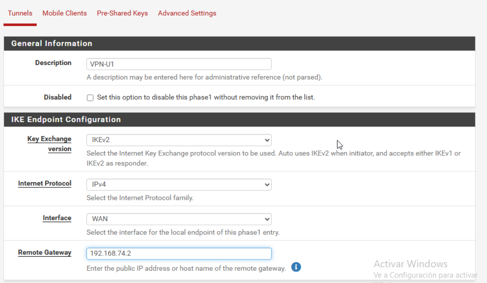

Autentifikazioa *Mutual Certificate* da. Bi identitateak FQDN motakoak dira eta ziurtagirien SAN-arekin bat datoz; pfSense-k PA-IT-ren ziurtagiria Intermediate CA-rekin egiaztatzen du.

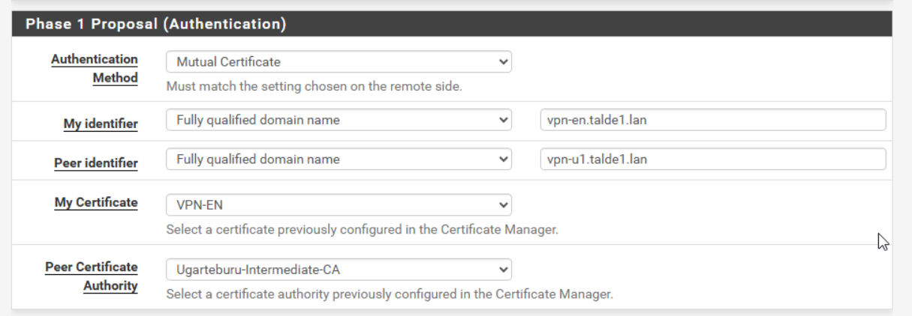

Proposamen bakarra dago (AES-256, SHA256, DH 14), negoziazioan algoritmo ahulagorik eskaini ez dadin. Iraupena 28800 s da.

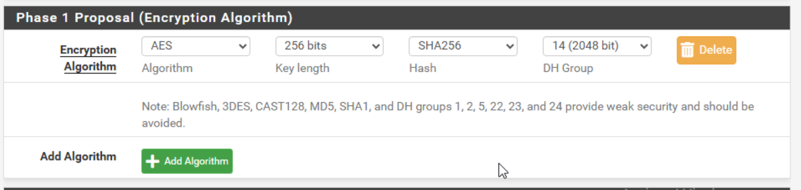

NAT-T *Auto* moduan dago eta DPD gaituta, urruneko muturra erortzen bada detektatzeko.

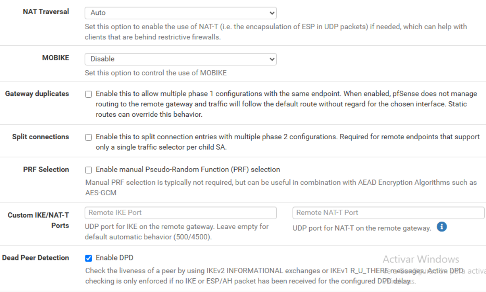

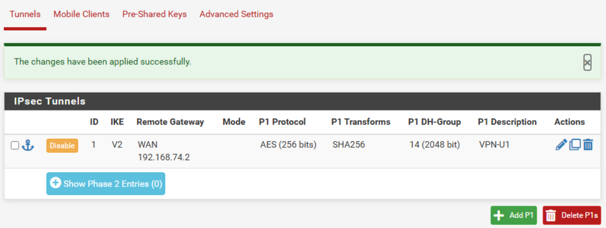

### 4.3 Phase 2

Phase 2 bakoitzak tuneletik pasa daitekeen sare-bikote bat definitzen du. U1-eko administratzaileak EN-ko administratzaileak bezala sarbidea izan behar duenez, hiru VLAN sartu dira U1-IT-rekin (`192.168.20.0/24`). Q sarea kanpoan geratzen da, isolatuta dagoelako.

| Phase 2 | Local (EN) | Remote (U1) |
|---|---|---|
| ZERBITZARIAK - U1-IT | `192.168.111.0/24` | `192.168.20.0/24` |
| SISTEMAK - U1-IT | `192.168.112.0/24` | `192.168.20.0/24` |
| BEZEROAK - U1-IT | `192.168.110.0/24` | `192.168.20.0/24` |

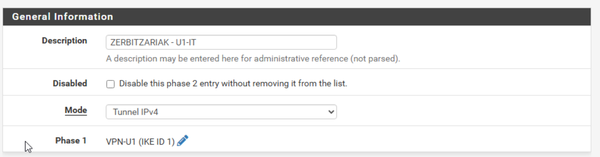

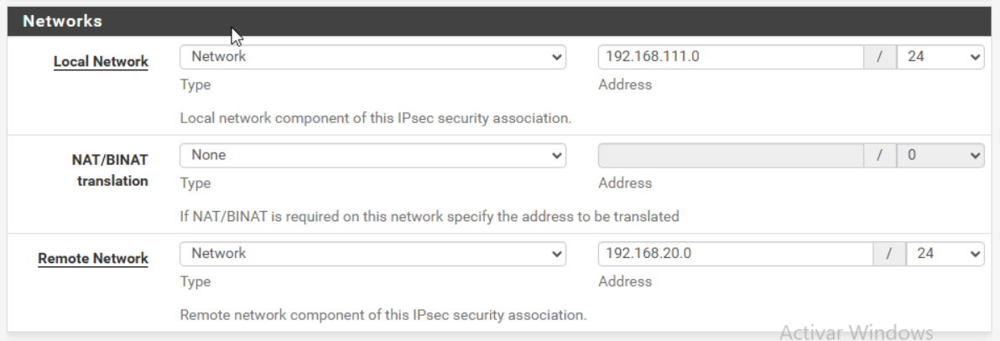

ESP protokoloa AES256-GCM-rekin bakarrik. GCM-k zifratzea eta osotasuna batera ematen ditu, beraz hash algoritmoa ez da erabiltzen. PFS 14. taldearekin eta 3600 s-ko iraupenarekin.

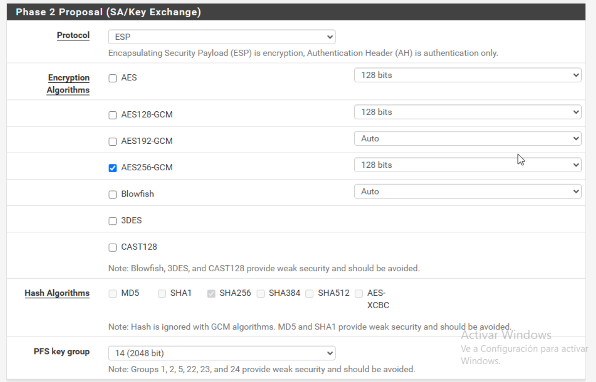

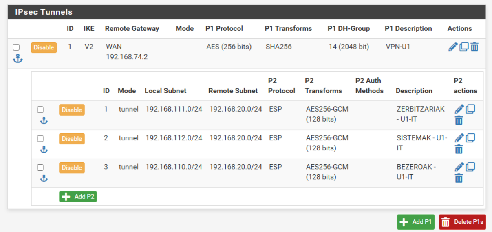

Tuneletik zein sare igarotzen diren Phase 2-ek erabakitzen dute; nork zer egin dezakeen, berriz, firewall arauek (ikus 6. atala).

## 5. Tunela PA-IT-n (U1)

Palo Alto-n tunela *route-based* da: tunel-interfaze bat dago, eta bideratze-taulak erabakitzen du zer trafiko sartzen den bertan.

### 5.1 Zona eta tunel-interfazea

`VPN-EN` zona (Layer3) sortu da, tuneletik datorren trafikoa gainerako zonetatik bereizteko eta segurtasun-politikekin kontrolatzeko.

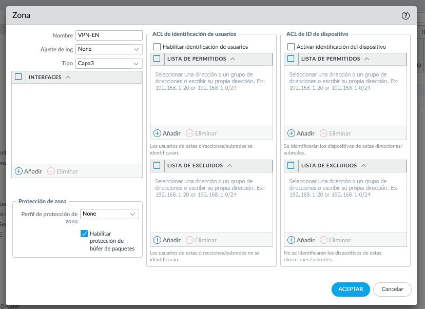

`tunnel.1` interfazea `default` enrutatzaile birtualean eta `VPN-EN` zonan dago. Ez du IP helbiderik behar, puntutik punturako tunela baita.

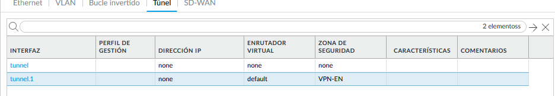

### 5.2 Profil kriptografikoak

Parametroak pfSense-ren berdinak dira: `EN-IKE` Phase 1-erako (group14, sha256, aes-256-cbc, 8 ordu) eta `EN-IPSEC` Phase 2-rako (ESP, aes-256-gcm, autentifikaziorik gabe, group14, ordu 1).

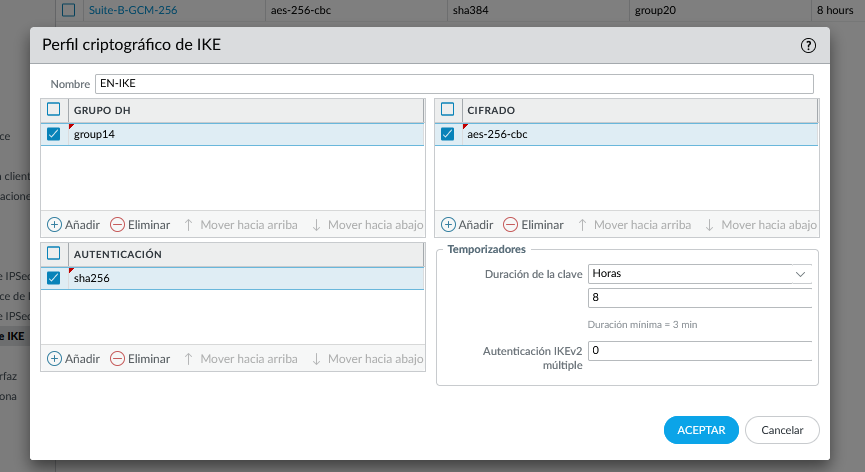

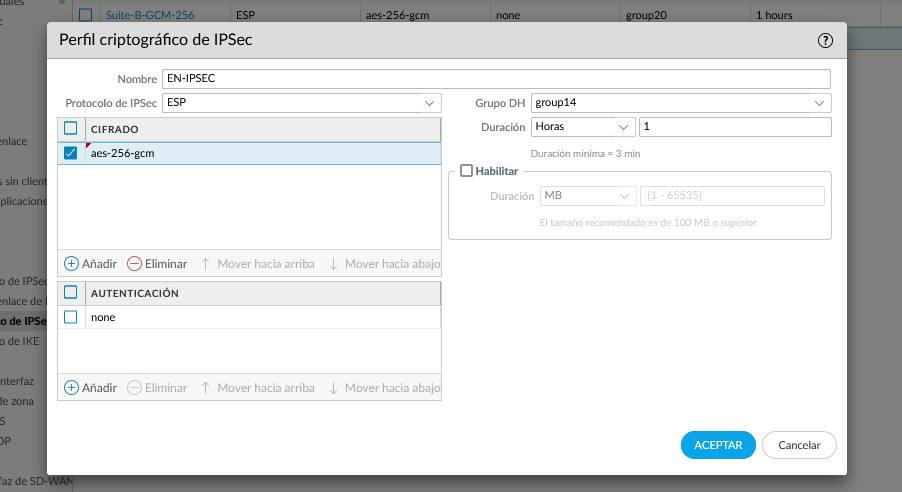

### 5.3 IKE gateway-a

`GW-EN`: IKEv2 bakarrik, `ethernet1/1` (WAN, `192.168.74.2`) eta peer-a `192.168.74.1`. Autentifikazioa `VPN-U1` ziurtagiriarekin egiten da; identitateak FQDN motakoak dira, bat-etortze zehatzarekin, eta pfSense-ren ziurtagiria `VPN-EN-Profile` profilarekin egiaztatzen da.

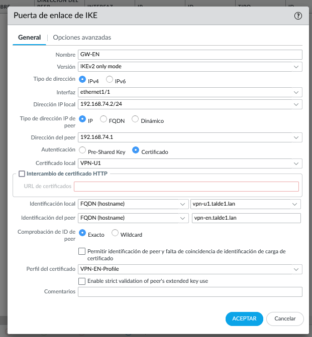

Modu pasiboa desgaituta dago, bi muturrek tunela hasi ahal izateko. NAT-T ez da behar (ez dago NAT-ik bi WAN-en artean), eta *liveness check*-a 5 segundoan behin egiten da.

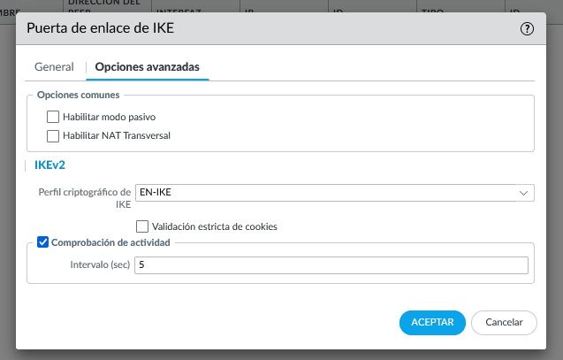

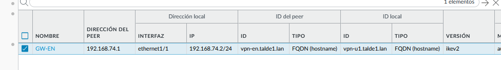

### 5.4 IPSec tunela eta Proxy ID-ak

`VPN-EN` tunelak `tunnel.1`, `GW-EN` eta `EN-IPSEC` lotzen ditu.

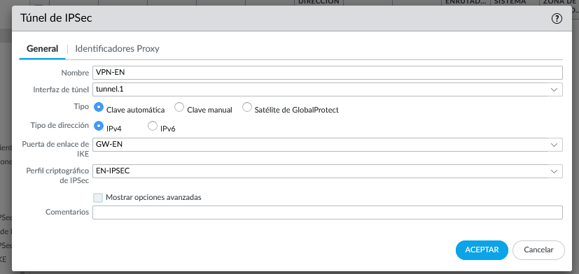

Proxy ID-ak pfSense-ko Phase 2-en berdinak dira, alderantziz (hemen U1 da lokala). Bat ez badatoz, Phase 2 hori ez da altxatzen.

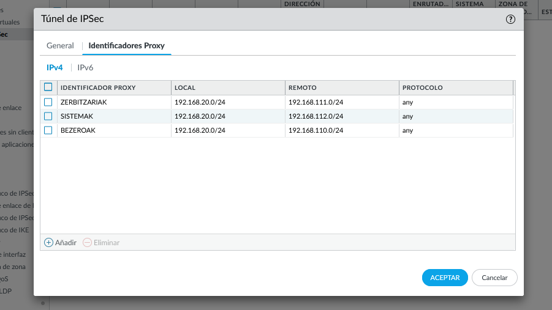

### 5.5 Bideratzea

EN-ko hiru sareetarako ibilbide estatikoak `tunnel.1`-etik doaz, hurrengo jauzirik gabe.

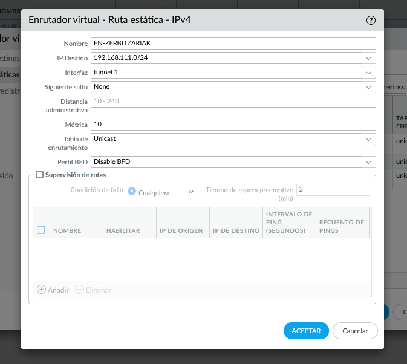

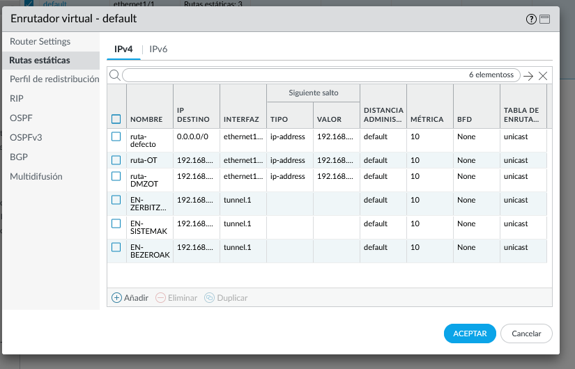

### 5.6 Segurtasun-politikak

Bi arau gehitu dira, *interzone-default*-en gainetik:

- `U1-ADMIN-EN`: U1-eko administratzailea (`192.168.20.10`) → `VPN-EN`.
- `EN-SISTEMAK-U1`: EN-ko SISTEMAK (`192.168.112.0/24`) → `U1-IT`.

U1-eko gainerako ekipoek ez dute EN-ra sarbiderik.

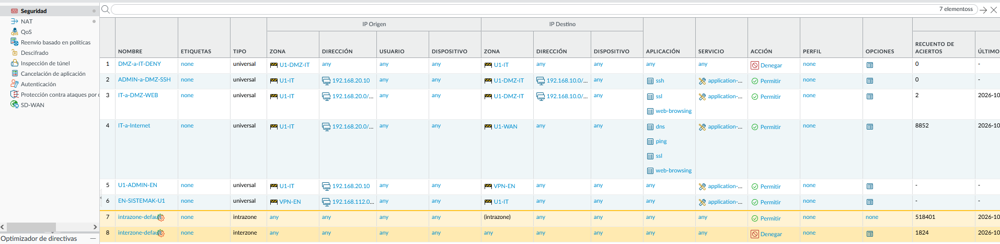

## 6. Firewall arauak pfSense-n (IPsec)

Tuneletik pfSense-ra sartzen den trafikoa *Firewall › Rules › IPsec* fitxako arauek kontrolatzen dute, eta lehenetsiz dena blokeatuta dago. PA-IT-ko arauaren baliokidea gehitu da: U1-eko administratzaileak (`192.168.20.10`) EN-ko sareetara sarbidea du. Beste norabidean ez da araurik behar, SISTEMAK sareak jada sarbide osoa baitu.

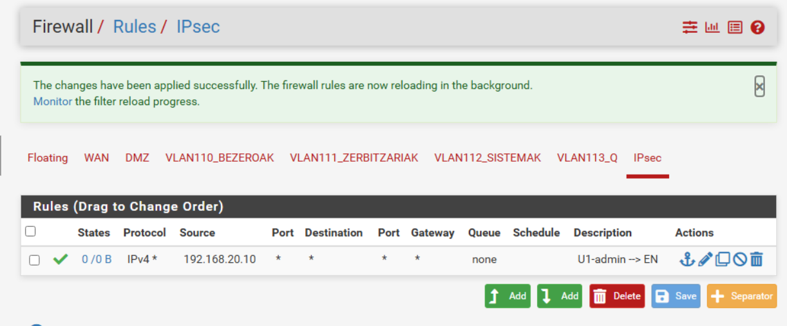

## 7. Egiaztapena

pfSense-n Phase 1 *Established* dago, ziurtagiri bidez autentifikatuta (`vpn-en.talde1.lan` ↔ `vpn-u1.talde1.lan`), eta Phase 2 *Installed* AES-GCM 256-rekin. Gainerako Phase 2-ak trafikoa dagoenean altxatzen dira.

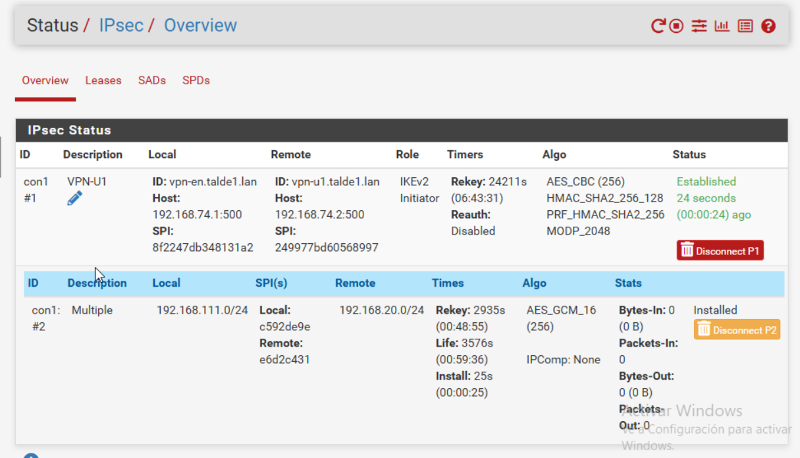

PA-IT-n IKE eta tunela berdez daude.

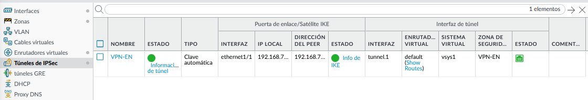

Proba: U1-admin-etik EN-CertServ-era (`192.168.111.20`) ping-a. TTL=62-k erakusten du paketeak bi suebakietatik igaro direla.

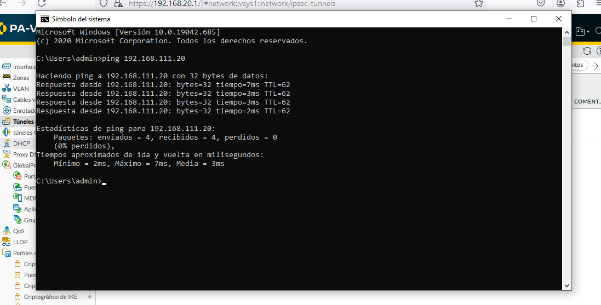

Beste norabidean, EN-ko SISTEMAK saretik (`sistemak-win`) U1-admin-era (`192.168.20.10`) ping-a. Windows-ek ICMP sarrera blokeatzen duenez, U1-admin-en arau bat gehitu da:

```
netsh advfirewall firewall add rule name="ICMP-in" protocol=icmpv4:8,any dir=in action=allow
```

TTL=126: Windows 128-rekin irteten da eta bi suebakiek jauzi bana kentzen dute.

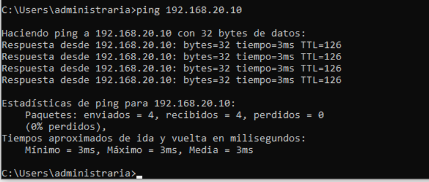

Trafiko horrek SISTEMAK-en Phase 2-a altxatu du; orain bi Phase 2 daude *Installed* egoeran (111 eta 112), eta paketeen kontagailuak igotzen dira.

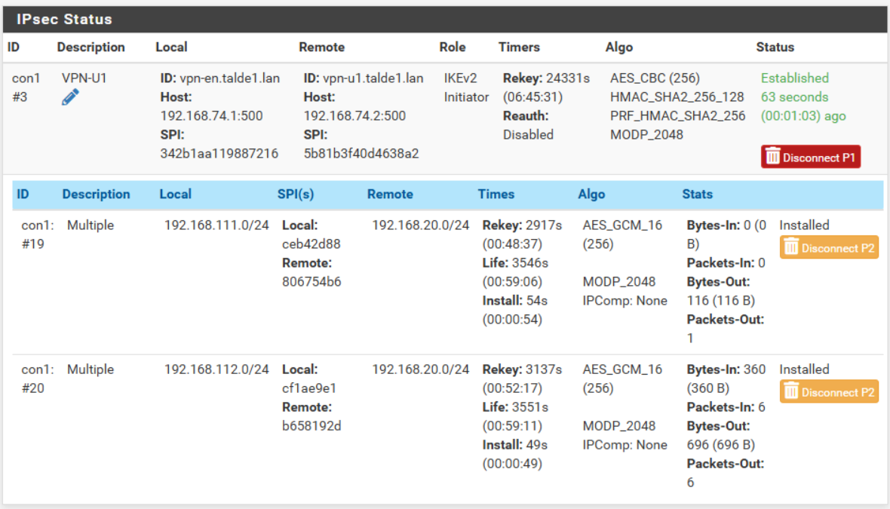

## 8. Active Directory-ren erreplikazioa tuneletik

U1-eko Windows Server-a (U1-WS, `192.168.20.20`) `talde1.lan` domeinuaren bigarren domeinu-kontrolatzailea da (ikus [Active Directory dokumentazioa](../../oinarriak/active-directory/README.md)). Bi DC-ek tuneletik erreplikatzen dute, eta horretarako bi DC-en artean bakarrik irekitzen dira AD-ren portuak; gainerako ekipoek ez dute portu horietarako sarbiderik.

Portuak `AD_PORTUAK` aliasekoak dira: DNS (53), Kerberos (88, 464), RPC (135 eta 49152-65535 tarte dinamikoa), LDAP (389, 636), SMB (445), katalogo globala (3268-3269) eta NTP (123).

### 8.1 pfSense

`U1_DC` aliasa sortu da U1-eko DC-arentzat (`EN_DC` lehendik zegoen).

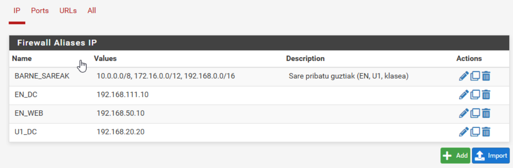

**IPsec fitxa** (U1-etik datorrena): `U1_DC` → `EN_DC`, TCP/UDP, `AD_PORTUAK`.

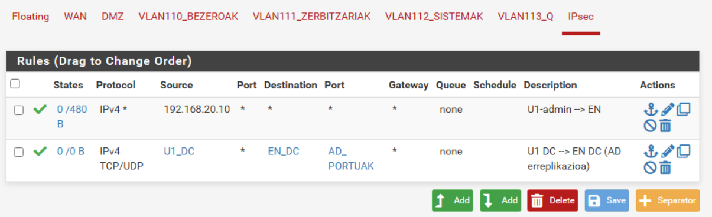

**VLAN111_ZERBITZARIAK fitxa** (EN-ko DC-tik U1-era): `EN_DC` → `U1_DC`, TCP/UDP, `AD_PORTUAK`. Arau hau beharrezkoa da ZERBITZARIAK sareak lehenetsiz Internetera bakarrik irten daitekeelako.

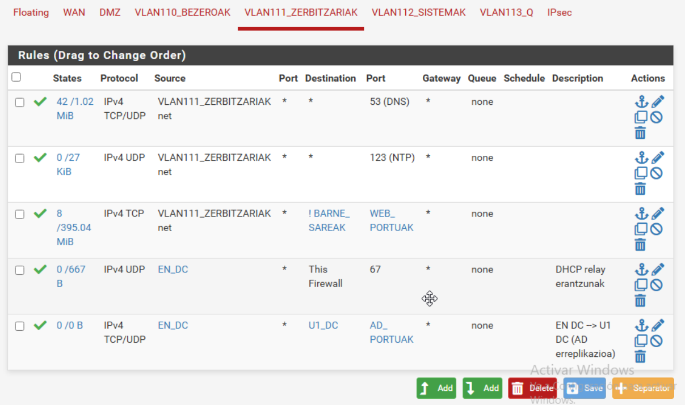

### 8.2 PA-IT

pfSense-ren aliasaren baliokidea zerbitzu-objektuekin sortu da: `AD-TCP` eta `AD-UDP`, helmuga-portuekin bakarrik (jatorrizko portua ausazkoa da), `AD-PORTUAK` taldean bilduta.

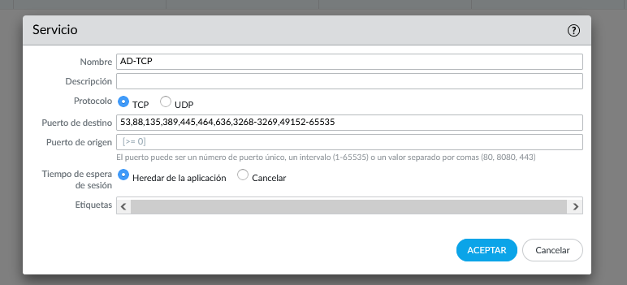

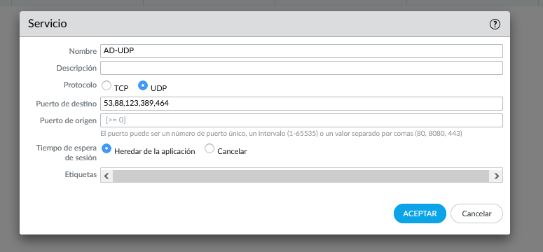

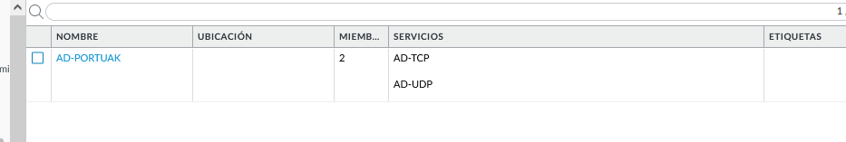

Bi arau, norabide bakoitzeko bat, *interzone-default*-en gainetik:

- `U1-DC-EN-DC`: U1-IT `192.168.20.20` → VPN-EN `192.168.111.10`, `AD-PORTUAK` zerbitzua.
- `EN-DC-U1-DC`: VPN-EN `192.168.111.10` → U1-IT `192.168.20.20`, `AD-PORTUAK` zerbitzua.

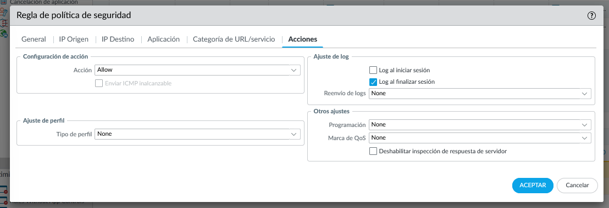

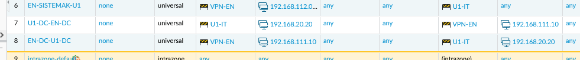

### 8.3 Egiaztapena

U1-WS-tik: domeinuaren izena EN-ko DC-aren bidez ebazten da, eta LDAP (389) eta SMB (445) portuak tuneletik eskuragarri daude.

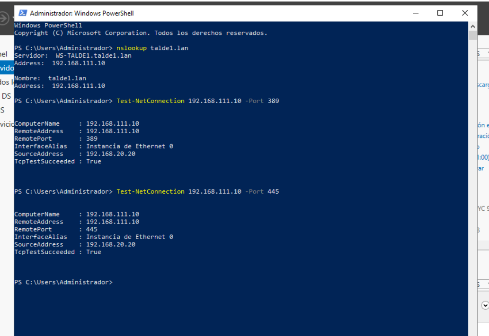
