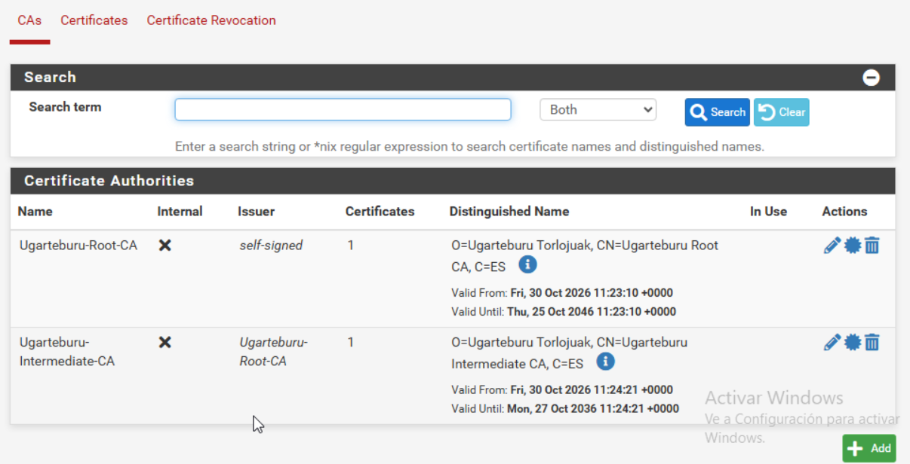
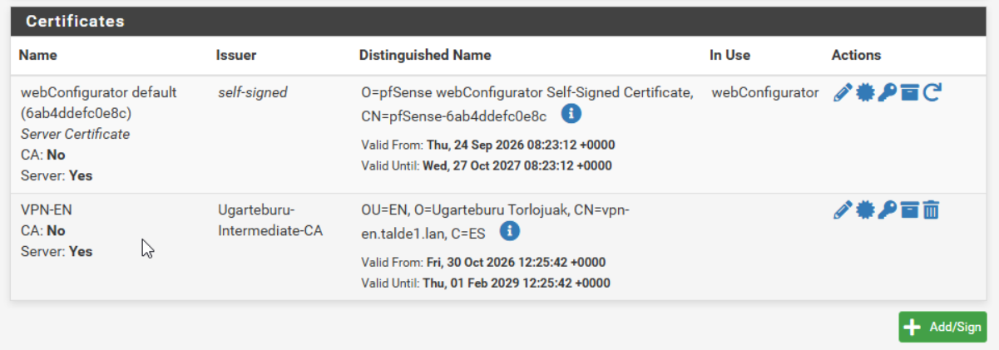
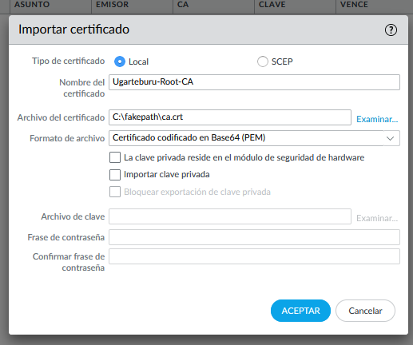
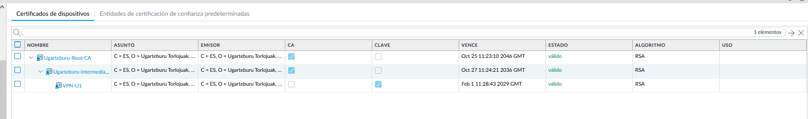
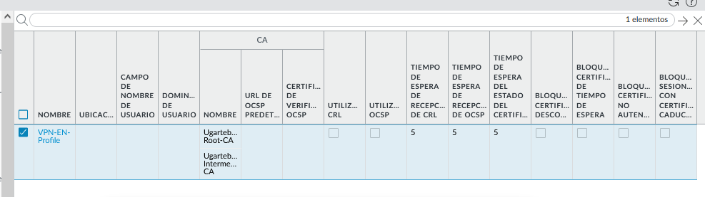

# EN ↔ U1 – IPsec VPN

Ugarteburu Torlojuak · 2. Erronka

EN egoitza (pfSense) eta U1 egoitza (PA-IT) site-to-site IPsec tunel baten bidez lotzen dira klaseko sarearen gainetik (vlan74). Autentifikazioa ziurtagiri digitalekin egiten da, enpresako PKI-ak sinatuta (ikus [PKI dokumentazioa](../pki/README.md)).

## 1. Diseinua

| | EN | U1 |
|---|---|---|
| Suebakia | pfSense | PA-IT (Palo Alto) |
| Peer IP (WAN) | `192.168.74.1` | `192.168.74.2` |
| IKE identitatea (FQDN) | `vpn-en.talde1.lan` | `vpn-u1.talde1.lan` |
| Ziurtagiria | `VPN-EN` | `VPN-U1` |

| Parametroa | Balioa |
|---|---|
| IKE bertsioa | IKEv2 |
| Phase 1 | AES-256-CBC, SHA256, DH 14. taldea, 28800 s |
| Phase 2 (ESP) | AES-256-GCM, PFS 14. taldea, 3600 s |
| Autentifikazioa | Ziurtagiriak (RSA) |

**Zergatik ziurtagiriak eta ez PSK:** gako partekatu bat bi muturretan idatzita dago eta inork ezin du jakin norbaitek kopiatu duen. Ziurtagiriekin muturreko bakoitzak bere gako pribatua du, beste muturrak CA-aren bidez egiaztatzen du nor den, eta arriskuan dagoen ziurtagiri bat errebokatu daiteke bestea ukitu gabe.

## 2. Ziurtagiriak pfSense-n (EN)

**CA-ak:** *System › Cert Manager › CAs › Add › Import an existing Certificate Authority*. Root eta Intermediate CA-ren ziurtagiriak bakarrik inportatzen dira, gako pribaturik gabe; horregatik *Internal* zutabean ✗ agertzen da. Intermediate-ren *Issuer* `Ugarteburu-Root-CA` da, beraz katea ondo lotuta dago.

**Ziurtagiria:** *Certificates › Add/Sign › Import an existing Certificate*, `vpn-en.crt` eta bere gakoa. *Issuer*: `Ugarteburu-Intermediate-CA`.

## 3. Ziurtagiriak PA-IT-n (U1)

*Device › Certificate Management › Certificates › Import*, ordena honetan:

1. `Ugarteburu-Root-CA` — `ca.crt`, gakorik gabe.
2. `Ugarteburu-Intermediate-CA` — `intermediate.crt`, gakorik gabe.
3. `VPN-U1` — `vpn-u1.crt`, *Import Private Key* markatuta eta gako zifratuarekin. *Block Private Key Export* ere markatu da, gakoa suebakitik atera ez dadin.

Zerrendan hiru ziurtagiriak habiaratuta agertzen dira (Root › Intermediate › VPN-U1); CA-ak gakorik gabe eta VPN-U1 gakoarekin.

**Ziurtagiri-profila:** *Certificate Profile* `VPN-EN-Profile`, Root eta Intermediate CA-ekin. Phase 1-ean erabiltzen da pfSense-ren ziurtagiria zein CA-rekin egiaztatu behar den adierazteko. CRL eta OCSP desgaituta daude, PKI-ak oraindik ez baitu CRL-rik argitaratzen.

## 4. Tunela

*(Egiteko: Phase 1 eta Phase 2 bi muturretan, bideratzea eta segurtasun-arauak.)*
