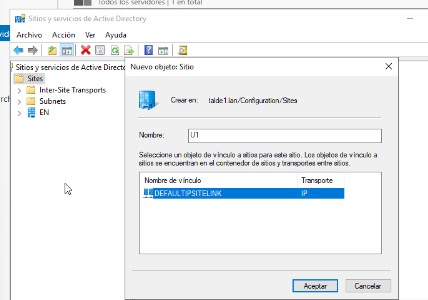
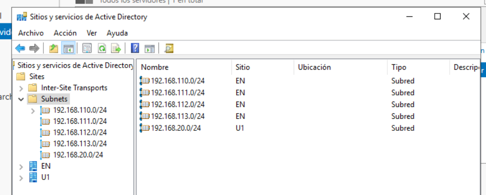
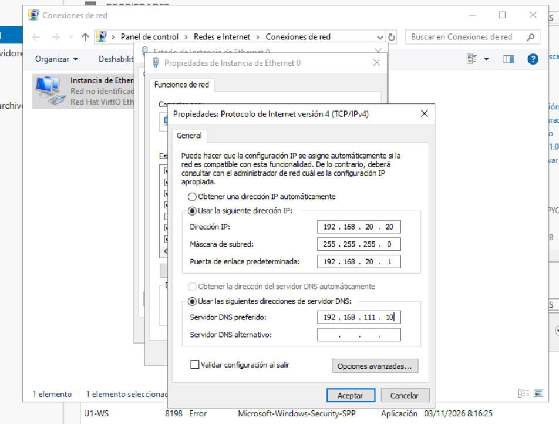
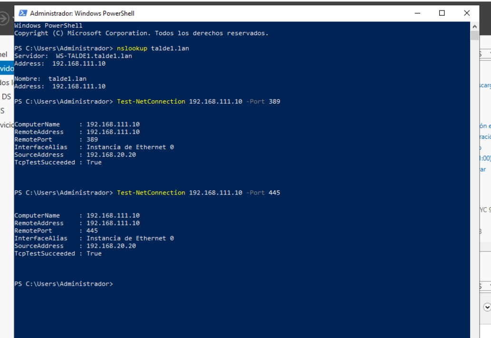
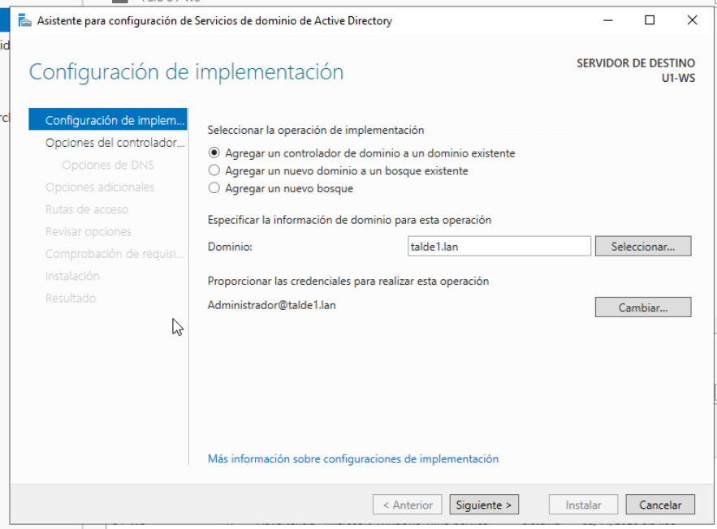
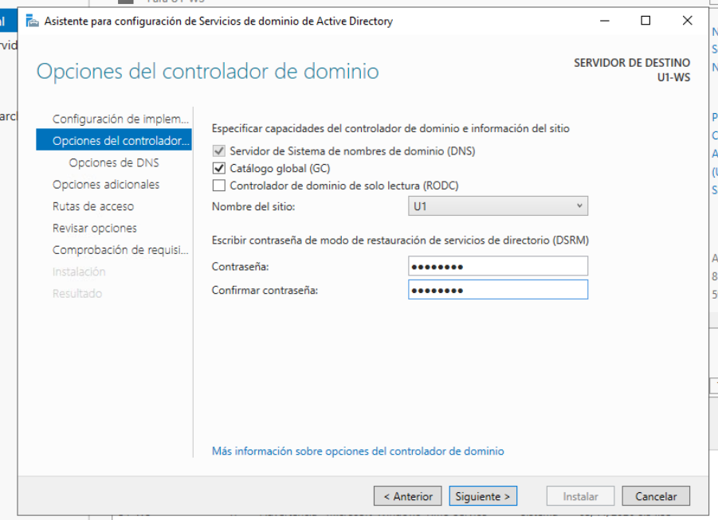
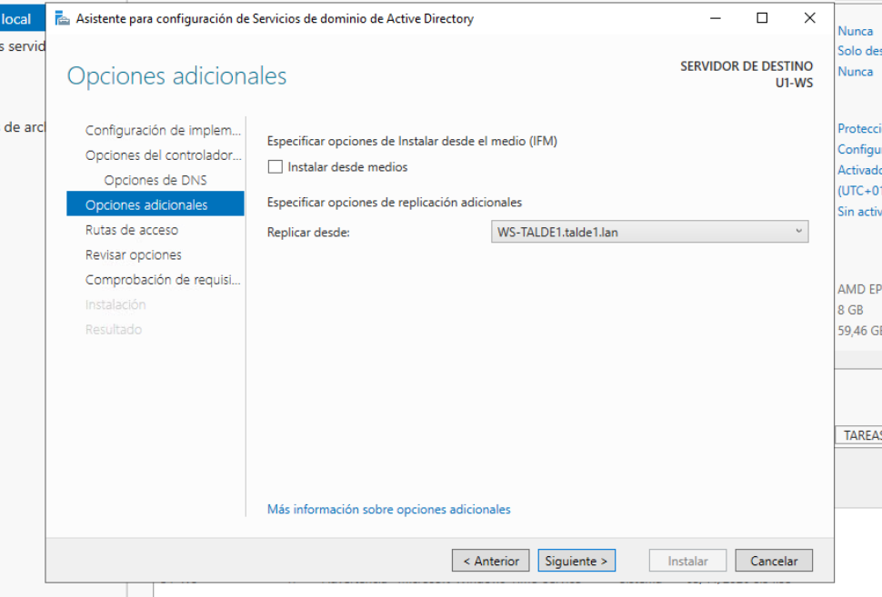
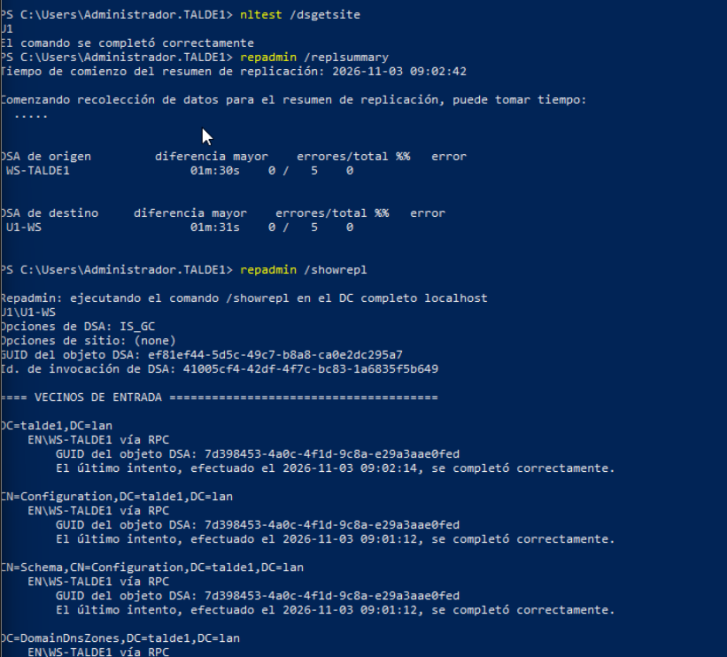
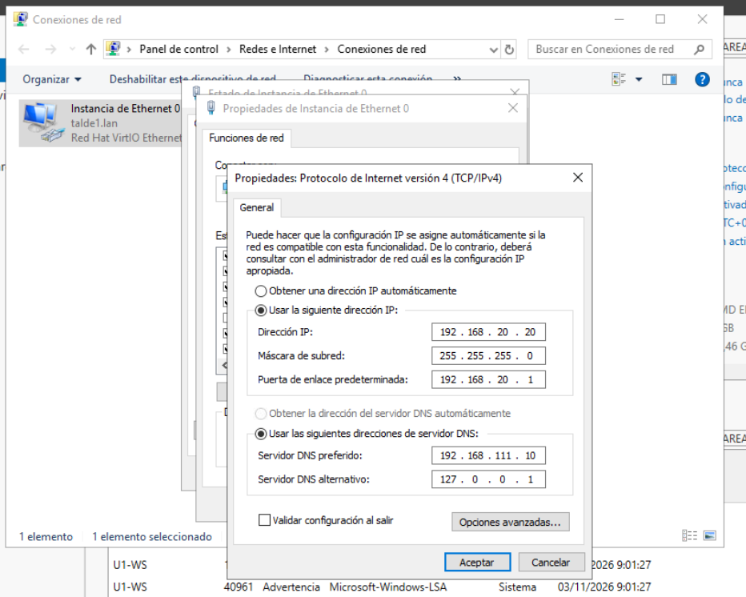

# Active Directory – U1-eko domeinu-kontrolatzailea

Ugarteburu Torlojuak · 2. Erronka

## 1. Diseinua

Ugarteburu enpresa bakarra da bi fabrikarekin, beraz domeinu bakarra dago bi egoitzetarako: `talde1.lan`. Egoitza bakoitzak bere domeinu-kontrolatzailea du:

| | EN | U1 |
|---|---|---|
| DC | WS-TALDE1 | U1-WS |
| IP | `192.168.111.10` | `192.168.20.20` |
| AD gunea | EN | U1 |
| Rolak | DNS, katalogo globala | DNS, katalogo globala |

Erabaki honen arrazoiak:

- **Kudeaketa zentralizatua:** GPO berberak aplikatzen zaizkie enpresako ekipo eta erabiltzaile guztiei, edozein egoitzatan daudela ere. Bi domeinurekin erabiltzaileak eta politikak bikoiztu beharko lirateke.
- **Erresilientzia:** U1-eko erabiltzaileek bertako DC-aren kontra hasten dute saioa. VPN-a erortzen bada, lanean jarraitzen dute; erreplikazioa bakarrik geratzen da zain tunela berriro altxatu arte.
- **Gutxieneko sarbidea:** tuneletik AD-rako bi DC-en arteko trafikoa bakarrik igarotzen da (ikus [VPN dokumentazioa](../../gotortze/vpn/README.md#8-active-directory-ren-erreplikazioa-tuneletik)).

## 2. AD guneak

*Sitios y servicios de Active Directory* tresnan egoitza bakoitzeko gune bat sortu da. Horrela ekipo bakoitzak bere egoitzako DC-a erabiltzen du, eta guneen arteko erreplikazioa kontrolatuta dago.

- `Default-First-Site-Name` gunea `EN` izendatu da.
- `U1` gune berria sortu da, `DEFAULTIPSITELINK` loturarekin.



Azpisare bakoitza bere guneari esleitu zaio:

| Azpisarea | Gunea |
|---|---|
| `192.168.110.0/24` | EN |
| `192.168.111.0/24` | EN |
| `192.168.112.0/24` | EN |
| `192.168.113.0/24` | EN |
| `192.168.20.0/24` | U1 |



## 3. U1-WS prestatzea

Windows Server 2019. IP finkoa du U1-IT sarean, eta DNS gisa EN-ko DC-a erabiltzen du domeinua aurkitzeko, oraindik ez baita DC.

| | |
|---|---|
| IP | `192.168.20.20/24` |
| Gateway | `192.168.20.1` (PA-IT) |
| DNS | `192.168.111.10` |
| Ordu-zona | UTC+01:00 Madrid (Kerberos-ek DC-en arteko ordu-aldea 5 minutu baino txikiagoa izatea eskatzen du) |



Sustatu aurretik egiaztatu da U1-WS-k domeinua ebazten duela eta EN-ko DC-ra iristen dela tuneletik:

```powershell
nslookup talde1.lan
Test-NetConnection 192.168.111.10 -Port 389
Test-NetConnection 192.168.111.10 -Port 445
```



## 4. Domeinu-kontrolatzaile gisa sustatzea

*Servicios de dominio de Active Directory* rola instalatu ondoren, U1-WS domeinu-kontrolatzaile gehigarri gisa sustatu da:

- **Eragiketa:** dagoen domeinu bati DC bat gehitu, `talde1.lan`, `TALDE1\Administrador` kredentzialekin.



- **Aukerak:** DNS zerbitzaria eta katalogo globala; ez da irakurtzeko soilik (RODC). Gunea automatikoki `U1` hautatu da, azpisarearen arabera, eta horrek 2. ataleko konfigurazioa zuzena dela baieztatzen du. DSRM pasahitza pasahitz-kudeatzailean gorde da.



- **Erreplikazioa:** `WS-TALDE1.talde1.lan`-etik.



## 5. Egiaztapena

```powershell
nltest /dsgetsite        # U1
repadmin /replsummary    # 0 errore
repadmin /showrepl       # partizio guztiak ondo erreplikatuta
```

DC-a `U1` gunean dago, eta bost partizioak (domeinua, Configuration, Schema, DomainDnsZones eta ForestDnsZones) WS-TALDE1-etik erreplikatu dira errorerik gabe, sustapenaren ondoren ere.



`dcdiag /q` komandoak sustapenaren uneko gertaerak bakarrik erakusten ditu (Isard-ek VM-a itzaltzea eta GPO-ak DC izan aurretik huts egitea); ez dago geroagoko errorerik.

## 6. DNS konfigurazioa

DC bihurtu ondoren U1-WS DNS zerbitzaria ere bada. Microsoft-en gomendioari jarraituz, DNS nagusia beste DC-a da eta bigarrena bera (`127.0.0.1`). Horrela DC-a ez da bere buruarekin bakarrik geratzen berrabiaraztean, eta VPN-a erortzen bada bere DNS-a erabiltzen du.


